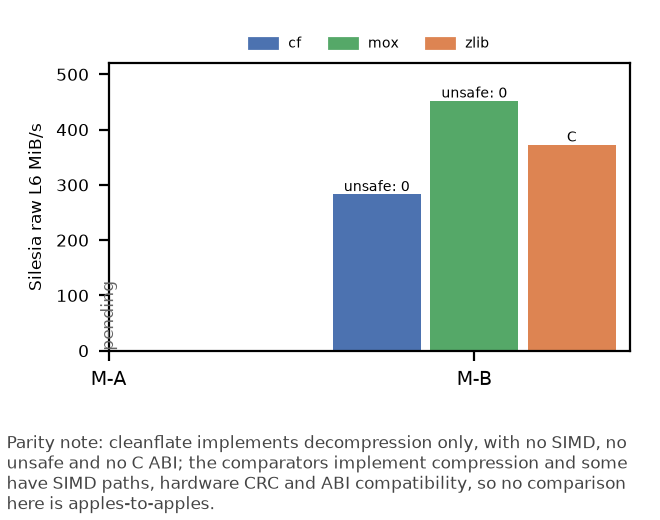

<!-- generated by cfbench.kits.paper; do not edit -->

# Paper kit (T1)

Every number below comes from a derived table, a committed raw file and a script; see the `Source:` line under each claim.

## Headline claims

3 supported, target 5-7. The remaining candidates are listed under Rejected claims and Pending below.

1. cleanflate's output matched the expected SHA-256 and length for 2962 of 2962 streams on M-B, with no disagreement.
   Source: `results/conformance.csv` <- `data/raw/correctness/M-B/20261002T150252Z.json` via `cfbench.conformance`

2. cleanflate has 0 unsafe blocks, functions, impls, traits and target-feature attributes, forbids unsafe code, and has 0 direct and 0 transitive runtime dependencies.
   Source: `results/unsafe.csv` <- `data/raw/size/any/20261002T180744Z.json` via `cfbench.unsafe_scan`; `results/deps.csv` <- `data/raw/size/any/20261002T180746Z.json` via `cfbench.deps`

3. Building cleanflate's three rounds took 28.5 hours of attributed wall-clock time and an estimated $361 of model cost.
   Source: `results/effort_totals.csv` <- `data/raw/effort/any/20261002T180907Z.json`, `data/raw/effort/any/20261002T180908Z.json` via `cfbench.effort.derive`

## Summary table

| Metric | cf | zlib | mox |
|---|---|---|---|
| Silesia raw L6 one-shot, M-A: MiB/s (vs zlib) | pending | pending | pending |
| Silesia raw L6 one-shot, M-B: MiB/s (vs zlib) | 283 MiB/s (0.76x) | 373 MiB/s (1.00x) | 452 MiB/s (1.21x) |
| Silesia gzip L6 one-shot, M-B: ratio vs zlib | 0.73x | 1.00x | n/a |
| `unsafe` blocks + fns in the decompression crate | 0 blocks + 0 fns | C (whole codebase) | 0 blocks + 0 fns |
| Runtime dependencies (direct / transitive) | 0 direct / 0 transitive | n/a | 1 direct / 1 transitive |
| Stripped minimal binary, opt-level 3, M-B | 393,888 B | 43,136 B | 361,120 B |

*Parity note: cleanflate implements decompression only, with no SIMD, no unsafe and no C ABI; the comparators implement compression and some have SIMD paths, hardware CRC and ABI compatibility, so no comparison here is apples-to-apples.*

Pending rows (missing data, shown as `pending`): Silesia raw L6 one-shot, M-A: MiB/s (vs zlib).

## Figure

Vector version: `figures/paper_throughput_unsafe.svg`.

Aggregate one-shot decompression throughput (MiB/s) on the Silesia corpus, raw framing, level 6, for cleanflate (cf), miniz_oxide (mox) and stock zlib, on each machine. Bars are annotated with the `unsafe` blocks plus functions in the decompression crate (C: memory-unsafe by language).

Source: `results/unsafe.csv` <- `data/raw/size/any/20261002T180744Z.json` via `cfbench.unsafe_scan`; `results/perf_aggregates.csv` <- `data/raw/perf/M-B/20261002T072144Z.json`, `data/raw/perf/M-B/20261002T091719Z.json`, `data/raw/perf/M-B/20261002T103403Z.json`, `data/raw/perf/M-B/20261002T115027Z.json` via `cfbench.perf_report`

Pending bars: M-A cf: no row {'machine': 'M-A', 'variant': 'generic', 'subject': 'cf', 'corpus': 'silesia', 'level': 6, 'framing': 'raw', 'mode': 'oneshot'} in perf_aggregates: run `make perf`; M-A mox: no row {'machine': 'M-A', 'variant': 'generic', 'subject': 'mox', 'corpus': 'silesia', 'level': 6, 'framing': 'raw', 'mode': 'oneshot'} in perf_aggregates: run `make perf`; M-A zlib: no row {'machine': 'M-A', 'variant': 'generic', 'subject': 'zlib', 'corpus': 'silesia', 'level': 6, 'framing': 'raw', 'mode': 'oneshot'} in perf_aggregates: run `make perf`

*Parity note: cleanflate implements decompression only, with no SIMD, no unsafe and no C ABI; the comparators implement compression and some have SIMD paths, hardware CRC and ABI compatibility, so no comparison here is apples-to-apples.*

## Rejected claims

- **similarity**: T1 claim NOT allowed: a cf pair is not at or near the negative control for `ident_jaccard` (cf-mox between), `ident_match_rate_left` (cf-zrs between).
- **parity_with_zlib**: no data supports it (no row {'machine': 'M-A', 'variant': 'generic'} in perf_agreement_summary: run `make perf`)
- **faster_than_zrs**: no data supports it (no row {'machine': 'M-A', 'variant': 'generic'} in perf_agreement_summary: run `make perf`)
- **faster_than_mox**: no data supports it (no row {'machine': 'M-A', 'variant': 'generic'} in perf_agreement_summary: run `make perf`)
- **gzip_gap_is_hw_crc**: the framing hypothesis verdict is inconclusive

## Pending

- **perf_range**: no row {'machine': 'M-A', 'variant': 'generic'} in perf_agreement_summary: run `make perf`
- **trajectory**: no row {'machine': 'M-A', 'round': 1, 'corpus': 'silesia', 'framing': 'raw', 'mode': 'oneshot', 'level': 6} in trajectory: run `make trajectory`

## Environments

| Machine | CPU | OS | Kernel |
|---|---|---|---|
| M-B | AMD Ryzen 5 3400G with Radeon Vega Graphics | Pop!_OS 24.04 LTS | 7.1.5-76070105-generic |
