<!-- generated by cfbench.kits.results_md; do not edit -->

# Results: Foundry

Results for Foundry, organised around its claims. cleanflate is the worked example; every number traces to a derived table, a committed raw file and a script (the source line under each table).

## Claims and evidence

Foundry is an agentic clean-room pipeline. It produced a functionally equivalent, memory-safe replacement for a legacy C library from RFCs alone, under mechanically enforced isolation from prior art. cleanflate (`cf`), a decompress-only safe-Rust replacement for zlib's inflate, is the worked example that supplies the evidence. Every claim below is about the pipeline and is tested on that one example.

| Category | Claim | Status | Evidence tables |
|---|---|---|---|
| Equivalence | `conformance` | Supported | `conformance` |
| Equivalence | `fuzz` | Supported | `fuzz_stats` |
| Equivalence | `malformed` | Supported | `malformed_summary` |
| Safety | `safety` | Supported | `deps`, `unsafe` |
| Clean-room | `similarity` | Not supported | `similarity_summary` |
| Clean-room | `isolation` | Supported | `effort_totals` |
| Effort | `effort` | Supported | `effort_totals` |
| Viability | `perf_range` | Supported | `perf_aggregates`, `perf_agreement_aggregates`, `perf_agreement_summary` |
| Iteration | `trajectory` | Supported | `trajectory` |

*Parity note: cleanflate implements decompression only, with no SIMD, no unsafe and no C ABI; the comparators implement compression and some have SIMD paths, hardware CRC and ABI compatibility, so no comparison here is apples-to-apples.*

### Equivalence

*Does cleanflate decode exactly what zlib decodes?*

1. **Supported** (`conformance`): cleanflate's output matched the expected SHA-256 and length for 2962 of 2962 streams on M-A and 2962 of 2962 streams on M-B, with no disagreement.
   Source: `results/conformance.csv` <- `data/raw/correctness/M-A/20261003T191948Z.json`, `data/raw/correctness/M-B/20261002T150252Z.json` via `cfbench.conformance`

2. **Supported** (`fuzz`): Differential fuzzing of cleanflate against each reference decoder: on M-B it found 0 divergences in 583,504 executions for diff_cf_zlib, 0 divergences in 313,085 executions for diff_cf_zrs and 0 divergences in 340,702 executions for diff_cf_mox (4 CPU-hours per pair). Fuzzing was not run on M-A (the SPEC fixes one fuzz budget per pair; it was spent on M-B and the M-A session did not repeat it).
   Source: `results/fuzz_stats.csv` <- `data/raw/correctness/M-B/20261002T160357Z.json`, `data/raw/correctness/M-B/20261002T170524Z.json`, `data/raw/correctness/M-B/20261002T180614Z.json` via `cfbench.fuzzing`

3. **Supported** (`malformed`): On cleanflate's malformed-input suite, on M-A cf's outcome matched EXPECTED.tsv for 42 of 42 files, and subjects disagreed on accept versus reject for 4 files, all of them cf rejecting what every other supported decoder accepts; on M-B cf's outcome matched EXPECTED.tsv for 42 of 42 files, and subjects disagreed on accept versus reject for 4 files, all of them cf rejecting what every other supported decoder accepts. The strictness is a documented default (trailing data and a bad second gzip member are errors), not a decoding difference.
   Source: `results/malformed_summary.csv` <- `data/raw/correctness/M-A/20261003T191951Z.json`, `data/raw/correctness/M-B/20261002T150253Z.json` via `cfbench.malformed`

### Safety

*Is the replacement memory-safe by construction?*

4. **Supported** (`safety`): cleanflate has 0 unsafe blocks, functions, impls, traits and target-feature attributes, forbids unsafe code, and has 0 direct and 0 transitive runtime dependencies.
   Source: `results/unsafe.csv` <- `data/raw/size/any/20261002T180744Z.json` via `cfbench.unsafe_scan`; `results/deps.csv` <- `data/raw/size/any/20261002T180746Z.json` via `cfbench.deps`

### Clean-room

*Was the build isolated from prior art, and does the code show it?*

5. **Not supported** (`similarity`): T1 claim NOT allowed: a cf pair is not at or near the negative control for `ident_jaccard` (cf-mox between), `ident_match_rate_left` (cf-zrs between). Scores: `comment_jaccard` negative control zrs-mox 0.00102, positive control zrs-zng 0.0395, cf-zrs 0.000511 (below negative), cf-mox 0.000306 (below negative); `ident_jaccard` negative control zrs-mox 0.0439, positive control zrs-zng 0.144, cf-zrs 0.0529 (at or near negative), cf-mox 0.0747 (between); `ident_match_rate_left` negative control zrs-mox 0.0601, positive control zrs-zng 0.339, cf-zrs 0.149 (between), cf-mox 0.129 (at or near negative).
   Source: `results/similarity_summary.csv` <- `data/raw/similarity/any/20261002T191558Z.json`, `data/raw/similarity/any/20261002T191601Z.json`, `data/raw/similarity/any/20261002T191604Z.json`, `data/raw/similarity/any/20261002T191653Z.json` via `cfbench.similarity.summary`

6. **Supported** (`isolation`): Foundry's guard denied 32 tool calls during the build. An audit of the 2,226 allowed read-capable calls in cleanflate's provenance log found 0 reads of prior art (1 candidate, classified by hand in `config/forbidden_read_verdicts.toml`). The log sees top-level tool calls only, so this bounds isolation rather than proving it.
   Source: `results/effort_totals.csv` <- `data/raw/effort/any/20261002T180908Z.json`, `data/raw/effort/any/20261003T193251Z.json` via `cfbench.effort.derive`

### Effort

*What did the build take in time, money and human help?*

7. **Supported** (`effort`): Foundry's three rounds building cleanflate took 28.5 hours of attributed wall-clock time, an estimated $361 of model cost and 11 recorded human interventions.
   Source: `results/effort_totals.csv` <- `data/raw/effort/any/20261002T180908Z.json`, `data/raw/effort/any/20261003T193251Z.json` via `cfbench.effort.derive`

### Viability

*Is the replacement fast enough to matter, on both machines?*

8. **Supported** (`perf_range`): On the Silesia corpus, cleanflate's oneshot decompression throughput at levels 6 and 9 in raw and zlib framing is 0.71x to 0.79x that of stock zlib (zlib = 1.00x) on M-A and M-B; no cf or zlib aggregate behind these ratios is flagged by run-to-run agreement (session verdicts: M-A flagged, M-B flagged).
   Source: `results/perf_aggregates.csv` <- `data/raw/perf/M-A/20261003T004833Z.json`, `data/raw/perf/M-A/20261003T022240Z.json`, `data/raw/perf/M-A/20261003T032646Z.json`, `data/raw/perf/M-A/20261003T043023Z.json`, `data/raw/perf/M-B/20261002T072144Z.json`, `data/raw/perf/M-B/20261002T091719Z.json`, `data/raw/perf/M-B/20261002T103403Z.json`, `data/raw/perf/M-B/20261002T115027Z.json` via `cfbench.perf_report`; `results/perf_agreement_aggregates.csv` <- `data/raw/perf/M-A/20261003T004833Z.json`, `data/raw/perf/M-A/20261003T022240Z.json`, `data/raw/perf/M-A/20261003T032646Z.json`, `data/raw/perf/M-A/20261003T043023Z.json`, `data/raw/perf/M-B/20261002T072144Z.json`, `data/raw/perf/M-B/20261002T091719Z.json`, `data/raw/perf/M-B/20261002T103403Z.json`, `data/raw/perf/M-B/20261002T115027Z.json` via `cfbench.agreement`; `results/perf_agreement_summary.csv` <- `data/raw/perf/M-A/20261003T004833Z.json`, `data/raw/perf/M-A/20261003T022240Z.json`, `data/raw/perf/M-A/20261003T032646Z.json`, `data/raw/perf/M-A/20261003T043023Z.json`, `data/raw/perf/M-B/20261002T072144Z.json`, `data/raw/perf/M-B/20261002T091719Z.json`, `data/raw/perf/M-B/20261002T103403Z.json`, `data/raw/perf/M-B/20261002T115027Z.json` via `cfbench.agreement`

### Iteration

*Did Foundry's later rounds improve it?*

9. **Supported** (`trajectory`): On Silesia raw level 6 oneshot, cleanflate's throughput relative to zlib across Foundry rounds 1, 2 and 3 was M-A: 0.26x, 0.69x, 0.72x; M-B: 0.16x, 0.65x, 0.75x.
   Source: `results/trajectory.csv` <- `data/raw/trajectory/M-A/20261003T164704Z.json`, `data/raw/trajectory/M-B/20261002T145905Z.json` via `cfbench.trajectory`

### Checked and not claimed

- **parity_with_zlib** (not supported): 8 of 8 cells are below 0.95x; the lowest is 0.71x
- **faster_than_zrs** (not supported): cleanflate is not faster in 8 cells, e.g. M-A raw L6: cf 0.71x vs zrs 1.65x
- **faster_than_mox** (not supported): cleanflate is not faster in 8 cells, e.g. M-A raw L6: cf 0.71x vs mox 1.04x
- **gzip_gap_is_hw_crc** (not supported): the framing hypothesis verdict is refuted

## Equivalence

*Does cleanflate decode exactly what zlib decodes?* Valid streams must decode byte-identically; malformed streams are compared on accept versus reject.

**Conformance over the shared corpus**

| Machine | Subject | Streams | Passed | Failed | Unsupported | Pass rate |
|---|---|---|---|---|---|---|
| M-A | cf | 2962 | 2962 | 0 | 0 | 1 |
| M-A | mox | 2962 | 2519 | 0 | 443 | 1 |
| M-A | zlib | 2962 | 2962 | 0 | 0 | 1 |
| M-A | zng | 2962 | 2962 | 0 | 0 | 1 |
| M-A | zrs | 2962 | 2962 | 0 | 0 | 1 |
| M-A | zsys | 2962 | 2962 | 0 | 0 | 1 |
| M-B | cf | 2962 | 2962 | 0 | 0 | 1 |
| M-B | mox | 2962 | 2519 | 0 | 443 | 1 |
| M-B | zlib | 2962 | 2962 | 0 | 0 | 1 |
| M-B | zng | 2962 | 2962 | 0 | 0 | 1 |
| M-B | zrs | 2962 | 2962 | 0 | 0 | 1 |
| M-B | zsys | 2962 | 2962 | 0 | 0 | 1 |

*Parity note: cleanflate implements decompression only, with no SIMD, no unsafe and no C ABI; the comparators implement compression and some have SIMD paths, hardware CRC and ABI compatibility, so no comparison here is apples-to-apples.*

*Source: `results/conformance.csv` <- `data/raw/correctness/M-A/20261003T191948Z.json`, `data/raw/correctness/M-B/20261002T150252Z.json` via `cfbench.conformance`.*

Operator note (`config/session_notes.toml`, `m-a-fixtures`): M-A conformance ran on testdata/generated copied from M-B's checkout of the same cleanflate SHA, because fixtures generated on macOS differ from the Linux-generated MANIFEST.json in the gzip header OS byte (results/findings.md). Corroboration: oracle generate --locked reported 0 generated and 2674 skipped on M-A, and pristine_check passed.

**Conformance disagreements (an empty table means none)**

| Machine | Entry | Framing | Subject | Outcome | Error |
|---|---|---|---|---|---|

*Parity note: cleanflate implements decompression only, with no SIMD, no unsafe and no C ABI; the comparators implement compression and some have SIMD paths, hardware CRC and ABI compatibility, so no comparison here is apples-to-apples.*

*Source: `results/conformance_disagreements.csv` <- `data/raw/correctness/M-A/20261003T191948Z.json`, `data/raw/correctness/M-B/20261002T150252Z.json` via `cfbench.conformance`.*

**Malformed inputs per machine**

| Machine | Files | Subjects | Files with a cf expectation | cf matches EXPECTED.tsv | cf mismatches | Subjects disagree | cf the stricter decoder |
|---|---|---|---|---|---|---|---|
| M-A | 42 | 6 | 42 | 42 | 0 | 4 | 4 |
| M-B | 42 | 6 | 42 | 42 | 0 | 4 | 4 |

*Parity note: cleanflate implements decompression only, with no SIMD, no unsafe and no C ABI; the comparators implement compression and some have SIMD paths, hardware CRC and ABI compatibility, so no comparison here is apples-to-apples.*

*Source: `results/malformed_summary.csv` <- `data/raw/correctness/M-A/20261003T191951Z.json`, `data/raw/correctness/M-B/20261002T150253Z.json` via `cfbench.malformed`.*

**Malformed inputs on which subjects disagree about accept versus reject**

| Machine | File | Framing | Outcomes by subject | cf expected |
|---|---|---|---|---|
| M-A | rfc1950/trailing_byte.bin | zlib | cf=error:TrailingData;zlib=accept+trailing;zng=accept+trailing;zrs=accept+trailing;mox=accept+trailing;zsys=accept+trailing | TrailingData |
| M-A | rfc1951/valid_stored_trailing_byte.bin | raw | cf=error:TrailingData;zlib=accept+trailing;zng=accept+trailing;zrs=accept+trailing;mox=accept+trailing;zsys=accept+trailing | TrailingData |
| M-A | rfc1952/second_member_bad_cm.bin | gzip | cf=error:BadHeader;zlib=accept+trailing;zng=accept+trailing;zrs=accept+trailing;mox=unsupported;zsys=accept+trailing | BadHeader |
| M-A | rfc1952/trailing_garbage.bin | gzip | cf=error:TrailingData;zlib=accept+trailing;zng=accept+trailing;zrs=accept+trailing;mox=unsupported;zsys=accept+trailing | TrailingData |
| M-B | rfc1950/trailing_byte.bin | zlib | cf=error:TrailingData;zlib=accept+trailing;zng=accept+trailing;zrs=accept+trailing;mox=accept+trailing;zsys=accept+trailing | TrailingData |
| M-B | rfc1951/valid_stored_trailing_byte.bin | raw | cf=error:TrailingData;zlib=accept+trailing;zng=accept+trailing;zrs=accept+trailing;mox=accept+trailing;zsys=accept+trailing | TrailingData |
| M-B | rfc1952/second_member_bad_cm.bin | gzip | cf=error:BadHeader;zlib=accept+trailing;zng=accept+trailing;zrs=accept+trailing;mox=unsupported;zsys=accept+trailing | BadHeader |
| M-B | rfc1952/trailing_garbage.bin | gzip | cf=error:TrailingData;zlib=accept+trailing;zng=accept+trailing;zrs=accept+trailing;mox=unsupported;zsys=accept+trailing | TrailingData |

*Parity note: cleanflate implements decompression only, with no SIMD, no unsafe and no C ABI; the comparators implement compression and some have SIMD paths, hardware CRC and ABI compatibility, so no comparison here is apples-to-apples.*

*Source: `results/malformed_disagreements.csv` <- `data/raw/correctness/M-A/20261003T191951Z.json`, `data/raw/correctness/M-B/20261002T150253Z.json` via `cfbench.malformed`.*

Full matrix: `results/malformed_matrix.csv`; highlights: [MALFORMED_HIGHLIGHTS.md](MALFORMED_HIGHLIGHTS.md).

*Malformed-input disagreements.* Parity note: cleanflate implements decompression only, with no SIMD, no unsafe and no C ABI; the comparators implement compression and some have SIMD paths, hardware CRC and ABI compatibility, so no comparison here is apples-to-apples.

**Differential fuzzing**

| Machine | Target | CPU hours | Executions | Exec/s | cf line coverage % | cf region coverage % | Divergences |
|---|---|---|---|---|---|---|---|
| M-B | diff_cf_mox | 4 | 340702 | 26 | 54.5 | 52.0 | 0 |
| M-B | diff_cf_zlib | 4 | 583504 | 46 | 73.1 | 70.4 | 0 |
| M-B | diff_cf_zrs | 4 | 313085 | 11 | 72.9 | 70.2 | 0 |

*Parity note: cleanflate implements decompression only, with no SIMD, no unsafe and no C ABI; the comparators implement compression and some have SIMD paths, hardware CRC and ABI compatibility, so no comparison here is apples-to-apples.*

*Source: `results/fuzz_stats.csv` <- `data/raw/correctness/M-B/20261002T160357Z.json`, `data/raw/correctness/M-B/20261002T170524Z.json`, `data/raw/correctness/M-B/20261002T180614Z.json` via `cfbench.fuzzing`.*

Not run on M-A: the SPEC fixes one fuzz budget per pair; it was spent on M-B and the M-A session did not repeat it.

Operator note (`config/session_notes.toml`, `fuzz-throttling`): The last fuzz pair to run (diff_cf_mox, after diff_cf_zlib and diff_cf_zrs) ran during the day under CPU throttling, which reduced its execution count. Corroboration: the fuzz raw files are stamped 16:03Z, 17:05Z and 18:06Z in that order.

**Fuzz divergences after triage (an empty table means none)**

| Machine | Target | Artifact SHA-256 | Classification | Outcomes |
|---|---|---|---|---|

*Parity note: cleanflate implements decompression only, with no SIMD, no unsafe and no C ABI; the comparators implement compression and some have SIMD paths, hardware CRC and ABI compatibility, so no comparison here is apples-to-apples.*

*Source: `results/fuzz_divergences.csv` <- `data/raw/correctness/M-B/20261002T160357Z.json`, `data/raw/correctness/M-B/20261002T170524Z.json`, `data/raw/correctness/M-B/20261002T180614Z.json` via `cfbench.fuzzing`.*

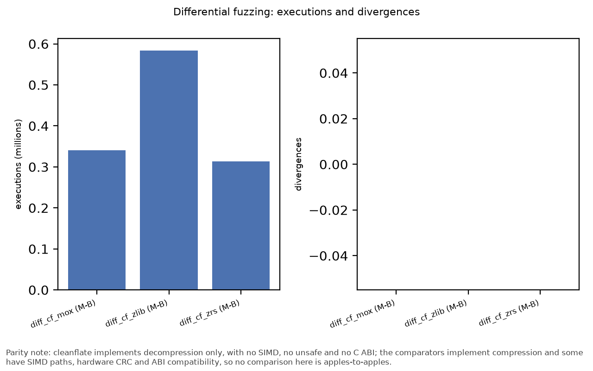

*Fuzzing executions and divergences.* Parity note: cleanflate implements decompression only, with no SIMD, no unsafe and no C ABI; the comparators implement compression and some have SIMD paths, hardware CRC and ABI compatibility, so no comparison here is apples-to-apples.

**Decompression-bomb sweep**

| Machine | Subject | Case | Ratio | Overall ratio (nested) | Output bytes | Limit bytes | Outcome | Peak RSS bytes | Seconds | Limit enforcement |
|---|---|---|---|---|---|---|---|---|---|---|
| M-A | cf | nested-2x-4294967296:layer1 | 1028.8500 | 633663 | 268435456 | 268435456 | error:limit | 7274496 | 1.0577 | native |
| M-A | cf | nested-2x-4294967296:layer2 | 615.8930 | 633663 | 4174525 | 268435456 | ok | 2965504 | 0.0183 | native |
| M-A | cf | zeros-1048576 | 1009.2200 | n/a | 1048576 | 268435456 | ok | 2932736 | 0.0110 | native |
| M-A | cf | zeros-1073741824 | 1028.8400 | n/a | 268435456 | 268435456 | error:limit | 4112384 | 1.0256 | native |
| M-A | cf | zeros-16777216 | 1028.2700 | n/a | 16777216 | 268435456 | ok | 2949120 | 0.0794 | native |
| M-A | cf | zeros-268435456 | 1028.8000 | n/a | 268435456 | 268435456 | ok | 3325952 | 1.0180 | native |
| M-A | cf | zeros-4294967296 | 1028.8500 | n/a | 268435456 | 268435456 | error:limit | 7258112 | 1.0247 | native |
| M-A | mox | nested-2x-4294967296:layer1 | 1028.8500 | 633663 | n/a | 268435456 | unsupported | n/a | n/a | caller |
| M-A | mox | nested-2x-4294967296:layer2 | 615.8930 | 633663 | n/a | 268435456 | unsupported | n/a | n/a | caller |
| M-A | mox | zeros-1048576 | 1009.2200 | n/a | 1048576 | 268435456 | ok | 2867200 | 0.0069 | caller |
| M-A | mox | zeros-1073741824 | 1028.8400 | n/a | 268435456 | 268435456 | error:limit | 3997696 | 0.4904 | caller |
| M-A | mox | zeros-16777216 | 1028.2700 | n/a | 16777216 | 268435456 | ok | 2883584 | 0.0434 | caller |
| M-A | mox | zeros-268435456 | 1028.8000 | n/a | 268435456 | 268435456 | ok | 3129344 | 0.4987 | caller |
| M-A | mox | zeros-4294967296 | 1028.8500 | n/a | 268435456 | 268435456 | error:limit | 7159808 | 0.4879 | caller |
| M-A | zlib | nested-2x-4294967296:layer1 | 1028.8500 | 633663 | 268435456 | 268435456 | error:limit | 7159808 | 0.5148 | caller |
| M-A | zlib | nested-2x-4294967296:layer2 | 615.8930 | 633663 | 4174525 | 268435456 | ok | 2916352 | 0.0139 | caller |
| M-A | zlib | zeros-1048576 | 1009.2200 | n/a | 1048576 | 268435456 | ok | 2850816 | 0.0095 | caller |
| M-A | zlib | zeros-1073741824 | 1028.8400 | n/a | 268435456 | 268435456 | error:limit | 3997696 | 0.5534 | caller |
| M-A | zlib | zeros-16777216 | 1028.2700 | n/a | 16777216 | 268435456 | ok | 2932736 | 0.0509 | caller |
| M-A | zlib | zeros-268435456 | 1028.8000 | n/a | 268435456 | 268435456 | ok | 3178496 | 0.5512 | caller |
| M-A | zlib | zeros-4294967296 | 1028.8500 | n/a | 268435456 | 268435456 | error:limit | 7159808 | 0.5642 | caller |
| M-A | zng | nested-2x-4294967296:layer1 | 1028.8500 | 633663 | 268435456 | 268435456 | error:limit | 7159808 | 0.4731 | caller |
| M-A | zng | nested-2x-4294967296:layer2 | 615.8930 | 633663 | 4174525 | 268435456 | ok | 2932736 | 0.0102 | caller |
| M-A | zng | zeros-1048576 | 1009.2200 | n/a | 1048576 | 268435456 | ok | 2899968 | 0.0065 | caller |
| M-A | zng | zeros-1073741824 | 1028.8400 | n/a | 268435456 | 268435456 | error:limit | 3997696 | 0.4633 | caller |
| M-A | zng | zeros-16777216 | 1028.2700 | n/a | 16777216 | 268435456 | ok | 2932736 | 0.0419 | caller |
| M-A | zng | zeros-268435456 | 1028.8000 | n/a | 268435456 | 268435456 | ok | 3178496 | 0.4712 | caller |
| M-A | zng | zeros-4294967296 | 1028.8500 | n/a | 268435456 | 268435456 | error:limit | 7159808 | 0.4636 | caller |
| M-A | zrs | nested-2x-4294967296:layer1 | 1028.8500 | 633663 | 268435456 | 268435456 | error:limit | 7127040 | 0.4661 | caller |
| M-A | zrs | nested-2x-4294967296:layer2 | 615.8930 | 633663 | 4174525 | 268435456 | ok | 2899968 | 0.0102 | caller |
| M-A | zrs | zeros-1048576 | 1009.2200 | n/a | 1048576 | 268435456 | ok | 2850816 | 0.0059 | caller |
| M-A | zrs | zeros-1073741824 | 1028.8400 | n/a | 268435456 | 268435456 | error:limit | 3964928 | 0.4638 | caller |
| M-A | zrs | zeros-16777216 | 1028.2700 | n/a | 16777216 | 268435456 | ok | 2899968 | 0.0397 | caller |
| M-A | zrs | zeros-268435456 | 1028.8000 | n/a | 268435456 | 268435456 | ok | 3145728 | 0.4717 | caller |
| M-A | zrs | zeros-4294967296 | 1028.8500 | n/a | 268435456 | 268435456 | error:limit | 7127040 | 0.4643 | caller |
| M-A | zsys | nested-2x-4294967296:layer1 | 1028.8500 | 633663 | 268435456 | 268435456 | error:limit | 7094272 | 0.4837 | caller |
| M-A | zsys | nested-2x-4294967296:layer2 | 615.8930 | 633663 | 4174525 | 268435456 | ok | 2850816 | 0.0098 | caller |
| M-A | zsys | zeros-1048576 | 1009.2200 | n/a | 1048576 | 268435456 | ok | 2785280 | 0.0073 | caller |
| M-A | zsys | zeros-1073741824 | 1028.8400 | n/a | 268435456 | 268435456 | error:limit | 3932160 | 0.4817 | caller |
| M-A | zsys | zeros-16777216 | 1028.2700 | n/a | 16777216 | 268435456 | ok | 2867200 | 0.0449 | caller |
| M-A | zsys | zeros-268435456 | 1028.8000 | n/a | 268435456 | 268435456 | ok | 3112960 | 0.4888 | caller |
| M-A | zsys | zeros-4294967296 | 1028.8500 | n/a | 268435456 | 268435456 | error:limit | 7094272 | 0.4885 | caller |
| M-B | cf | nested-2x-4294967296:layer1 | 1028.8500 | 633756 | 268435456 | 268435456 | error:limit | 23609344 | 1.7584 | native |
| M-B | cf | nested-2x-4294967296:layer2 | 615.9840 | 633756 | 4174525 | 268435456 | ok | 23609344 | 0.0295 | native |
| M-B | cf | zeros-1048576 | 1009.2200 | n/a | 1048576 | 268435456 | ok | 23609344 | 0.0102 | native |
| M-B | cf | zeros-1073741824 | 1028.8400 | n/a | 268435456 | 268435456 | error:limit | 23609344 | 1.7729 | native |
| M-B | cf | zeros-16777216 | 1028.2700 | n/a | 16777216 | 268435456 | ok | 23609344 | 0.1090 | native |
| M-B | cf | zeros-268435456 | 1028.8000 | n/a | 268435456 | 268435456 | ok | 23609344 | 1.6856 | native |
| M-B | cf | zeros-4294967296 | 1028.8500 | n/a | 268435456 | 268435456 | error:limit | 23609344 | 1.7381 | native |
| M-B | mox | nested-2x-4294967296:layer1 | 1028.8500 | 633756 | n/a | 268435456 | unsupported | n/a | n/a | caller |
| M-B | mox | nested-2x-4294967296:layer2 | 615.9840 | 633756 | n/a | 268435456 | unsupported | n/a | n/a | caller |
| M-B | mox | zeros-1048576 | 1009.2200 | n/a | 1048576 | 268435456 | ok | 23609344 | 0.0031 | caller |
| M-B | mox | zeros-1073741824 | 1028.8400 | n/a | 268435456 | 268435456 | error:limit | 23609344 | 0.2441 | caller |
| M-B | mox | zeros-16777216 | 1028.2700 | n/a | 16777216 | 268435456 | ok | 23609344 | 0.0188 | caller |
| M-B | mox | zeros-268435456 | 1028.8000 | n/a | 268435456 | 268435456 | ok | 23609344 | 0.2384 | caller |
| M-B | mox | zeros-4294967296 | 1028.8500 | n/a | 268435456 | 268435456 | error:limit | 23609344 | 0.2385 | caller |
| M-B | zlib | nested-2x-4294967296:layer1 | 1028.8500 | 633756 | 268435456 | 268435456 | error:limit | 23609344 | 0.7854 | caller |
| M-B | zlib | nested-2x-4294967296:layer2 | 615.9840 | 633756 | 4174525 | 268435456 | ok | 23609344 | 0.0154 | caller |
| M-B | zlib | zeros-1048576 | 1009.2200 | n/a | 1048576 | 268435456 | ok | 23609344 | 0.0055 | caller |
| M-B | zlib | zeros-1073741824 | 1028.8400 | n/a | 268435456 | 268435456 | error:limit | 23609344 | 0.8378 | caller |
| M-B | zlib | zeros-16777216 | 1028.2700 | n/a | 16777216 | 268435456 | ok | 23609344 | 0.0534 | caller |
| M-B | zlib | zeros-268435456 | 1028.8000 | n/a | 268435456 | 268435456 | ok | 23609344 | 0.9287 | caller |
| M-B | zlib | zeros-4294967296 | 1028.8500 | n/a | 268435456 | 268435456 | error:limit | 23609344 | 0.8075 | caller |
| M-B | zng | nested-2x-4294967296:layer1 | 1028.8500 | 633756 | 268435456 | 268435456 | error:limit | 23609344 | 0.2002 | caller |
| M-B | zng | nested-2x-4294967296:layer2 | 615.9840 | 633756 | 4174525 | 268435456 | ok | 23609344 | 0.0051 | caller |
| M-B | zng | zeros-1048576 | 1009.2200 | n/a | 1048576 | 268435456 | ok | 23609344 | 0.0036 | caller |
| M-B | zng | zeros-1073741824 | 1028.8400 | n/a | 268435456 | 268435456 | error:limit | 23609344 | 0.1979 | caller |
| M-B | zng | zeros-16777216 | 1028.2700 | n/a | 16777216 | 268435456 | ok | 23609344 | 0.0172 | caller |
| M-B | zng | zeros-268435456 | 1028.8000 | n/a | 268435456 | 268435456 | ok | 23609344 | 0.1933 | caller |
| M-B | zng | zeros-4294967296 | 1028.8500 | n/a | 268435456 | 268435456 | error:limit | 23609344 | 0.2067 | caller |
| M-B | zrs | nested-2x-4294967296:layer1 | 1028.8500 | 633756 | 268435456 | 268435456 | error:limit | 23609344 | 0.2207 | caller |
| M-B | zrs | nested-2x-4294967296:layer2 | 615.9840 | 633756 | 4174525 | 268435456 | ok | 23609344 | 0.0067 | caller |
| M-B | zrs | zeros-1048576 | 1009.2200 | n/a | 1048576 | 268435456 | ok | 23609344 | 0.0032 | caller |
| M-B | zrs | zeros-1073741824 | 1028.8400 | n/a | 268435456 | 268435456 | error:limit | 23609344 | 0.1967 | caller |
| M-B | zrs | zeros-16777216 | 1028.2700 | n/a | 16777216 | 268435456 | ok | 23609344 | 0.0140 | caller |
| M-B | zrs | zeros-268435456 | 1028.8000 | n/a | 268435456 | 268435456 | ok | 23609344 | 0.2112 | caller |
| M-B | zrs | zeros-4294967296 | 1028.8500 | n/a | 268435456 | 268435456 | error:limit | 23609344 | 0.1969 | caller |
| M-B | zsys | nested-2x-4294967296:layer1 | 1028.8500 | 633756 | 268435456 | 268435456 | error:limit | 23609344 | 0.7756 | caller |
| M-B | zsys | nested-2x-4294967296:layer2 | 615.9840 | 633756 | 4174525 | 268435456 | ok | 23609344 | 0.0155 | caller |
| M-B | zsys | zeros-1048576 | 1009.2200 | n/a | 1048576 | 268435456 | ok | 23609344 | 0.0075 | caller |
| M-B | zsys | zeros-1073741824 | 1028.8400 | n/a | 268435456 | 268435456 | error:limit | 23609344 | 0.8100 | caller |
| M-B | zsys | zeros-16777216 | 1028.2700 | n/a | 16777216 | 268435456 | ok | 23609344 | 0.0538 | caller |
| M-B | zsys | zeros-268435456 | 1028.8000 | n/a | 268435456 | 268435456 | ok | 23609344 | 0.7974 | caller |
| M-B | zsys | zeros-4294967296 | 1028.8500 | n/a | 268435456 | 268435456 | error:limit | 23609344 | 0.8162 | caller |

*Parity note: cleanflate implements decompression only, with no SIMD, no unsafe and no C ABI; the comparators implement compression and some have SIMD paths, hardware CRC and ABI compatibility, so no comparison here is apples-to-apples.*

*Source: `results/bombs.csv` <- `data/raw/correctness/M-A/20261003T192022Z.json`, `data/raw/correctness/M-B/20261002T180727Z.json` via `cfbench.bombs`.*

## Safety

*Is the replacement memory-safe by construction?*

**Unsafe surface**

| Subject | Crate | Version | Role | forbids unsafe | Unsafe blocks | Unsafe fns | Unsafe impls | geiger used | Note |
|---|---|---|---|---|---|---|---|---|---|
| cf | cleanflate | 0.1.0 | subject | true | 0 | 0 | 0 | 0 | n/a |
| mox | adler2 | 2.0.1 | dependency | true | 0 | 0 | 0 | 0 | n/a |
| mox | miniz_oxide | 0.9.1 | subject | true | 0 | 0 | 0 | 0 | n/a |
| zlib | zlib | n/a | subject | n/a | n/a | n/a | n/a | n/a | C: entire codebase memory-unsafe by language |
| zng | zng | n/a | subject | n/a | n/a | n/a | n/a | n/a | C: entire codebase memory-unsafe by language |
| zrs | libz-rs-sys | 0.6.8 | subject | false | 320 | 102 | 0 | 495 | n/a |
| zrs | zlib-rs | 0.6.8 | subject | false | 354 | 94 | 5 | 2860 | n/a |
| zsys | zsys | n/a | subject | n/a | n/a | n/a | n/a | n/a | C: entire codebase memory-unsafe by language |

*Parity note: cleanflate implements decompression only, with no SIMD, no unsafe and no C ABI; the comparators implement compression and some have SIMD paths, hardware CRC and ABI compatibility, so no comparison here is apples-to-apples.*

*Source: `results/unsafe.csv` <- `data/raw/size/any/20261002T180744Z.json` via `cfbench.unsafe_scan`.*

*Unsafe code per subject.* Parity note: cleanflate implements decompression only, with no SIMD, no unsafe and no C ABI; the comparators implement compression and some have SIMD paths, hardware CRC and ABI compatibility, so no comparison here is apples-to-apples.

**Dependencies**

| Subject | Package | Direct | Transitive | Advisories |
|---|---|---|---|---|
| cf | cleanflate@0.1.0 | 0 | 0 | n/a |
| mox | miniz_oxide@0.9.1 | 1 | 1 | n/a |
| zrs | libz-rs-sys@0.6.8 | 1 | 1 | n/a |
| zrs | zlib-rs@0.6.8 | 0 | 0 | n/a |

*Parity note: cleanflate implements decompression only, with no SIMD, no unsafe and no C ABI; the comparators implement compression and some have SIMD paths, hardware CRC and ABI compatibility, so no comparison here is apples-to-apples.*

*Source: `results/deps.csv` <- `data/raw/size/any/20261002T180746Z.json` via `cfbench.deps`.*

**Decompression-path lines of code (tokei; method in docs/methods/decomp-paths.md)**

| Subject | Language | Files | Code | Comments | Blanks |
|---|---|---|---|---|---|
| cf | Markdown (embedded) | 0 | 0 | 1013 | 27 |
| cf | Rust | 17 | 3683 | 119 | 318 |
| cf | Total | 17 | 3683 | 1132 | 345 |
| mox | Markdown (embedded) | 0 | 0 | 353 | 75 |
| mox | Rust | 5 | 2293 | 363 | 339 |
| mox | Total | 5 | 2293 | 716 | 414 |
| zlib | C | 7 | 2666 | 761 | 292 |
| zlib | C Header | 6 | 9791 | 147 | 134 |
| zlib | Total | 13 | 12457 | 908 | 426 |
| zng | C | 50 | 6843 | 1747 | 1425 |
| zng | C Header | 43 | 12908 | 1192 | 551 |
| zng | Total | 93 | 19751 | 2939 | 1976 |
| zrs | Markdown (embedded) | 0 | 0 | 225 | 64 |
| zrs | Rust | 26 | 7296 | 695 | 1632 |
| zrs | Total | 26 | 7296 | 920 | 1696 |

*Parity note: cleanflate implements decompression only, with no SIMD, no unsafe and no C ABI; the comparators implement compression and some have SIMD paths, hardware CRC and ABI compatibility, so no comparison here is apples-to-apples.*

*Source: `results/loc.csv` <- `data/raw/size/any/20261002T180747Z.json` via `cfbench.loc`.*

**Per-function complexity (p90 by nearest rank)**

| Subject | Tool | Version | Metric | Functions | Median | p90 | Max |
|---|---|---|---|---|---|---|---|
| cf | rust-code-analysis-cli | 0.0.25 | cognitive | 173 | 0 | 7 | 171 |
| cf | rust-code-analysis-cli | 0.0.25 | cyclomatic | 173 | 2 | 8 | 106 |
| mox | rust-code-analysis-cli | 0.0.25 | cognitive | 93 | 0 | 5 | 40 |
| mox | rust-code-analysis-cli | 0.0.25 | cyclomatic | 93 | 1 | 9 | 86 |
| zlib | lizard | 1.24.0 | cyclomatic | 71 | 3 | 13 | 209 |
| zlib | lizard (cognitive unavailable) | 1.24.0 | cognitive | 71 | n/a | n/a | n/a |
| zng | lizard | 1.24.0 | cyclomatic | 284 | 1 | 9 | 210 |
| zng | lizard (cognitive unavailable) | 1.24.0 | cognitive | 284 | n/a | n/a | n/a |
| zrs | rust-code-analysis-cli | 0.0.25 | cognitive | 326 | 0 | 5 | 332 |
| zrs | rust-code-analysis-cli | 0.0.25 | cyclomatic | 326 | 1 | 6 | 161 |

*Parity note: cleanflate implements decompression only, with no SIMD, no unsafe and no C ABI; the comparators implement compression and some have SIMD paths, hardware CRC and ABI compatibility, so no comparison here is apples-to-apples.*

*Source: `results/complexity.csv` <- `data/raw/size/any/20261002T180748Z.json`, `data/raw/size/any/20261002T180750Z.json` via `cfbench.complexity`.*

## Clean-room

*Was the build isolated from prior art, and does the code show it?*

**Mechanical isolation.** Foundry's guard hook refuses tool calls that would reach prior art (forbidden words in paths, recursive searches, network fetches outside an allowlist, forbidden tools). Every refusal is logged. The audit below re-reads the allowed calls for any that touched a prior-art path anyway (method in `docs/methods/effort.md`).

**Guard and audit totals per round**

| Round | Denied calls | Allowed read-capable calls | Forbidden-read candidates | Forbidden reads | Human interventions |
|---|---|---|---|---|---|
| 1 | 15 | 1344 | 1 | 0 | 2 |
| 2 | 5 | 410 | 0 | 0 | 7 |
| 3 | 12 | 472 | 0 | 0 | 2 |
| total | 32 | 2226 | 1 | 0 | 11 |

*Parity note: cleanflate implements decompression only, with no SIMD, no unsafe and no C ABI; the comparators implement compression and some have SIMD paths, hardware CRC and ABI compatibility, so no comparison here is apples-to-apples.*

*Source: `results/effort_totals.csv` <- `data/raw/effort/any/20261002T180908Z.json`, `data/raw/effort/any/20261003T193251Z.json` via `cfbench.effort.derive`.*

**Denied tool calls by category**

| Round | Category | Denied calls |
|---|---|---|
| 1 | clean-room forbidden word | 4 |
| 1 | forbidden tool | 2 |
| 1 | network lockdown | 6 |
| 1 | recursive grep | 1 |
| 1 | unparseable command | 2 |
| 2 | clean-room forbidden word | 1 |
| 2 | recursive grep | 4 |
| 3 | clean-room forbidden word | 6 |
| 3 | profiling rule | 3 |
| 3 | recursive grep | 3 |

*Parity note: cleanflate implements decompression only, with no SIMD, no unsafe and no C ABI; the comparators implement compression and some have SIMD paths, hardware CRC and ABI compatibility, so no comparison here is apples-to-apples.*

*Source: `results/effort_denied.csv` <- `data/raw/effort/any/20261002T180908Z.json`, `data/raw/effort/any/20261003T193251Z.json` via `cfbench.effort.derive`.*

**Forbidden-read candidates and their classification (`config/forbidden_read_verdicts.toml`)**

| Round | When | Tool | Stage | Path | Rule | Verdict | Note |
|---|---|---|---|---|---|---|---|
| 1 | 2026-09-29T21:12:31.068Z | Bash | review | /usr/include/zlib | root ^/usr/(local/)?include/ | not-a-read | Review-stage audit of the tool log itself: /usr/include/zlib is one alternative of the regex the reviewer used (python -c over provenance/tool-log.jsonl) to search for forbidden reads; the command opens only the log. |

*Parity note: cleanflate implements decompression only, with no SIMD, no unsafe and no C ABI; the comparators implement compression and some have SIMD paths, hardware CRC and ABI compatibility, so no comparison here is apples-to-apples.*

*Source: `results/effort_forbidden_reads.csv` <- `data/raw/effort/any/20261002T180908Z.json`, `data/raw/effort/any/20261003T193251Z.json` via `cfbench.effort.derive`.*

### Similarity against negative and positive controls

Methods (full description in `docs/methods/similarity.md`): tree-sitter token n-gram Jaccard (n from 5 to 10), identifier overlap (length at least 6, RFC-mandated names excluded), comment n-gram overlap, and JPlag 6.3.0. Tools: tree-sitter 0.26.0, tree-sitter-rust 0.24.2, tree-sitter-c 0.24.2. The RFC exclusion list is `config/rfc_identifiers.txt` (effective list: `results/similarity_identifier_exclusions.txt`). A post-hoc sensitivity analysis, added after the first full run and not pre-registered, repeats the identifier metrics (`ident_*_filtered`) with the extended list `config/identifier_exclusions_posthoc.txt` (Rust attribute, lint and std names, and names built only from RFC-defined terms), applied to every pair including the controls. The T1 claim is decided on the pre-registered metrics alone.

**Scores against the controls (negative zrs-mox, positive zrs-zng)**

| Metric | Pair | Role | Score | Negative control | Positive control | Position | Classification |
|---|---|---|---|---|---|---|---|
| comment_jaccard | cf-mox | test | 0.0003 | 0.0010 | 0.0395 | -0.0185 | below negative |
| comment_jaccard | cf-zlib | test | 0.0003 | 0.0010 | 0.0395 | -0.0198 | below negative |
| comment_jaccard | cf-zng | test | 0.0003 | 0.0010 | 0.0395 | -0.0195 | below negative |
| comment_jaccard | cf-zrs | test | 0.0005 | 0.0010 | 0.0395 | -0.0132 | below negative |
| comment_jaccard | zrs-mox | negative | 0.0010 | 0.0010 | 0.0395 | 0 | negative control |
| comment_jaccard | zrs-zng | positive | 0.0395 | 0.0010 | 0.0395 | 1 | positive control |
| ident_jaccard | cf-mox | test | 0.0747 | 0.0439 | 0.1438 | 0.3090 | between |
| ident_jaccard | cf-zlib | test | 0.0207 | 0.0439 | 0.1438 | -0.2316 | below negative |
| ident_jaccard | cf-zng | test | 0.0108 | 0.0439 | 0.1438 | -0.3306 | below negative |
| ident_jaccard | cf-zrs | test | 0.0529 | 0.0439 | 0.1438 | 0.0907 | at or near negative |
| ident_jaccard | zrs-mox | negative | 0.0439 | 0.0439 | 0.1438 | 0 | negative control |
| ident_jaccard | zrs-zng | positive | 0.1438 | 0.0439 | 0.1438 | 1 | positive control |
| ident_jaccard_filtered | cf-mox | test | 0.0252 | 0.0164 | 0.1421 | 0.0699 | at or near negative |
| ident_jaccard_filtered | cf-zlib | test | 0.0106 | 0.0164 | 0.1421 | -0.0456 | below negative |
| ident_jaccard_filtered | cf-zng | test | 0.0050 | 0.0164 | 0.1421 | -0.0905 | below negative |
| ident_jaccard_filtered | cf-zrs | test | 0.0217 | 0.0164 | 0.1421 | 0.0420 | at or near negative |
| ident_jaccard_filtered | zrs-mox | negative | 0.0164 | 0.0164 | 0.1421 | 0 | negative control |
| ident_jaccard_filtered | zrs-zng | positive | 0.1421 | 0.0164 | 0.1421 | 1 | positive control |
| ident_match_rate_left | cf-mox | test | 0.1285 | 0.0601 | 0.3386 | 0.2457 | at or near negative |
| ident_match_rate_left | cf-zlib | test | 0.0334 | 0.0601 | 0.3386 | -0.0959 | below negative |
| ident_match_rate_left | cf-zng | test | 0.0463 | 0.0601 | 0.3386 | -0.0498 | below negative |
| ident_match_rate_left | cf-zrs | test | 0.1491 | 0.0601 | 0.3386 | 0.3195 | between |
| ident_match_rate_left | zrs-mox | negative | 0.0601 | 0.0601 | 0.3386 | 0 | negative control |
| ident_match_rate_left | zrs-zng | positive | 0.3386 | 0.0601 | 0.3386 | 1 | positive control |
| ident_match_rate_left_filtered | cf-mox | test | 0.0457 | 0.0225 | 0.3493 | 0.0710 | at or near negative |
| ident_match_rate_left_filtered | cf-zlib | test | 0.0183 | 0.0225 | 0.3493 | -0.0130 | below negative |
| ident_match_rate_left_filtered | cf-zng | test | 0.0244 | 0.0225 | 0.3493 | 0.0057 | at or near negative |
| ident_match_rate_left_filtered | cf-zrs | test | 0.0671 | 0.0225 | 0.3493 | 0.1363 | at or near negative |
| ident_match_rate_left_filtered | zrs-mox | negative | 0.0225 | 0.0225 | 0.3493 | 0 | negative control |
| ident_match_rate_left_filtered | zrs-zng | positive | 0.3493 | 0.0225 | 0.3493 | 1 | positive control |
| jplag_avg | cf-mox | test | 0.1795 | 0.1311 | n/a | n/a | positive control unavailable |
| jplag_avg | cf-zrs | test | 0.1812 | 0.1311 | n/a | n/a | positive control unavailable |
| jplag_avg | zlib-zng | context | 0.2997 | 0.1311 | n/a | n/a | positive control unavailable |
| jplag_avg | zrs-mox | negative | 0.1311 | 0.1311 | n/a | 0 | negative control |
| ngram_containment@5 | cf-mox | test | 0.3673 | 0.5251 | 0.1095 | n/a | controls not separated |
| ngram_containment@5 | cf-zlib | test | 0.0688 | 0.5251 | 0.1095 | n/a | controls not separated |
| ngram_containment@5 | cf-zng | test | 0.0902 | 0.5251 | 0.1095 | n/a | controls not separated |
| ngram_containment@5 | cf-zrs | test | 0.5155 | 0.5251 | 0.1095 | n/a | controls not separated |
| ngram_containment@5 | zrs-mox | negative | 0.5251 | 0.5251 | 0.1095 | 0 | negative control |
| ngram_containment@5 | zrs-zng | positive | 0.1095 | 0.5251 | 0.1095 | 1 | positive control |
| ngram_jaccard@10 | cf-mox | test | 0.0414 | 0.0395 | 0.0082 | n/a | controls not separated |
| ngram_jaccard@10 | cf-zlib | test | 0.0010 | 0.0395 | 0.0082 | n/a | controls not separated |
| ngram_jaccard@10 | cf-zng | test | 0.0017 | 0.0395 | 0.0082 | n/a | controls not separated |
| ngram_jaccard@10 | cf-zrs | test | 0.0500 | 0.0395 | 0.0082 | n/a | controls not separated |
| ngram_jaccard@10 | zrs-mox | negative | 0.0395 | 0.0395 | 0.0082 | 0 | negative control |
| ngram_jaccard@10 | zrs-zng | positive | 0.0082 | 0.0395 | 0.0082 | 1 | positive control |
| ngram_jaccard@5 | cf-mox | test | 0.2148 | 0.2153 | 0.0555 | n/a | controls not separated |
| ngram_jaccard@5 | cf-zlib | test | 0.0352 | 0.2153 | 0.0555 | n/a | controls not separated |
| ngram_jaccard@5 | cf-zng | test | 0.0348 | 0.2153 | 0.0555 | n/a | controls not separated |
| ngram_jaccard@5 | cf-zrs | test | 0.2234 | 0.2153 | 0.0555 | n/a | controls not separated |
| ngram_jaccard@5 | zrs-mox | negative | 0.2153 | 0.2153 | 0.0555 | 0 | negative control |
| ngram_jaccard@5 | zrs-zng | positive | 0.0555 | 0.2153 | 0.0555 | 1 | positive control |
| ngram_jaccard@6 | cf-mox | test | 0.1539 | 0.1516 | 0.0333 | n/a | controls not separated |
| ngram_jaccard@6 | cf-zlib | test | 0.0171 | 0.1516 | 0.0333 | n/a | controls not separated |
| ngram_jaccard@6 | cf-zng | test | 0.0182 | 0.1516 | 0.0333 | n/a | controls not separated |
| ngram_jaccard@6 | cf-zrs | test | 0.1643 | 0.1516 | 0.0333 | n/a | controls not separated |
| ngram_jaccard@6 | zrs-mox | negative | 0.1516 | 0.1516 | 0.0333 | 0 | negative control |
| ngram_jaccard@6 | zrs-zng | positive | 0.0333 | 0.1516 | 0.0333 | 1 | positive control |
| ngram_jaccard@7 | cf-mox | test | 0.1105 | 0.1076 | 0.0209 | n/a | controls not separated |
| ngram_jaccard@7 | cf-zlib | test | 0.0075 | 0.1076 | 0.0209 | n/a | controls not separated |
| ngram_jaccard@7 | cf-zng | test | 0.0094 | 0.1076 | 0.0209 | n/a | controls not separated |
| ngram_jaccard@7 | cf-zrs | test | 0.1220 | 0.1076 | 0.0209 | n/a | controls not separated |
| ngram_jaccard@7 | zrs-mox | negative | 0.1076 | 0.1076 | 0.0209 | 0 | negative control |
| ngram_jaccard@7 | zrs-zng | positive | 0.0209 | 0.1076 | 0.0209 | 1 | positive control |
| ngram_jaccard@8 | cf-mox | test | 0.0785 | 0.0773 | 0.0137 | n/a | controls not separated |
| ngram_jaccard@8 | cf-zlib | test | 0.0034 | 0.0773 | 0.0137 | n/a | controls not separated |
| ngram_jaccard@8 | cf-zng | test | 0.0050 | 0.0773 | 0.0137 | n/a | controls not separated |
| ngram_jaccard@8 | cf-zrs | test | 0.0911 | 0.0773 | 0.0137 | n/a | controls not separated |
| ngram_jaccard@8 | zrs-mox | negative | 0.0773 | 0.0773 | 0.0137 | 0 | negative control |
| ngram_jaccard@8 | zrs-zng | positive | 0.0137 | 0.0773 | 0.0137 | 1 | positive control |
| ngram_jaccard@9 | cf-mox | test | 0.0575 | 0.0554 | 0.0103 | n/a | controls not separated |
| ngram_jaccard@9 | cf-zlib | test | 0.0017 | 0.0554 | 0.0103 | n/a | controls not separated |
| ngram_jaccard@9 | cf-zng | test | 0.0029 | 0.0554 | 0.0103 | n/a | controls not separated |
| ngram_jaccard@9 | cf-zrs | test | 0.0682 | 0.0554 | 0.0103 | n/a | controls not separated |
| ngram_jaccard@9 | zrs-mox | negative | 0.0554 | 0.0554 | 0.0103 | 0 | negative control |
| ngram_jaccard@9 | zrs-zng | positive | 0.0103 | 0.0554 | 0.0103 | 1 | positive control |

*Parity note: cleanflate implements decompression only, with no SIMD, no unsafe and no C ABI; the comparators implement compression and some have SIMD paths, hardware CRC and ABI compatibility, so no comparison here is apples-to-apples.*

*Source: `results/similarity_summary.csv` <- `data/raw/similarity/any/20261002T191558Z.json`, `data/raw/similarity/any/20261002T191601Z.json`, `data/raw/similarity/any/20261002T191604Z.json`, `data/raw/similarity/any/20261002T191653Z.json` via `cfbench.similarity.summary`.*

**Result statement:** T1 claim NOT allowed: a cf pair is not at or near the negative control for `ident_jaccard` (cf-mox between), `ident_match_rate_left` (cf-zrs between).

**Sensitivity:** Post-hoc sensitivity (extended identifier exclusions, not pre-registered) would be allowed: on every separable metric each cf pair sits at or near the negative control or below it.

*Where cleanflate falls between the controls.* Parity note: cleanflate implements decompression only, with no SIMD, no unsafe and no C ABI; the comparators implement compression and some have SIMD paths, hardware CRC and ABI compatibility, so no comparison here is apples-to-apples.

**Top fragment pairs and their review verdicts**

| Pair | Fragments | RFC-forced | idiomatic-inevitable | suspicious | Unreviewed |
|---|---|---|---|---|---|
| cf-mox | 20 | 0 | 0 | 0 | 20 |
| cf-zlib | 20 | 0 | 0 | 0 | 20 |
| cf-zng | 20 | 0 | 0 | 0 | 20 |
| cf-zrs | 20 | 0 | 0 | 0 | 20 |
| zrs-mox | 20 | 0 | 0 | 0 | 20 |
| zrs-zng | 20 | 0 | 0 | 0 | 20 |

*Parity note: cleanflate implements decompression only, with no SIMD, no unsafe and no C ABI; the comparators implement compression and some have SIMD paths, hardware CRC and ABI compatibility, so no comparison here is apples-to-apples.*

Verdicts live in `config/similarity_verdicts.toml` and are filled in by a human reviewer; per-pair excerpts are under `results/similarity_fragments/`.

Structural write-up: [STRUCTURE_COMPARISON.md](STRUCTURE_COMPARISON.md).

## Effort, cost and provenance

**Totals per round**

| Round | Wall-clock s | Idle s | Models | Input tokens | Output tokens | Cache-write tokens | Cache-read tokens | Cost USD |
|---|---|---|---|---|---|---|---|---|
| 1 | 30485 | 0 | claude-opus-5-5;claude-sonnet-5 | 4338 | 850772 | 5338331 | 769582775 | 182 |
| 2 | 26218 | 28931 | claude-opus-5-5;claude-sonnet-5-5 | 1096 | 168462 | 9928038 | 153669576 | 63 |
| 3 | 45863 | 0 | claude-opus-5-5;claude-sonnet-5-5 | 1214 | 143298 | 25095429 | 200948466 | 116 |
| total | 102566 | 28931 | claude-opus-5-5;claude-sonnet-5;claude-sonnet-5-5 | 6648 | 1162532 | 40361798 | 1124200817 | 361 |

*Parity note: cleanflate implements decompression only, with no SIMD, no unsafe and no C ABI; the comparators implement compression and some have SIMD paths, hardware CRC and ABI compatibility, so no comparison here is apples-to-apples.*

*Source: `results/effort_totals.csv` <- `data/raw/effort/any/20261002T180908Z.json`, `data/raw/effort/any/20261003T193251Z.json` via `cfbench.effort.derive`.*

**Per stage and round**

| Round | Stage | Wall-clock s | Models | Input tokens | Output tokens | Cache-write tokens | Cache-read tokens | Cost USD |
|---|---|---|---|---|---|---|---|---|
| 1 | controller | n/a | claude-opus-5-5 | 158 | 26308 | 219416 | 5312174 | 3 |
| 1 | fix | 12459 | claude-sonnet-5 | 1734 | 209432 | 2406085 | 341861784 | 76 |
| 1 | implement | 12776 | claude-sonnet-5 | 2002 | 489175 | 1389604 | 400356890 | 88 |
| 1 | plan | 1800 | claude-opus-5-5 | 36 | 96886 | 370984 | 1971772 | 4 |
| 1 | review | 2876 | claude-opus-5-5 | 372 | 19845 | 883029 | 19416463 | 9 |
| 1 | summarize | 186 | claude-opus-5-5 | 36 | 9126 | 69213 | 663692 | 1 |
| 1 | untagged | 388 | n/a | n/a | n/a | n/a | n/a | n/a |
| 2 | controller | n/a | claude-opus-5-5;claude-sonnet-5-5 | 132 | 33965 | 407858 | 9477717 | 5 |
| 2 | fix | 2449 | claude-sonnet-5-5 | 68 | 1574 | 91343 | 1057595 | 0 |
| 2 | implement | 19391 | claude-sonnet-5-5 | 596 | 11623 | 8414676 | 124047330 | 46 |
| 2 | plan | 2703 | claude-opus-5-5 | 66 | 97541 | 551216 | 6023705 | 6 |
| 2 | review | 1288 | claude-opus-5-5 | 212 | 16171 | 408950 | 12749955 | 5 |
| 2 | summarize | 387 | claude-opus-5-5 | 22 | 7588 | 53995 | 313274 | 0 |
| 3 | controller | n/a | claude-opus-5-5;claude-sonnet-5-5 | 156 | 52408 | 1690750 | 17414900 | 16 |
| 3 | fix | 2312 | claude-sonnet-5-5 | 36 | 604 | 77926 | 471724 | 0 |
| 3 | implement | 30843 | claude-sonnet-5-5 | 750 | 12274 | 21842529 | 164213966 | 88 |
| 3 | plan | 1727 | claude-opus-5-5 | 94 | 61994 | 1043871 | 10377909 | 9 |
| 3 | review | 527 | claude-opus-5-5 | 156 | 7866 | 386239 | 8137984 | 4 |
| 3 | summarize | 6410 | claude-opus-5-5 | 22 | 8152 | 54114 | 331983 | 1 |
| 3 | untagged | 4044 | n/a | n/a | n/a | n/a | n/a | n/a |

*Parity note: cleanflate implements decompression only, with no SIMD, no unsafe and no C ABI; the comparators implement compression and some have SIMD paths, hardware CRC and ABI compatibility, so no comparison here is apples-to-apples.*

*Source: `results/effort_stage_round.csv` <- `data/raw/effort/any/20261002T180908Z.json`, `data/raw/effort/any/20261003T193251Z.json` via `cfbench.effort.derive`.*

*Effort per stage and round.* Parity note: cleanflate implements decompression only, with no SIMD, no unsafe and no C ABI; the comparators implement compression and some have SIMD paths, hardware CRC and ABI compatibility, so no comparison here is apples-to-apples.

**Milestones**

| Round | Milestone | Wall-clock s | Review rounds |
|---|---|---|---|
| 1 | P0 | 1530 | 4 |
| 1 | P1 | 2944 | 4 |
| 1 | P2 | 1871 | 4 |
| 1 | P3 | 1747 | 4 |
| 1 | P4 | 5526 | 4 |
| 1 | P6 | 529 | 4 |
| 1 | R1 | 2353 | 4 |
| 1 | R2 | 822 | 4 |
| 1 | R3 | 198 | 4 |
| 1 | other | 12965 | 4 |
| 2 | P0 | 6490 | 3 |
| 2 | P1 | 2762 | 3 |
| 2 | P2 | 2507 | 3 |
| 2 | P3 | 2931 | 3 |
| 2 | P4 | 2481 | 3 |
| 2 | P5 | 1214 | 3 |
| 2 | R1 | 419 | 3 |
| 2 | R2 | 193 | 3 |
| 2 | other | 7221 | 3 |
| 3 | P0 | 5535 | 2 |
| 3 | P1 | 3272 | 2 |
| 3 | P2 | 7799 | 2 |
| 3 | P3 | 5102 | 2 |
| 3 | P4 | 6570 | 2 |
| 3 | P5 | 1429 | 2 |
| 3 | R1 | 597 | 2 |
| 3 | other | 15559 | 2 |

*Parity note: cleanflate implements decompression only, with no SIMD, no unsafe and no C ABI; the comparators implement compression and some have SIMD paths, hardware CRC and ABI compatibility, so no comparison here is apples-to-apples.*

*Source: `results/effort_milestones.csv` <- `data/raw/effort/any/20261002T180908Z.json`, `data/raw/effort/any/20261003T193251Z.json` via `cfbench.effort.derive`.*

**Review rounds**

| Round | Review round | Verdict | Fix tasks |
|---|---|---|---|
| 1 | 1 | CHANGES REQUESTED | 8 |
| 1 | 2 | CHANGES REQUESTED | 5 |
| 1 | 3 | CHANGES REQUESTED | 1 |
| 1 | 4 | APPROVED | 0 |
| 2 | 1 | CHANGES REQUESTED | 2 |
| 2 | 2 | CHANGES REQUESTED | 1 |
| 2 | 3 | APPROVED | 0 |
| 3 | 1 | CHANGES REQUESTED | 1 |
| 3 | 2 | APPROVED | 0 |

*Parity note: cleanflate implements decompression only, with no SIMD, no unsafe and no C ABI; the comparators implement compression and some have SIMD paths, hardware CRC and ABI compatibility, so no comparison here is apples-to-apples.*

*Source: `results/effort_review_rounds.csv` <- `data/raw/effort/any/20261002T180908Z.json`, `data/raw/effort/any/20261003T193251Z.json` via `cfbench.effort.derive`.*

**Defect discovery source**

| Round | Discovery source | Defects |
|---|---|---|
| 1 | conformance | 1 |
| 1 | fuzzing | 1 |
| 1 | none reported | 47 |
| 1 | other | 3 |
| 1 | review | 2 |
| 1 | unit_tests | 3 |
| 2 | conformance | 2 |
| 2 | none reported | 33 |
| 2 | unit_tests | 2 |
| 3 | none reported | 36 |
| 3 | other | 2 |

*Parity note: cleanflate implements decompression only, with no SIMD, no unsafe and no C ABI; the comparators implement compression and some have SIMD paths, hardware CRC and ABI compatibility, so no comparison here is apples-to-apples.*

*Source: `results/effort_defects.csv` <- `data/raw/effort/any/20261002T180908Z.json`, `data/raw/effort/any/20261003T193251Z.json` via `cfbench.effort.derive`.*

**Human interventions**

| Round | When | Stage/task | Nature |
|---|---|---|---|
| 1 | 2026-09-29T15:33Z | implement/P0-08 | Downloaded the Canterbury corpus archive (`cantrbry.tar.gz`, sha256 `f140e8a5b73d3f53198555a63bfb827889394a42f20825df33c810c3d5e3f8fb`) from the allowlisted URL in a browser and supplied it to `fetch-corpora.sh --from-file`, which verified it against that known-good SHA-256 before use. |
| 1 | 2026-09-29T18:50Z | review→implement, round 1 | Re-opened the 17 tasks auto-skipped behind P0-08 (P0-09..P0-11, P1-03, P1-11, P1-12, P2-05, P2-06, P3-04, P3-06, P4-07..P4-10, P6-01..P6-03) by flipping `[-]` to `[ ]` in `docs/PROGRESS.md` (commit `b992fec`, tagged `[stage:review] [task:reopen]`). The operator authorized it; the go-flight controller session made the edit. |
| 2 | 2026-09-29 | phase-2 SPEC | Directed a performance pass after phase 1 missed its 70% throughput target; the controller session drafted `docs/SPEC.md` (now `docs/phase-2/SPEC.md`) from that direction, using only phase-1 docs, cleanflate's own code and general techniques. |
| 2 | 2026-09-30 | phase-2 post-merge | Created and pushed signed tags `v0.1.0-cleanroom` (`e94efcf`) and `v0.2.0-cleanroom` (`d3e911b`); phase 1's tag had never been created. |
| 2 | 2026-09-30 | phase-2 post-merge | Hour-long fuzz runs, `make bomb` peak-memory comparison and DESIGN D-27..D-32 read-through deferred (not done yet). |
| 2 | 2026-09-30 | phase-2 post-merge | Merged PR #2 (phase 2) into `main` after green CI, and re-ran the full `make bench` on the merged code (`docs/perf/phase2-final-operator.json`, recorded in `docs/PERF.md`). |
| 2 | 2026-09-30 | phase-2 post-merge fix | Bounded one-shot size hints by DEFLATE's maximum expansion (`MAX_DEFLATE_EXPANSION` = 1032, DESIGN.md D-33), so an 18-byte gzip input claiming a 4 GiB ISIZE preallocates at most 18,576 bytes instead of 64 MiB. Written and verified in the controller session, outside a Foundry flight, so it had no pipeline review. |
| 2 | 2026-09-30 | phase-2 pre-flight | Installed `perf` 7.1.5 (Pop!_OS `linux-tools-common`, `linux-tools-generic`, `linux-tools-$(uname -r)`) and `cargo flamegraph` 0.6.14 (`cargo install flamegraph --locked`). `kernel.perf_event_paranoid` left at 2. |
| 2 | 2026-09-30T00:00Z | post-approval CI | Two CI fixes after the round-4 APPROVED review, never reviewed by the pipeline: `ea3809a` commits `testdata/corpora/archives/cantrbry.tar.gz` (un-ignoring only that file) so CI skips the download; `f2b547b` makes the corpus verify step check only the requested corpus. |
| 3 | 2026-09-30 | phase-3 SPEC | Supplied a "round 3" performance brief (drafted with Claude Desktop from the phase-2 bench numbers); the controller session reconciled it with the repo into `docs/SPEC.md`. No implementation source was consulted. |
| 3 | 2026-09-30 | phase-3 post-merge | Merged PR #3 (phase 3) into `main`; controller session created and pushed the signed tag `v0.3.0-cleanroom`. Quiet-machine bench re-run, peak-memory comparison, hour-long fuzz runs and hand review of D-34..D-36 deferred (not done yet). |

*Parity note: cleanflate implements decompression only, with no SIMD, no unsafe and no C ABI; the comparators implement compression and some have SIMD paths, hardware CRC and ABI compatibility, so no comparison here is apples-to-apples.*

*Source: `results/effort_interventions.csv` <- `data/raw/effort/any/20261002T180908Z.json`, `data/raw/effort/any/20261003T193251Z.json` via `cfbench.effort.derive`.*

Data gaps and methods: [EFFORT_GAPS.md](EFFORT_GAPS.md).

**zlib-rs status-quo context (from the public GitHub and crates.io APIs)**

| Fact | Value | Fetched |
|---|---|---|
| commit_count | 1083 | 20261002T180911Z |
| contributor_count_including_anonymous | 37 | 20261002T180911Z |
| first_commit_date | 2023-12-05T05:04:21Z | 20261002T180911Z |
| first_commit_sha | 8b273a581175728de535a363c25a4352e6d005c6 | 20261002T180911Z |
| first_github_release | v0.2.0 (2024-06-12T12:16:19Z) | 20261002T180911Z |
| first_published_version_libz-rs-sys | 0.0.1 (2024-02-23T08:44:59.656473Z) | 20261002T180911Z |
| first_published_version_zlib-rs | 0.0.1 (2024-02-23T08:44:37.843487Z) | 20261002T180911Z |
| latest_github_release | v0.6.8 (2026-09-15T13:10:36Z) | 20261002T180911Z |
| latest_published_version_libz-rs-sys | 0.6.8 (2026-09-15T13:10:03.060802Z) | 20261002T180911Z |
| latest_published_version_zlib-rs | 0.6.8 (2026-09-15T13:10:00.283903Z) | 20261002T180911Z |
| repo_created_at | 2023-12-05T05:04:21Z | 20261002T180911Z |
| stable_1_0_release_libz-rs-sys | none: no 1.0 or later version published as of the fetch date | 20261002T180911Z |
| stable_1_0_release_zlib-rs | none: no 1.0 or later version published as of the fetch date | 20261002T180911Z |

*Parity note: cleanflate implements decompression only, with no SIMD, no unsafe and no C ABI; the comparators implement compression and some have SIMD paths, hardware CRC and ABI compatibility, so no comparison here is apples-to-apples.*

*Scope:* Context, not a head-to-head comparison. zlib-rs is a full zlib replacement: complete API and C ABI, compression as well as decompression, SIMD code paths, and performance parity with zlib-ng as a goal. cleanflate (this repo's subject) only decompresses, in safe Rust, without SIMD or a C ABI, and was built in three Foundry rounds; the two efforts have different scopes.

*Source: `results/zlibrs_context.csv` via `cfbench.effort.context`.*

## Viability

*Is the replacement fast enough to matter, on both machines?*

### Performance methodology

- Harness: one process per measured cell, cells in randomized order (seed 20261019); the harness is single-threaded and counts heap with an in-process allocator.
- Each cell warms up for 500 ms, then takes at least 30 samples of at least 10 ms each.
- Medians carry a 95% bootstrap confidence interval from 2000 resamples.
- The full session is run 2 times; the two runs agree when every aggregate is within 5%, otherwise the machine is flagged.
- The starting load average is checked against 1.0 and a higher value is recorded as a precondition warning; a run is refused for it only under `--strict`.
- Levels 1, 6, 9; framings raw, zlib, gzip; modes oneshot, stream_small, stream_large. Small streaming feeds 1024-byte input chunks into 4096-byte output buffers; large streaming uses 1048576-byte input and 1048576-byte output chunks.
- Aggregates are total output bytes divided by summed per-file time; ratios are against stock zlib (zlib = 1.00x) and are only formed within the same mode.

### Both machines in one table

cleanflate's aggregate throughput as a ratio of stock zlib's (zlib = 1.00x) at level 6, oneshot, per machine and build variant (native = `target-cpu=native` Rust builds against the same zlib). † marks a ratio whose cf or zlib aggregate differs between the two runs by more than the agreement tolerance.

| Corpus | Framing | M-A generic | M-B generic | M-A native | M-B native |
|---|---|---|---|---|---|
| Silesia | raw | 0.71x | 0.76x | 0.69x | 0.77x |
| Silesia | zlib | 0.73x | 0.79x | 0.71x | 0.78x |
| Silesia | gzip | 0.62x | 0.73x | 0.61x | 0.74x |
| Canterbury | raw | 0.56x | 0.68x | 0.57x | 0.70x |
| Canterbury | zlib | 0.61x | 0.71x† | 0.61x | 0.73x |
| Canterbury | gzip | 0.48x | 0.64x | 0.48x | 0.64x |

*Parity note: cleanflate implements decompression only, with no SIMD, no unsafe and no C ABI; the comparators implement compression and some have SIMD paths, hardware CRC and ABI compatibility, so no comparison here is apples-to-apples.*

Source: `results/perf_aggregates.csv` <- `data/raw/perf/M-A/20261003T004833Z.json`, `data/raw/perf/M-A/20261003T022240Z.json`, `data/raw/perf/M-A/20261003T032646Z.json`, `data/raw/perf/M-A/20261003T043023Z.json`, `data/raw/perf/M-B/20261002T072144Z.json`, `data/raw/perf/M-B/20261002T091719Z.json`, `data/raw/perf/M-B/20261002T103403Z.json`, `data/raw/perf/M-B/20261002T115027Z.json` via `cfbench.perf_report`; `results/perf_agreement_aggregates.csv` <- `data/raw/perf/M-A/20261003T004833Z.json`, `data/raw/perf/M-A/20261003T022240Z.json`, `data/raw/perf/M-A/20261003T032646Z.json`, `data/raw/perf/M-A/20261003T043023Z.json`, `data/raw/perf/M-B/20261002T072144Z.json`, `data/raw/perf/M-B/20261002T091719Z.json`, `data/raw/perf/M-B/20261002T103403Z.json`, `data/raw/perf/M-B/20261002T115027Z.json` via `cfbench.agreement`

### Run-to-run stability

Each machine ran the full perf session 2 times. SPEC 3.2 requires agreement within 5% of the median, or the result is flagged. A machine is `flagged` when any aggregate (a subject's whole corpus at one level, framing and mode) moves by more than that; flagged results are reported, not dropped.

| Machine | Variant | Runs | Flagged cells | Flagged aggregates | Max cell difference | Verdict |
|---|---|---|---|---|---|---|
| M-A | generic | 2 | 291 of 4896 | 2 of 306 | 49.0% | flagged |
| M-A | native | 2 | 169 of 3168 | 0 of 198 | 36.1% | pass |
| M-B | generic | 2 | 787 of 4896 | 24 of 306 | 41.1% | flagged |
| M-B | native | 2 | 447 of 3168 | 14 of 198 | 58.4% | flagged |

*Parity note: cleanflate implements decompression only, with no SIMD, no unsafe and no C ABI; the comparators implement compression and some have SIMD paths, hardware CRC and ABI compatibility, so no comparison here is apples-to-apples.*

Source: `results/perf_agreement_summary.csv` <- `data/raw/perf/M-A/20261003T004833Z.json`, `data/raw/perf/M-A/20261003T022240Z.json`, `data/raw/perf/M-A/20261003T032646Z.json`, `data/raw/perf/M-A/20261003T043023Z.json`, `data/raw/perf/M-B/20261002T072144Z.json`, `data/raw/perf/M-B/20261002T091719Z.json`, `data/raw/perf/M-B/20261002T103403Z.json`, `data/raw/perf/M-B/20261002T115027Z.json` via `cfbench.agreement`

Operator note (`config/session_notes.toml`, `m-a-high-power`): The M-A session (2026-10-02 to 2026-10-03) ran in macOS High Power Mode on AC power. Corroboration: the env captures record `powermode 2` and `sleep prevented by caffeinate` in pmset.

Operator note (`config/session_notes.toml`, `m-b-background-load`): Docker and a k3s cluster were running on M-B during the perf sessions. Corroboration: the M-B perf raw files record start load averages above perf.max_start_load as precondition warnings.

### Hardware-CRC evidence: the gzip gap on each machine

cleanflate's ratio vs zlib in raw and gzip framing at level 6, oneshot. zlib is 1.00x in both framings, so the gap (gzip minus raw) is the gzip penalty cf pays beyond zlib's. The hardware-CRC columns are each machine's determination by disassembly and symbol inspection of the built binary (`subjects.lock.json` machines.M-A.builds.zlib.hw_crc; `subjects.lock.json` machines.M-B.builds.zlib.hw_crc).

| Machine | Variant | Corpus | cf raw | cf gzip | Gap | zlib hardware CRC | cf hardware CRC |
|---|---|---|---|---|---|---|---|
| M-A | generic | Canterbury | 0.56x | 0.48x | -0.078 | yes | no |
| M-A | generic | Silesia | 0.71x | 0.62x | -0.088 | yes | no |
| M-A | native | Canterbury | 0.57x | 0.48x | -0.092 | yes | not recorded |
| M-A | native | Silesia | 0.69x | 0.61x | -0.085 | yes | not recorded |
| M-B | generic | Canterbury | 0.68x | 0.64x | -0.039 | no | no |
| M-B | generic | Silesia | 0.76x | 0.73x | -0.031 | no | no |
| M-B | native | Canterbury | 0.70x | 0.64x | -0.065 | no | no |
| M-B | native | Silesia | 0.77x | 0.74x | -0.026 | no | no |

*Parity note: cleanflate implements decompression only, with no SIMD, no unsafe and no C ABI; the comparators implement compression and some have SIMD paths, hardware CRC and ABI compatibility, so no comparison here is apples-to-apples.*

In every compared row the gzip penalty is larger on M-A than on M-B (M-A's zlib has hardware CRC compiled in; M-B's does not).

This is descriptive. The pre-registered framing hypothesis (cf's gzip overhead matches stock zlib's with hardware CRC disabled) came out **refuted**; see `framing_hypothesis` in RESULTS.md.

Source: `results/crossmachine_gzip_gap.csv` <- `data/raw/perf/M-A/20261003T004833Z.json`, `data/raw/perf/M-A/20261003T022240Z.json`, `data/raw/perf/M-A/20261003T032646Z.json`, `data/raw/perf/M-A/20261003T043023Z.json`, `data/raw/perf/M-B/20261002T072144Z.json`, `data/raw/perf/M-B/20261002T091719Z.json`, `data/raw/perf/M-B/20261002T103403Z.json`, `data/raw/perf/M-B/20261002T115027Z.json` via `cfbench.crossmachine`; `results/framing_hypothesis.csv` <- `data/raw/framing/M-A/20261003T050844Z.json`, `data/raw/framing/M-A/20261003T054500Z.json`, `data/raw/framing/M-B/20261002T123656Z.json`, `data/raw/framing/M-B/20261002T132114Z.json` via `cfbench.framing`

### Aggregates per machine and build variant

**M-A, generic build, one-shot, level 6**

| Subject | Corpus | Framing | Aggregate MiB/s | Ratio vs zlib | Complete |
|---|---|---|---|---|---|
| cf | canterbury | gzip | 407.3 | 0.48 | true |
| cf | canterbury | raw | 482.3 | 0.56 | true |
| cf | canterbury | zlib | 429.8 | 0.61 | true |
| cf | silesia | gzip | 368.5 | 0.62 | true |
| cf | silesia | raw | 426.3 | 0.71 | true |
| cf | silesia | zlib | 382.6 | 0.73 | true |
| mox | canterbury | raw | 861.5 | 1.00 | true |
| mox | canterbury | zlib | 757.3 | 1.07 | true |
| mox | silesia | raw | 623.1 | 1.04 | true |
| mox | silesia | zlib | 573.7 | 1.10 | true |
| zlib | canterbury | gzip | 847.6 | 1 | true |
| zlib | canterbury | raw | 862.9 | 1 | true |
| zlib | canterbury | zlib | 705.0 | 1 | true |
| zlib | silesia | gzip | 590.0 | 1 | true |
| zlib | silesia | raw | 598.6 | 1 | true |
| zlib | silesia | zlib | 523.7 | 1 | true |
| zng | canterbury | gzip | 1162.2 | 1.37 | true |
| zng | canterbury | raw | 1274.6 | 1.48 | true |
| zng | canterbury | zlib | 1230.8 | 1.75 | true |
| zng | silesia | gzip | 872.5 | 1.48 | true |
| zng | silesia | raw | 945.2 | 1.58 | true |
| zng | silesia | zlib | 925.5 | 1.77 | true |
| zrs | canterbury | gzip | 1245.3 | 1.47 | true |
| zrs | canterbury | raw | 1294.7 | 1.50 | true |
| zrs | canterbury | zlib | 1252.0 | 1.78 | true |
| zrs | silesia | gzip | 956.8 | 1.62 | true |
| zrs | silesia | raw | 990.2 | 1.65 | true |
| zrs | silesia | zlib | 966.0 | 1.84 | true |
| zsys | canterbury | gzip | 1831.1 | 2.16 | true |
| zsys | canterbury | raw | 1892.9 | 2.19 | true |
| zsys | canterbury | zlib | 1741.4 | 2.47 | true |
| zsys | silesia | gzip | 1270.2 | 2.15 | true |
| zsys | silesia | raw | 1307.1 | 2.18 | true |
| zsys | silesia | zlib | 1230.2 | 2.35 | true |

*Parity note: cleanflate implements decompression only, with no SIMD, no unsafe and no C ABI; the comparators implement compression and some have SIMD paths, hardware CRC and ABI compatibility, so no comparison here is apples-to-apples.*

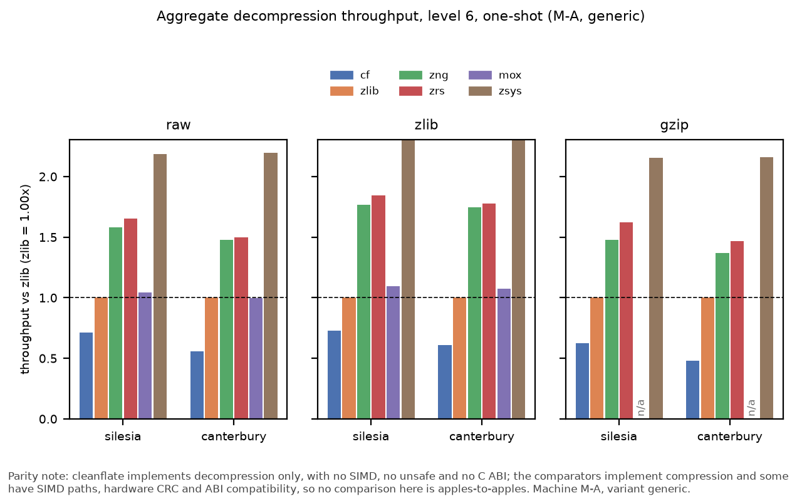

*Aggregate throughput on M-A (generic).* Parity note: cleanflate implements decompression only, with no SIMD, no unsafe and no C ABI; the comparators implement compression and some have SIMD paths, hardware CRC and ABI compatibility, so no comparison here is apples-to-apples.

**M-A, native build, one-shot, level 6**

| Subject | Corpus | Framing | Aggregate MiB/s | Ratio vs zlib | Complete |
|---|---|---|---|---|---|
| cf@native | canterbury | gzip | 404.8 | 0.48 | true |
| cf@native | canterbury | raw | 487.5 | 0.57 | true |
| cf@native | canterbury | zlib | 433.2 | 0.61 | true |
| cf@native | silesia | gzip | 360.7 | 0.61 | true |
| cf@native | silesia | raw | 418.6 | 0.69 | true |
| cf@native | silesia | zlib | 376.2 | 0.71 | true |
| mox@native | canterbury | raw | 852.4 | 1.00 | true |
| mox@native | canterbury | zlib | 757.3 | 1.07 | true |
| mox@native | silesia | raw | 622.8 | 1.03 | true |
| mox@native | silesia | zlib | 574.8 | 1.09 | true |
| zlib | canterbury | gzip | 844.0 | 1 | true |
| zlib | canterbury | raw | 853.4 | 1 | true |
| zlib | canterbury | zlib | 709.8 | 1 | true |
| zlib | silesia | gzip | 592.3 | 1 | true |
| zlib | silesia | raw | 602.8 | 1 | true |
| zlib | silesia | zlib | 526.4 | 1 | true |
| zrs@native | canterbury | gzip | 1245.8 | 1.48 | true |
| zrs@native | canterbury | raw | 1296.6 | 1.52 | true |
| zrs@native | canterbury | zlib | 1257.5 | 1.77 | true |
| zrs@native | silesia | gzip | 962.4 | 1.62 | true |
| zrs@native | silesia | raw | 989.6 | 1.64 | true |
| zrs@native | silesia | zlib | 966.2 | 1.84 | true |

*Parity note: cleanflate implements decompression only, with no SIMD, no unsafe and no C ABI; the comparators implement compression and some have SIMD paths, hardware CRC and ABI compatibility, so no comparison here is apples-to-apples.*

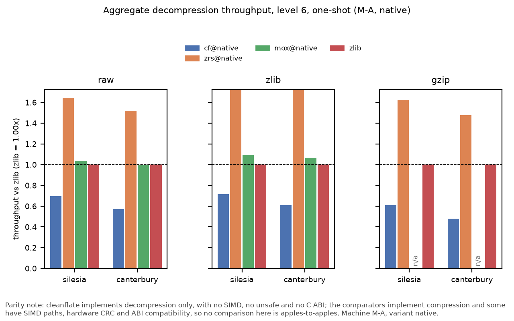

*Aggregate throughput on M-A (native).* Parity note: cleanflate implements decompression only, with no SIMD, no unsafe and no C ABI; the comparators implement compression and some have SIMD paths, hardware CRC and ABI compatibility, so no comparison here is apples-to-apples.

**M-B, generic build, one-shot, level 6**

| Subject | Corpus | Framing | Aggregate MiB/s | Ratio vs zlib | Complete |
|---|---|---|---|---|---|
| cf | canterbury | gzip | 252.6 | 0.64 | true |
| cf | canterbury | raw | 295.5 | 0.68 | true |
| cf | canterbury | zlib | 270.0 | 0.71 | true |
| cf | silesia | gzip | 248.9 | 0.73 | true |
| cf | silesia | raw | 282.8 | 0.76 | true |
| cf | silesia | zlib | 261.9 | 0.79 | true |
| mox | canterbury | raw | 506.0 | 1.17 | true |
| mox | canterbury | zlib | 480.5 | 1.27 | true |
| mox | silesia | raw | 452.1 | 1.21 | true |
| mox | silesia | zlib | 429.4 | 1.30 | true |
| zlib | canterbury | gzip | 392.3 | 1 | true |
| zlib | canterbury | raw | 432.4 | 1 | true |
| zlib | canterbury | zlib | 379.6 | 1 | true |
| zlib | silesia | gzip | 341.8 | 1 | true |
| zlib | silesia | raw | 372.7 | 1 | true |
| zlib | silesia | zlib | 330.3 | 1 | true |
| zng | canterbury | gzip | 774.1 | 1.97 | true |
| zng | canterbury | raw | 797.3 | 1.84 | true |
| zng | canterbury | zlib | 774.9 | 2.04 | true |
| zng | silesia | gzip | 634.3 | 1.86 | true |
| zng | silesia | raw | 674.9 | 1.81 | true |
| zng | silesia | zlib | 639.5 | 1.94 | true |
| zrs | canterbury | gzip | 775.5 | 1.98 | true |
| zrs | canterbury | raw | 843.5 | 1.95 | true |
| zrs | canterbury | zlib | 808.2 | 2.13 | true |
| zrs | silesia | gzip | 633.0 | 1.85 | true |
| zrs | silesia | raw | 686.5 | 1.84 | true |
| zrs | silesia | zlib | 658.1 | 1.99 | true |
| zsys | canterbury | gzip | 373.1 | 0.95 | true |
| zsys | canterbury | raw | 405.9 | 0.94 | true |
| zsys | canterbury | zlib | 364.8 | 0.96 | true |
| zsys | silesia | gzip | 335.0 | 0.98 | true |
| zsys | silesia | raw | 361.6 | 0.97 | true |
| zsys | silesia | zlib | 324.3 | 0.98 | true |

*Parity note: cleanflate implements decompression only, with no SIMD, no unsafe and no C ABI; the comparators implement compression and some have SIMD paths, hardware CRC and ABI compatibility, so no comparison here is apples-to-apples.*

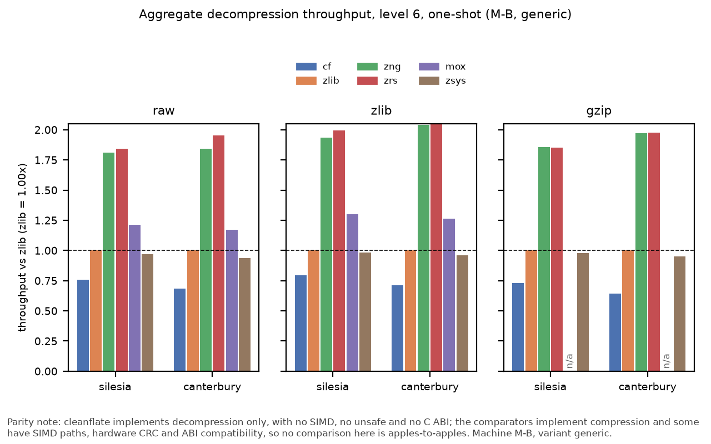

*Aggregate throughput on M-B (generic).* Parity note: cleanflate implements decompression only, with no SIMD, no unsafe and no C ABI; the comparators implement compression and some have SIMD paths, hardware CRC and ABI compatibility, so no comparison here is apples-to-apples.

**M-B, native build, one-shot, level 6**

| Subject | Corpus | Framing | Aggregate MiB/s | Ratio vs zlib | Complete |
|---|---|---|---|---|---|
| cf@native | canterbury | gzip | 251.5 | 0.64 | true |
| cf@native | canterbury | raw | 300.8 | 0.70 | true |
| cf@native | canterbury | zlib | 268.2 | 0.73 | true |
| cf@native | silesia | gzip | 253.3 | 0.74 | true |
| cf@native | silesia | raw | 286.6 | 0.77 | true |
| cf@native | silesia | zlib | 258.4 | 0.78 | true |
| mox@native | canterbury | raw | 477.8 | 1.12 | true |
| mox@native | canterbury | zlib | 439.6 | 1.19 | true |
| mox@native | silesia | raw | 431.9 | 1.16 | true |
| mox@native | silesia | zlib | 412.7 | 1.24 | true |
| zlib | canterbury | gzip | 393.9 | 1 | true |
| zlib | canterbury | raw | 427.3 | 1 | true |
| zlib | canterbury | zlib | 368.3 | 1 | true |
| zlib | silesia | gzip | 340.5 | 1 | true |
| zlib | silesia | raw | 372.2 | 1 | true |
| zlib | silesia | zlib | 332.0 | 1 | true |
| zrs@native | canterbury | gzip | 790.1 | 2.01 | true |
| zrs@native | canterbury | raw | 811.4 | 1.90 | true |
| zrs@native | canterbury | zlib | 781.4 | 2.12 | true |
| zrs@native | silesia | gzip | 650.1 | 1.91 | true |
| zrs@native | silesia | raw | 691.0 | 1.86 | true |
| zrs@native | silesia | zlib | 652.8 | 1.97 | true |

*Parity note: cleanflate implements decompression only, with no SIMD, no unsafe and no C ABI; the comparators implement compression and some have SIMD paths, hardware CRC and ABI compatibility, so no comparison here is apples-to-apples.*

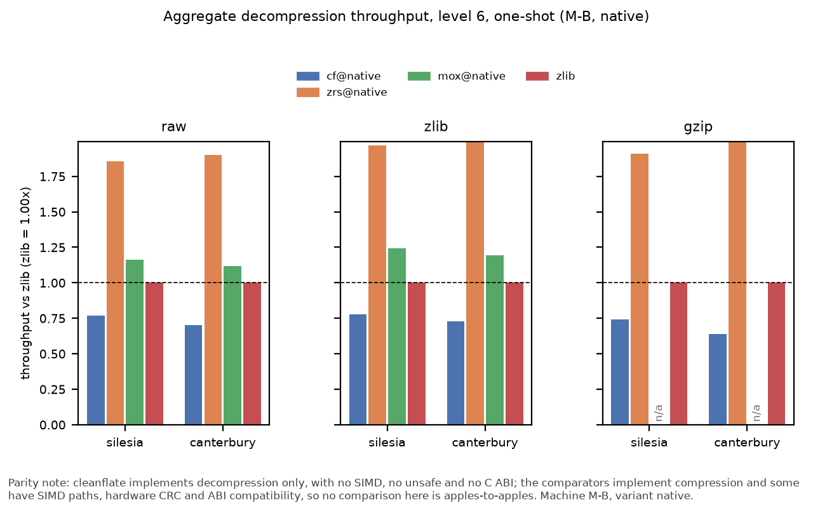

*Aggregate throughput on M-B (native).* Parity note: cleanflate implements decompression only, with no SIMD, no unsafe and no C ABI; the comparators implement compression and some have SIMD paths, hardware CRC and ABI compatibility, so no comparison here is apples-to-apples.

*Source: `results/perf_aggregates.csv` <- `data/raw/perf/M-A/20261003T004833Z.json`, `data/raw/perf/M-A/20261003T022240Z.json`, `data/raw/perf/M-A/20261003T032646Z.json`, `data/raw/perf/M-A/20261003T043023Z.json`, `data/raw/perf/M-B/20261002T072144Z.json`, `data/raw/perf/M-B/20261002T091719Z.json`, `data/raw/perf/M-B/20261002T103403Z.json`, `data/raw/perf/M-B/20261002T115027Z.json` via `cfbench.perf_report`.*

### Framing decomposition

| Machine | Subject | Corpus | Level | Mode | zlib framing overhead | gzip framing overhead |
|---|---|---|---|---|---|---|
| M-A | cf | canterbury | 1 | oneshot | 10.5% | 16.5% |
| M-A | cf | canterbury | 6 | oneshot | 12.7% | 19.5% |
| M-A | cf | canterbury | 9 | oneshot | 13.2% | 20.9% |
| M-A | cf | silesia | 1 | oneshot | 9.8% | 13.3% |
| M-A | cf | silesia | 6 | oneshot | 11.3% | 15.6% |
| M-A | cf | silesia | 9 | oneshot | 11.8% | 16.1% |
| M-A | mox | canterbury | 1 | oneshot | 8.4% | n/a |
| M-A | mox | canterbury | 6 | oneshot | 10.7% | n/a |
| M-A | mox | canterbury | 9 | oneshot | 11.3% | n/a |
| M-A | mox | silesia | 1 | oneshot | 7.6% | n/a |
| M-A | mox | silesia | 6 | oneshot | 8.7% | n/a |
| M-A | mox | silesia | 9 | oneshot | 8.5% | n/a |
| M-A | zlib | canterbury | 1 | oneshot | 20.3% | 3.2% |
| M-A | zlib | canterbury | 6 | oneshot | 22.4% | 4.6% |
| M-A | zlib | canterbury | 9 | oneshot | 22.5% | 2.4% |
| M-A | zlib | silesia | 1 | oneshot | 13.7% | 1.9% |
| M-A | zlib | silesia | 6 | oneshot | 14.7% | 1.8% |
| M-A | zlib | silesia | 9 | oneshot | 15.0% | 2.1% |
| M-A | zlib-nohw | canterbury | 1 | oneshot | 19.7% | 8.5% |
| M-A | zlib-nohw | canterbury | 6 | oneshot | 19.4% | 9.1% |
| M-A | zlib-nohw | canterbury | 9 | oneshot | 19.2% | 8.0% |
| M-A | zlib-nohw | silesia | 1 | oneshot | 13.9% | 6.4% |
| M-A | zlib-nohw | silesia | 6 | oneshot | 14.9% | 6.7% |
| M-A | zlib-nohw | silesia | 9 | oneshot | 15.2% | 6.9% |
| M-A | zng | canterbury | 1 | oneshot | 2.6% | 8.8% |
| M-A | zng | canterbury | 6 | oneshot | 3.6% | 10.8% |
| M-A | zng | canterbury | 9 | oneshot | 3.8% | 11.3% |
| M-A | zng | silesia | 1 | oneshot | 2.2% | 7.6% |
| M-A | zng | silesia | 6 | oneshot | 2.2% | 8.0% |
| M-A | zng | silesia | 9 | oneshot | 2.3% | 8.5% |
| M-A | zrs | canterbury | 1 | oneshot | 2.3% | 3.3% |
| M-A | zrs | canterbury | 6 | oneshot | 2.5% | 3.7% |
| M-A | zrs | canterbury | 9 | oneshot | 2.8% | 3.6% |
| M-A | zrs | silesia | 1 | oneshot | 2.3% | 2.8% |
| M-A | zrs | silesia | 6 | oneshot | 2.4% | 2.8% |
| M-A | zrs | silesia | 9 | oneshot | 2.6% | 2.9% |
| M-A | zsys | canterbury | 1 | oneshot | 7.2% | 4.0% |
| M-A | zsys | canterbury | 6 | oneshot | 8.6% | 4.5% |
| M-A | zsys | canterbury | 9 | oneshot | 8.8% | 4.3% |
| M-A | zsys | silesia | 1 | oneshot | 5.5% | 2.7% |
| M-A | zsys | silesia | 6 | oneshot | 6.0% | 3.0% |
| M-A | zsys | silesia | 9 | oneshot | 5.9% | 3.2% |
| M-B | cf | canterbury | 1 | oneshot | 7.5% | 14.9% |
| M-B | cf | canterbury | 6 | oneshot | 8.6% | 17.5% |
| M-B | cf | canterbury | 9 | oneshot | 12.4% | 15.5% |
| M-B | cf | silesia | 1 | oneshot | 5.3% | 9.1% |
| M-B | cf | silesia | 6 | oneshot | 8.7% | 13.8% |
| M-B | cf | silesia | 9 | oneshot | 8.4% | 13.8% |
| M-B | mox | canterbury | 1 | oneshot | 6.9% | n/a |
| M-B | mox | canterbury | 6 | oneshot | 8.1% | n/a |
| M-B | mox | canterbury | 9 | oneshot | 3.6% | n/a |
| M-B | mox | silesia | 1 | oneshot | 5.1% | n/a |
| M-B | mox | silesia | 6 | oneshot | 6.0% | n/a |
| M-B | mox | silesia | 9 | oneshot | 5.2% | n/a |
| M-B | zlib | canterbury | 1 | oneshot | 13.5% | 6.0% |
| M-B | zlib | canterbury | 6 | oneshot | 15.0% | 9.5% |
| M-B | zlib | canterbury | 9 | oneshot | 11.8% | 7.8% |
| M-B | zlib | silesia | 1 | oneshot | 11.7% | 9.4% |
| M-B | zlib | silesia | 6 | oneshot | 12.0% | 8.9% |
| M-B | zlib | silesia | 9 | oneshot | 13.0% | 9.5% |
| M-B | zlib-nohw | canterbury | 1 | oneshot | 13.6% | 9.9% |
| M-B | zlib-nohw | canterbury | 6 | oneshot | 12.9% | 9.4% |
| M-B | zlib-nohw | canterbury | 9 | oneshot | 13.2% | 8.7% |
| M-B | zlib-nohw | silesia | 1 | oneshot | 11.8% | 8.8% |
| M-B | zlib-nohw | silesia | 6 | oneshot | 12.7% | 8.6% |
| M-B | zlib-nohw | silesia | 9 | oneshot | 12.3% | 9.1% |
| M-B | zng | canterbury | 1 | oneshot | 5.7% | 5.0% |
| M-B | zng | canterbury | 6 | oneshot | 6.2% | 4.2% |
| M-B | zng | canterbury | 9 | oneshot | 5.3% | 5.7% |
| M-B | zng | silesia | 1 | oneshot | 4.9% | 5.1% |
| M-B | zng | silesia | 6 | oneshot | 4.6% | 5.5% |
| M-B | zng | silesia | 9 | oneshot | 5.7% | 5.5% |
| M-B | zrs | canterbury | 1 | oneshot | 3.0% | 3.6% |
| M-B | zrs | canterbury | 6 | oneshot | 9.3% | 6.5% |
| M-B | zrs | canterbury | 9 | oneshot | 2.4% | 8.9% |
| M-B | zrs | silesia | 1 | oneshot | 4.1% | 6.4% |
| M-B | zrs | silesia | 6 | oneshot | 5.5% | 6.1% |
| M-B | zrs | silesia | 9 | oneshot | 5.8% | 7.3% |
| M-B | zsys | canterbury | 1 | oneshot | 19.2% | 12.2% |
| M-B | zsys | canterbury | 6 | oneshot | 9.2% | 6.9% |
| M-B | zsys | canterbury | 9 | oneshot | 14.9% | 9.8% |
| M-B | zsys | silesia | 1 | oneshot | 12.0% | 8.3% |
| M-B | zsys | silesia | 6 | oneshot | 11.3% | 8.1% |
| M-B | zsys | silesia | 9 | oneshot | 12.2% | 9.3% |

*Parity note: cleanflate implements decompression only, with no SIMD, no unsafe and no C ABI; the comparators implement compression and some have SIMD paths, hardware CRC and ABI compatibility, so no comparison here is apples-to-apples.*

*Source: `results/framing_overhead.csv` <- `data/raw/framing/M-A/20261003T050844Z.json`, `data/raw/framing/M-A/20261003T054500Z.json`, `data/raw/framing/M-B/20261002T123656Z.json`, `data/raw/framing/M-B/20261002T132114Z.json` via `cfbench.framing`.*

| Machine | cf gzip overhead | zlib-nohw gzip overhead | zlib gzip overhead | Relative difference | Verdict |
|---|---|---|---|---|---|
| ALL | n/a | n/a | n/a | n/a | refuted |
| M-A | 16.5% | 8.5% | 3.2% | 92.8% | outside band |
| M-A | 19.5% | 9.1% | 4.6% | 113.9% | outside band |
| M-A | 20.9% | 8.0% | 2.4% | 161.6% | outside band |
| M-A | 13.3% | 6.4% | 1.9% | 108.2% | outside band |
| M-A | 15.6% | 6.7% | 1.8% | 135.0% | outside band |
| M-A | 16.1% | 6.9% | 2.1% | 133.4% | outside band |
| M-B | 14.9% | 9.9% | 6.0% | 50.4% | outside band (control identical to default on x86_64) |
| M-B | 17.5% | 9.4% | 9.5% | 86.0% | outside band (control identical to default on x86_64) |
| M-B | 15.5% | 8.7% | 7.8% | 79.2% | outside band (control identical to default on x86_64) |
| M-B | 9.1% | 8.8% | 9.4% | 3.6% | within band (control identical to default on x86_64) |
| M-B | 13.8% | 8.6% | 8.9% | 60.5% | outside band (control identical to default on x86_64) |
| M-B | 13.8% | 9.1% | 9.5% | 52.4% | outside band (control identical to default on x86_64) |

*Parity note: cleanflate implements decompression only, with no SIMD, no unsafe and no C ABI; the comparators implement compression and some have SIMD paths, hardware CRC and ABI compatibility, so no comparison here is apples-to-apples.*

*Source: `results/framing_hypothesis.csv` <- `data/raw/framing/M-A/20261003T050844Z.json`, `data/raw/framing/M-A/20261003T054500Z.json`, `data/raw/framing/M-B/20261002T123656Z.json`, `data/raw/framing/M-B/20261002T132114Z.json` via `cfbench.framing`.*

Overhead is `(1/T_framed - 1/T_raw) / (1/T_raw)`. The headline test asks whether cleanflate's gzip penalty roughly matches stock zlib's with hardware CRC disabled; the verdict is reported either way, and on x86_64 the control build is identical to the default build.

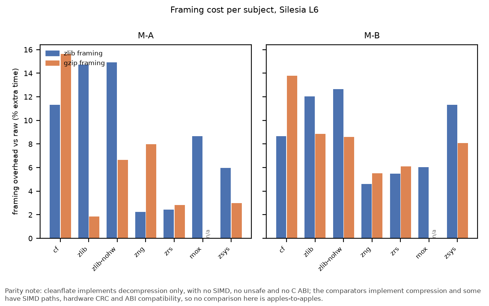

*Framing cost per subject.* Parity note: cleanflate implements decompression only, with no SIMD, no unsafe and no C ABI; the comparators implement compression and some have SIMD paths, hardware CRC and ABI compatibility, so no comparison here is apples-to-apples.

## Iteration

*Did Foundry's later rounds improve it?*

### Trajectory

| Machine | Round | Tag | Corpus | Framing | Aggregate MiB/s | Ratio vs zlib |
|---|---|---|---|---|---|---|
| M-A | 1 | v0.1.0-cleanroom | canterbury | gzip | 138.0 | 0.17 |
| M-A | 1 | v0.1.0-cleanroom | canterbury | raw | 182.5 | 0.21 |
| M-A | 1 | v0.1.0-cleanroom | canterbury | zlib | 170.7 | 0.23 |
| M-A | 1 | v0.1.0-cleanroom | silesia | gzip | 123.4 | 0.21 |
| M-A | 1 | v0.1.0-cleanroom | silesia | raw | 158.4 | 0.26 |
| M-A | 1 | v0.1.0-cleanroom | silesia | zlib | 140.4 | 0.26 |
| M-A | 2 | v0.2.0-cleanroom | canterbury | gzip | 406.5 | 0.50 |
| M-A | 2 | v0.2.0-cleanroom | canterbury | raw | 456.7 | 0.52 |
| M-A | 2 | v0.2.0-cleanroom | canterbury | zlib | 424.2 | 0.58 |
| M-A | 2 | v0.2.0-cleanroom | silesia | gzip | 361.3 | 0.60 |
| M-A | 2 | v0.2.0-cleanroom | silesia | raw | 414.1 | 0.69 |
| M-A | 2 | v0.2.0-cleanroom | silesia | zlib | 373.6 | 0.70 |
| M-A | 3 | v0.3.0-cleanroom | canterbury | gzip | 403.4 | 0.49 |
| M-A | 3 | v0.3.0-cleanroom | canterbury | raw | 505.8 | 0.58 |
| M-A | 3 | v0.3.0-cleanroom | canterbury | zlib | 443.5 | 0.61 |
| M-A | 3 | v0.3.0-cleanroom | silesia | gzip | 373.4 | 0.62 |
| M-A | 3 | v0.3.0-cleanroom | silesia | raw | 433.0 | 0.72 |
| M-A | 3 | v0.3.0-cleanroom | silesia | zlib | 391.7 | 0.73 |
| M-B | 1 | v0.1.0-cleanroom | canterbury | gzip | 56.3 | 0.15 |
| M-B | 1 | v0.1.0-cleanroom | canterbury | raw | 62.1 | 0.14 |
| M-B | 1 | v0.1.0-cleanroom | canterbury | zlib | 64.3 | 0.17 |
| M-B | 1 | v0.1.0-cleanroom | silesia | gzip | 53.1 | 0.16 |
| M-B | 1 | v0.1.0-cleanroom | silesia | raw | 59.7 | 0.16 |
| M-B | 1 | v0.1.0-cleanroom | silesia | zlib | 58.8 | 0.18 |
| M-B | 2 | v0.2.0-cleanroom | canterbury | gzip | 224.1 | 0.60 |
| M-B | 2 | v0.2.0-cleanroom | canterbury | raw | 259.7 | 0.60 |
| M-B | 2 | v0.2.0-cleanroom | canterbury | zlib | 243.2 | 0.65 |
| M-B | 2 | v0.2.0-cleanroom | silesia | gzip | 213.1 | 0.63 |
| M-B | 2 | v0.2.0-cleanroom | silesia | raw | 242.6 | 0.65 |
| M-B | 2 | v0.2.0-cleanroom | silesia | zlib | 217.5 | 0.67 |
| M-B | 3 | v0.3.0-cleanroom | canterbury | gzip | 240.7 | 0.65 |
| M-B | 3 | v0.3.0-cleanroom | canterbury | raw | 275.2 | 0.64 |
| M-B | 3 | v0.3.0-cleanroom | canterbury | zlib | 259.7 | 0.70 |
| M-B | 3 | v0.3.0-cleanroom | silesia | gzip | 242.6 | 0.72 |
| M-B | 3 | v0.3.0-cleanroom | silesia | raw | 277.0 | 0.75 |
| M-B | 3 | v0.3.0-cleanroom | silesia | zlib | 254.9 | 0.79 |

*Parity note: cleanflate implements decompression only, with no SIMD, no unsafe and no C ABI; the comparators implement compression and some have SIMD paths, hardware CRC and ABI compatibility, so no comparison here is apples-to-apples.*

*Source: `results/trajectory.csv` <- `data/raw/trajectory/M-A/20261003T164704Z.json`, `data/raw/trajectory/M-B/20261002T145905Z.json` via `cfbench.trajectory`.*

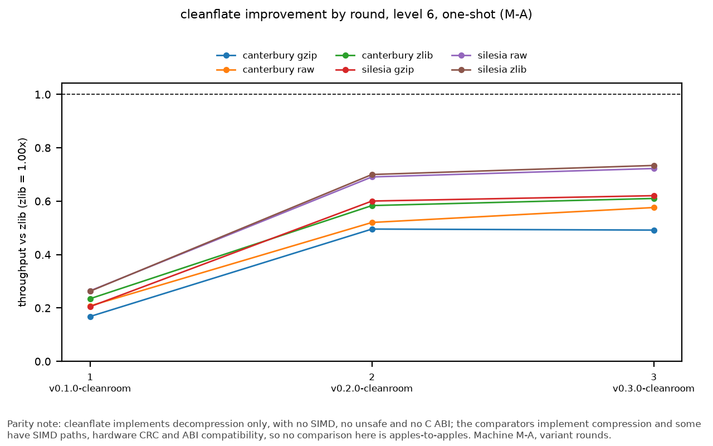

*Throughput ratio vs zlib by round on M-A.* Parity note: cleanflate implements decompression only, with no SIMD, no unsafe and no C ABI; the comparators implement compression and some have SIMD paths, hardware CRC and ABI compatibility, so no comparison here is apples-to-apples.

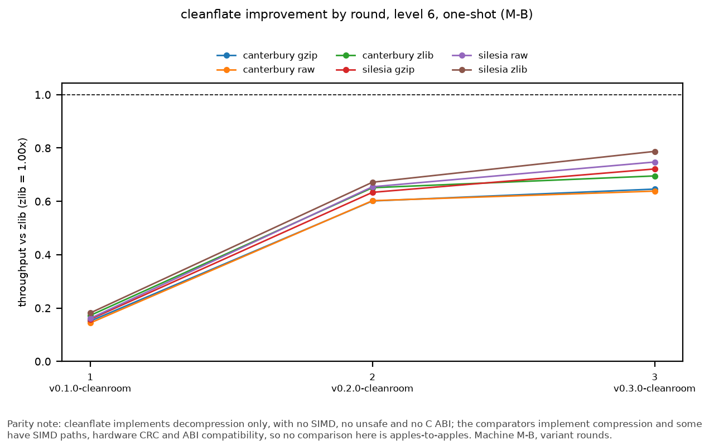

*Throughput ratio vs zlib by round on M-B.* Parity note: cleanflate implements decompression only, with no SIMD, no unsafe and no C ABI; the comparators implement compression and some have SIMD paths, hardware CRC and ABI compatibility, so no comparison here is apples-to-apples.

### Sleep-interruption check

The trajectory stage rebuilds every round, including the round-3 tag that the perf stage measures, so its round-3 ratio should repeat the perf ratio. A sleep or other interruption that distorted the trajectory run would show up as a difference beyond the run-to-run agreement tolerance. The session span is the time from the trajectory session's start to its raw file.

| Machine | Corpus | Framing | Trajectory round 3 | Perf session | Difference | Tolerance | Verdict | Session span (h) |
|---|---|---|---|---|---|---|---|---|
| M-A | Canterbury | gzip | 0.492x | 0.481x | +2.3% | 5% | within tolerance | 11.0 |
| M-A | Canterbury | raw | 0.576x | 0.559x | +3.1% | 5% | within tolerance | 11.0 |
| M-A | Canterbury | zlib | 0.610x | 0.610x | +0.1% | 5% | within tolerance | 11.0 |
| M-A | Silesia | gzip | 0.621x | 0.625x | -0.7% | 5% | within tolerance | 11.0 |
| M-A | Silesia | raw | 0.722x | 0.712x | +1.4% | 5% | within tolerance | 11.0 |
| M-A | Silesia | zlib | 0.734x | 0.731x | +0.4% | 5% | within tolerance | 11.0 |
| M-B | Canterbury | gzip | 0.646x | 0.644x | +0.3% | 5% | within tolerance | 1.6 |
| M-B | Canterbury | raw | 0.638x | 0.683x | -6.6% | 5% | outside tolerance | 1.6 |
| M-B | Canterbury | zlib | 0.695x | 0.711x | -2.2% | 5% | within tolerance | 1.6 |
| M-B | Silesia | gzip | 0.721x | 0.728x | -0.9% | 5% | within tolerance | 1.6 |
| M-B | Silesia | raw | 0.748x | 0.759x | -1.5% | 5% | within tolerance | 1.6 |
| M-B | Silesia | zlib | 0.787x | 0.793x | -0.7% | 5% | within tolerance | 1.6 |

*Parity note: cleanflate implements decompression only, with no SIMD, no unsafe and no C ABI; the comparators implement compression and some have SIMD paths, hardware CRC and ABI compatibility, so no comparison here is apples-to-apples.*

- M-A: every row is within tolerance.

- M-B: at least one row is outside tolerance.

Operator note (`config/session_notes.toml`, `m-a-sleep`): M-A slept from about 23:00 to 09:00 local time (UTC-7) during the trajectory stage. Corroboration: the trajectory session id starts at 05:48Z and its raw file is stamped 16:47Z.

Source: `results/crossmachine_sleep_check.csv` <- `data/raw/perf/M-A/20261003T004833Z.json`, `data/raw/perf/M-A/20261003T022240Z.json`, `data/raw/perf/M-A/20261003T032646Z.json`, `data/raw/perf/M-A/20261003T043023Z.json`, `data/raw/perf/M-B/20261002T072144Z.json`, `data/raw/perf/M-B/20261002T091719Z.json`, `data/raw/perf/M-B/20261002T103403Z.json`, `data/raw/perf/M-B/20261002T115027Z.json`, `data/raw/trajectory/M-A/20261003T164704Z.json`, `data/raw/trajectory/M-B/20261002T145905Z.json` via `cfbench.crossmachine`

## Findings for the cleanflate repo

See [findings.md](findings.md) for bugs found in cleanflate. They are recorded there and never patched in this repo. The file currently lists 4 entries.

## Threats to validity

### Single case study (n=1 target)

Every claim about Foundry rests on one target library (cleanflate, replacing zlib's inflate) built once in three rounds by one operator. It is an existence proof that the pipeline can do this, not an estimate of how often it succeeds, how it fares on other libraries, or how its cost scales.

### Run-to-run stability

Flagged aggregates per machine and variant: M-A generic: 2 of 306 aggregates flagged (flagged); M-A native: 0 of 198 aggregates flagged (pass); M-B generic: 24 of 306 aggregates flagged (flagged); M-B native: 14 of 198 aggregates flagged (flagged). Flagged results stay in every table. The viability table marks each ratio that rests on one. The viability claim (Silesia raw and zlib at levels 6 and 9) rests on none.

### M-A sleep during trajectory

Operator note (`config/session_notes.toml`, `m-a-sleep`): M-A slept from about 23:00 to 09:00 local time (UTC-7) during the trajectory stage. Corroboration: the trajectory session id starts at 05:48Z and its raw file is stamped 16:47Z. Trajectory session spans: M-A 11.0 h, M-B 1.6 h. The sleep-interruption check compares the round-3 trajectory ratios with the perf ratios.

### M-A High Power Mode

Operator note (`config/session_notes.toml`, `m-a-high-power`): The M-A session (2026-10-02 to 2026-10-03) ran in macOS High Power Mode on AC power. Corroboration: the env captures record `powermode 2` and `sleep prevented by caffeinate` in pmset. Absolute M-A throughput is therefore a High Power Mode figure, and the default power mode may be slower; ratios against zlib were measured in the same mode and session.

### M-B background load

Operator note (`config/session_notes.toml`, `m-b-background-load`): Docker and a k3s cluster were running on M-B during the perf sessions. Corroboration: the M-B perf raw files record start load averages above perf.max_start_load as precondition warnings. Background services add noise. Cells ran in randomized order, which spreads that interference across subjects instead of concentrating it on one, but does not remove it; it is one plausible source of M-B's flagged aggregates (above).

### Fuzz budget and throttling

Fuzzing finds divergences but cannot show their absence. Executions per pair, in run order: diff_cf_zlib on M-B 583,504 executions at 46/s in 4 CPU hours; diff_cf_zrs on M-B 313,085 executions at 11/s in 4 CPU hours; diff_cf_mox on M-B 340,702 executions at 26/s in 4 CPU hours (configured budget 4 CPU hours per pair). Operator note (`config/session_notes.toml`, `fuzz-throttling`): The last fuzz pair to run (diff_cf_mox, after diff_cf_zlib and diff_cf_zrs) ran during the day under CPU throttling, which reduced its execution count. Corroboration: the fuzz raw files are stamped 16:03Z, 17:05Z and 18:06Z in that order. Fewer executions on a pair means that comparison was explored less deeply.

### Host-dependent gzip fixtures

cleanflate's conformance corpus records host-dependent hashes for its gzip fixtures (the gzip header OS byte). The build's review stage missed this because every review ran on Linux. It is recorded as a finding in `results/findings.md`. Operator note (`config/session_notes.toml`, `m-a-fixtures`): M-A conformance ran on testdata/generated copied from M-B's checkout of the same cleanflate SHA, because fixtures generated on macOS differ from the Linux-generated MANIFEST.json in the gzip header OS byte (results/findings.md). Corroboration: oracle generate --locked reported 0 generated and 2674 skipped on M-A, and pristine_check passed.

### Training-data contamination

Model training data cannot be controlled, so resemblance is measured against negative and positive controls instead of assumed away. T1 claim NOT allowed: a cf pair is not at or near the negative control for `ident_jaccard` (cf-mox between), `ident_match_rate_left` (cf-zrs between). Similarity metrics are proxies: a low score does not prove independence and a high one does not prove copying.

### Provenance coverage

The isolation evidence comes from cleanflate's tool log, which records top-level tool calls. Subprocesses of make targets and interpreter escapes are not individually logged (cleanflate's provenance/README.md lists the gaps), so the forbidden-read audit bounds what the pipeline read rather than proving it.

### Feature-scope mismatch

cleanflate only decompresses, in safe Rust, with no SIMD and no C ABI. Parity note: cleanflate implements decompression only, with no SIMD, no unsafe and no C ABI; the comparators implement compression and some have SIMD paths, hardware CRC and ABI compatibility, so no comparison here is apples-to-apples.

### Hardware-CRC asymmetry

Hardware CRC is not equal across subjects or machines (M-A: zlib hardware CRC compiled in; M-B: zlib hardware CRC not compiled in). The gzip-gap comparison uses that asymmetry as evidence; it is descriptive, not a controlled test.

### Effort accounting

Wall-clock time is attributed from commit gaps, model cost is estimated from token counts and list prices, and human time is only partly recorded (EFFORT_GAPS.md).

## Appendix

Supporting detail behind the sections above: the setup, per-file tables, tiny-input timing, content correlations and binary size.

### Environments

| Machine | CPU | Cores (physical / logical) | OS | Kernel | Governor |
|---|---|---|---|---|---|
| M-A | Apple M4 Max | 16 / 16 | macOS 26.6.2 | 25.6.0 | n/a |
| M-B | AMD Ryzen 5 3400G with Radeon Vega Graphics | 4 / 8 | Pop!_OS 24.04 LTS | 7.1.5-76070105-generic | schedutil |

*Parity note: cleanflate implements decompression only, with no SIMD, no unsafe and no C ABI; the comparators implement compression and some have SIMD paths, hardware CRC and ABI compatibility, so no comparison here is apples-to-apples.*

*Source: raw env captures `data/raw/env/M-A/20261002T231333Z.json`, `data/raw/env/M-B/20261002T052545Z.json`.*

### Subjects and pins

**M-A**

| Build | Compiler | Target CPU | Hardware CRC compiled in | Runtime dispatch |
|---|---|---|---|---|
| cf | rustc 1.89.0 (29483883e 2025-08-04) | generic | no | no |
| mox | rustc 1.89.0 (29483883e 2025-08-04) | generic | no | no |
| zlib | Apple clang version 21.0.0 (clang-2100.1.1.101) | generic | yes | no |
| zlib-nohw | Apple clang version 21.0.0 (clang-2100.1.1.101) | generic | no | no |
| zng | Apple clang version 21.0.0 (clang-2100.1.1.101) | generic | yes | yes |
| zrs | rustc 1.89.0 (29483883e 2025-08-04) | generic | yes | yes |
| zsys | None | generic | no | no |

*Parity note: cleanflate implements decompression only, with no SIMD, no unsafe and no C ABI; the comparators implement compression and some have SIMD paths, hardware CRC and ABI compatibility, so no comparison here is apples-to-apples.*

**M-B**

| Build | Compiler | Target CPU | Hardware CRC compiled in | Runtime dispatch |
|---|---|---|---|---|
| cf | rustc 1.89.0 (29483883e 2025-08-04) | generic | no | no |
| cf@native | rustc 1.89.0 (29483883e 2025-08-04) | native | no | no |
| mox | rustc 1.89.0 (29483883e 2025-08-04) | generic | no | no |
| mox@native | rustc 1.89.0 (29483883e 2025-08-04) | native | no | no |
| zlib | cc (Ubuntu 13.3.0-6ubuntu2~24.04.1) 13.3.0 | generic | no | no |
| zlib-nohw | cc (Ubuntu 13.3.0-6ubuntu2~24.04.1) 13.3.0 | generic | no | no |
| zng | cc (Ubuntu 13.3.0-6ubuntu2~24.04.1) 13.3.0 | generic | yes | yes |
| zrs | rustc 1.89.0 (29483883e 2025-08-04) | generic | yes | yes |
| zrs@native | rustc 1.89.0 (29483883e 2025-08-04) | native | yes | yes |
| zsys | None | generic | no | no |

*Parity note: cleanflate implements decompression only, with no SIMD, no unsafe and no C ABI; the comparators implement compression and some have SIMD paths, hardware CRC and ABI compatibility, so no comparison here is apples-to-apples.*

Hardware-CRC determinations come from disassembly and symbol inspection of each built binary (`subjects.lock.json`); on x86_64 the `zlib-nohw` control is identical to the default build.

*Source: `subjects.lock.json`.*

### Per-file throughput

M-A, silesia, raw framing, level 1: median MiB/s per file

| Workload | cf | zlib | zng | zrs | mox | zsys |
|---|---|---|---|---|---|---|
| silesia/dickens | 235.6 | 464.9 | 773.9 | 793.4 | 417.7 | 1148.6 |
| silesia/mozilla | 348.1 | 488.3 | 705.0 | 744.6 | 504.9 | 941.0 |
| silesia/mr | 363.1 | 539.6 | 805.7 | 829.2 | 603.2 | 1138.5 |
| silesia/nci | 894.3 | 1279.1 | 2169.8 | 2247.5 | 1235.3 | 3198.8 |
| silesia/ooffice | 231.4 | 323.7 | 480.0 | 509.3 | 345.5 | 647.5 |
| silesia/osdb | 421.5 | 574.6 | 814.4 | 835.8 | 648.7 | 1143.5 |
| silesia/reymont | 281.9 | 535.9 | 961.6 | 991.1 | 470.1 | 1355.7 |
| silesia/samba | 429.1 | 681.4 | 1110.9 | 1149.1 | 649.6 | 1545.5 |
| silesia/sao | 260.9 | 375.2 | 462.3 | 480.8 | 412.8 | 658.8 |
| silesia/webster | 296.2 | 527.7 | 919.7 | 947.0 | 474.2 | 1364.6 |
| silesia/x-ray | 275.3 | 326.1 | 471.8 | 491.5 | 415.3 | 674.3 |
| silesia/xml | 613.2 | 972.7 | 1715.9 | 1758.7 | 875.0 | 2468.5 |

*Parity note: cleanflate implements decompression only, with no SIMD, no unsafe and no C ABI; the comparators implement compression and some have SIMD paths, hardware CRC and ABI compatibility, so no comparison here is apples-to-apples.*

**M-A, silesia, raw framing, level 6: median MiB/s per file**

| Workload | cf | zlib | zng | zrs | mox | zsys |
|---|---|---|---|---|---|---|
| silesia/dickens | 297.4 | 466.5 | 839.5 | 883.6 | 453.9 | 1212.6 |
| silesia/mozilla | 390.2 | 516.0 | 805.8 | 847.6 | 574.9 | 1067.3 |
| silesia/mr | 370.9 | 526.8 | 842.1 | 878.5 | 616.5 | 1172.4 |
| silesia/nci | 1336.3 | 1648.7 | 2849.2 | 2889.1 | 1650.8 | 3956.0 |
| silesia/ooffice | 269.6 | 358.0 | 559.0 | 585.5 | 396.6 | 757.3 |
| silesia/osdb | 485.8 | 623.7 | 944.0 | 958.3 | 741.7 | 1325.3 |
| silesia/reymont | 393.7 | 624.7 | 1125.5 | 1177.0 | 532.3 | 1571.8 |
| silesia/samba | 517.9 | 756.4 | 1239.0 | 1286.8 | 729.3 | 1692.7 |
| silesia/sao | 285.7 | 404.3 | 494.3 | 513.4 | 448.1 | 701.4 |
| silesia/webster | 370.5 | 570.1 | 961.2 | 1025.7 | 530.4 | 1380.0 |
| silesia/x-ray | 247.3 | 323.3 | 430.7 | 451.8 | 386.1 | 606.0 |
| silesia/xml | 907.2 | 1248.7 | 2228.6 | 2263.8 | 1160.9 | 3162.3 |

*Parity note: cleanflate implements decompression only, with no SIMD, no unsafe and no C ABI; the comparators implement compression and some have SIMD paths, hardware CRC and ABI compatibility, so no comparison here is apples-to-apples.*

M-A, silesia, raw framing, level 9: median MiB/s per file

| Workload | cf | zlib | zng | zrs | mox | zsys |
|---|---|---|---|---|---|---|
| silesia/dickens | 298.9 | 500.6 | 846.0 | 886.8 | 453.6 | 1222.7 |
| silesia/mozilla | 395.4 | 525.3 | 811.1 | 852.5 | 574.1 | 1078.9 |
| silesia/mr | 388.8 | 545.2 | 892.9 | 923.5 | 628.6 | 1239.2 |
| silesia/nci | 1435.0 | 1687.4 | 2926.8 | 2938.4 | 1603.8 | 3970.2 |
| silesia/ooffice | 268.6 | 362.7 | 561.1 | 597.0 | 397.5 | 765.2 |
| silesia/osdb | 499.8 | 635.7 | 957.8 | 984.1 | 752.0 | 1349.7 |
| silesia/reymont | 401.9 | 621.0 | 1116.5 | 1180.4 | 547.5 | 1572.6 |
| silesia/samba | 533.1 | 762.9 | 1239.4 | 1286.8 | 740.0 | 1695.8 |
| silesia/sao | 283.8 | 403.0 | 495.7 | 514.0 | 448.6 | 709.7 |
| silesia/webster | 374.8 | 576.4 | 958.5 | 1019.3 | 535.4 | 1377.3 |
| silesia/x-ray | 247.8 | 322.7 | 431.9 | 455.5 | 388.5 | 606.5 |
| silesia/xml | 958.5 | 1277.9 | 2286.3 | 2338.2 | 1231.9 | 3238.0 |

*Parity note: cleanflate implements decompression only, with no SIMD, no unsafe and no C ABI; the comparators implement compression and some have SIMD paths, hardware CRC and ABI compatibility, so no comparison here is apples-to-apples.*

M-A, silesia, zlib framing, level 1: median MiB/s per file

| Workload | cf | zlib | zng | zrs | mox | zsys |
|---|---|---|---|---|---|---|
| silesia/dickens | 220.1 | 416.6 | 756.6 | 776.4 | 396.0 | 1094.5 |
| silesia/mozilla | 319.4 | 433.8 | 695.8 | 731.5 | 475.3 | 904.7 |
| silesia/mr | 330.8 | 470.1 | 790.1 | 816.6 | 556.4 | 1091.9 |
| silesia/nci | 721.8 | 978.8 | 2078.0 | 2132.6 | 1040.6 | 2775.7 |
| silesia/ooffice | 218.3 | 305.1 | 479.8 | 501.5 | 333.2 | 628.7 |
| silesia/osdb | 378.7 | 503.0 | 795.8 | 813.1 | 591.0 | 1089.9 |
| silesia/reymont | 262.7 | 472.4 | 945.5 | 962.9 | 439.3 | 1278.1 |
| silesia/samba | 386.5 | 586.8 | 1078.7 | 1115.3 | 588.6 | 1449.1 |
| silesia/sao | 241.8 | 341.7 | 455.9 | 475.8 | 390.4 | 645.9 |
| silesia/webster | 274.5 | 466.2 | 901.8 | 932.0 | 445.2 | 1291.7 |
| silesia/x-ray | 255.7 | 299.3 | 466.2 | 483.2 | 387.4 | 648.4 |
| silesia/xml | 528.4 | 790.0 | 1650.3 | 1677.0 | 763.5 | 2192.5 |

*Parity note: cleanflate implements decompression only, with no SIMD, no unsafe and no C ABI; the comparators implement compression and some have SIMD paths, hardware CRC and ABI compatibility, so no comparison here is apples-to-apples.*

**M-A, silesia, zlib framing, level 6: median MiB/s per file**

| Workload | cf | zlib | zng | zrs | mox | zsys |
|---|---|---|---|---|---|---|
| silesia/dickens | 275.9 | 440.3 | 827.9 | 862.8 | 428.4 | 1149.3 |
| silesia/mozilla | 352.0 | 460.2 | 794.2 | 827.4 | 530.9 | 1012.0 |
| silesia/mr | 335.4 | 465.1 | 831.8 | 860.4 | 568.5 | 1108.7 |
| silesia/nci | 979.6 | 1169.3 | 2664.4 | 2717.4 | 1367.7 | 3372.5 |
| silesia/ooffice | 250.0 | 326.4 | 547.5 | 581.3 | 375.8 | 730.1 |
| silesia/osdb | 431.9 | 543.5 | 917.9 | 936.8 | 660.2 | 1246.5 |
| silesia/reymont | 353.9 | 535.9 | 1092.7 | 1137.6 | 502.7 | 1471.2 |
| silesia/samba | 460.9 | 634.5 | 1199.2 | 1251.9 | 663.3 | 1567.1 |
| silesia/sao | 267.5 | 364.2 | 490.1 | 508.5 | 424.2 | 675.8 |
| silesia/webster | 337.3 | 503.1 | 939.3 | 997.7 | 493.0 | 1294.1 |
| silesia/x-ray | 231.5 | 299.4 | 427.1 | 446.1 | 367.5 | 590.7 |
| silesia/xml | 730.8 | 945.2 | 2114.7 | 2139.6 | 983.6 | 2767.8 |

*Parity note: cleanflate implements decompression only, with no SIMD, no unsafe and no C ABI; the comparators implement compression and some have SIMD paths, hardware CRC and ABI compatibility, so no comparison here is apples-to-apples.*

M-A, silesia, zlib framing, level 9: median MiB/s per file

| Workload | cf | zlib | zng | zrs | mox | zsys |
|---|---|---|---|---|---|---|
| silesia/dickens | 277.2 | 440.2 | 818.5 | 865.7 | 428.5 | 1161.2 |
| silesia/mozilla | 355.1 | 463.5 | 795.1 | 835.2 | 529.6 | 1025.3 |
| silesia/mr | 351.9 | 479.1 | 864.2 | 899.8 | 578.4 | 1185.3 |
| silesia/nci | 1038.9 | 1203.5 | 2710.8 | 2735.4 | 1351.5 | 3383.7 |
| silesia/ooffice | 252.8 | 332.9 | 550.6 | 587.4 | 375.2 | 736.1 |
| silesia/osdb | 440.8 | 548.0 | 930.8 | 952.9 | 682.4 | 1276.7 |
| silesia/reymont | 364.2 | 540.0 | 1076.5 | 1148.1 | 502.4 | 1474.4 |
| silesia/samba | 463.9 | 642.5 | 1199.0 | 1255.0 | 667.4 | 1574.4 |
| silesia/sao | 262.8 | 368.9 | 491.5 | 508.4 | 424.0 | 685.7 |
| silesia/webster | 341.6 | 504.7 | 945.8 | 995.9 | 499.9 | 1296.2 |
| silesia/x-ray | 231.9 | 297.6 | 419.0 | 441.8 | 365.4 | 595.1 |
| silesia/xml | 761.5 | 966.9 | 2144.6 | 2204.8 | 1014.7 | 2815.6 |

*Parity note: cleanflate implements decompression only, with no SIMD, no unsafe and no C ABI; the comparators implement compression and some have SIMD paths, hardware CRC and ABI compatibility, so no comparison here is apples-to-apples.*

M-A, silesia, gzip framing, level 1: median MiB/s per file

| Workload | cf | zlib | zng | zrs | mox | zsys |
|---|---|---|---|---|---|---|
| silesia/dickens | 215.2 | 452.5 | 724.2 | 773.3 | n/a | 1120.6 |
| silesia/mozilla | 309.9 | 476.8 | 664.0 | 733.2 | n/a | 925.7 |
| silesia/mr | 321.7 | 526.9 | 755.2 | 814.3 | n/a | 1123.1 |
| silesia/nci | 671.4 | 1235.2 | 1853.4 | 2121 | n/a | 2967.1 |
| silesia/ooffice | 212.6 | 319.0 | 460.2 | 503.8 | n/a | 634.6 |
| silesia/osdb | 360.6 | 563.7 | 757.3 | 806.6 | n/a | 1108.0 |
| silesia/reymont | 254.7 | 526.1 | 894.5 | 958.9 | n/a | 1322.8 |
| silesia/samba | 372.6 | 667.9 | 1015.2 | 1109.3 | n/a | 1502.1 |
| silesia/sao | 237.2 | 371.5 | 444.7 | 475.7 | n/a | 643.4 |
| silesia/webster | 267.7 | 521.7 | 855.7 | 932.4 | n/a | 1320.3 |
| silesia/x-ray | 249.4 | 322.9 | 450.1 | 481.8 | n/a | 659.2 |
| silesia/xml | 497.1 | 940.9 | 1493.3 | 1674.6 | n/a | 2350.4 |

*Parity note: cleanflate implements decompression only, with no SIMD, no unsafe and no C ABI; the comparators implement compression and some have SIMD paths, hardware CRC and ABI compatibility, so no comparison here is apples-to-apples.*

**M-A, silesia, gzip framing, level 6: median MiB/s per file**

| Workload | cf | zlib | zng | zrs | mox | zsys |
|---|---|---|---|---|---|---|
| silesia/dickens | 269.0 | 487.2 | 788.8 | 860.5 | n/a | 1188.1 |
| silesia/mozilla | 342.0 | 510.0 | 753.7 | 817.6 | n/a | 1044.2 |
| silesia/mr | 324.7 | 514.4 | 790.5 | 851.5 | n/a | 1144.6 |
| silesia/nci | 895.2 | 1577.5 | 2229.7 | 2673.7 | n/a | 3635.6 |
| silesia/ooffice | 243.9 | 349.2 | 527.0 | 578.0 | n/a | 739.8 |
| silesia/osdb | 411.0 | 606.6 | 863.4 | 933.0 | n/a | 1285.4 |
| silesia/reymont | 340.9 | 611.4 | 1021.0 | 1132.9 | n/a | 1523.8 |
| silesia/samba | 436.1 | 740.8 | 1114.6 | 1232.4 | n/a | 1634.8 |
| silesia/sao | 259.5 | 397.6 | 473.2 | 506.2 | n/a | 694.0 |
| silesia/webster | 326.4 | 562.9 | 890.0 | 988.1 | n/a | 1330.3 |
| silesia/x-ray | 224.7 | 318.6 | 415.9 | 443.2 | n/a | 599.6 |
| silesia/xml | 683.7 | 1190.6 | 1866.0 | 2120.3 | n/a | 2965.4 |

*Parity note: cleanflate implements decompression only, with no SIMD, no unsafe and no C ABI; the comparators implement compression and some have SIMD paths, hardware CRC and ABI compatibility, so no comparison here is apples-to-apples.*

M-A, silesia, gzip framing, level 9: median MiB/s per file

| Workload | cf | zlib | zng | zrs | mox | zsys |
|---|---|---|---|---|---|---|
| silesia/dickens | 268.6 | 492.4 | 788.4 | 864.0 | n/a | 1195.7 |
| silesia/mozilla | 345.6 | 517.8 | 763.1 | 834.7 | n/a | 1054.3 |
| silesia/mr | 337.9 | 531.3 | 824.7 | 895.1 | n/a | 1207.6 |
| silesia/nci | 932.1 | 1616.3 | 2355.0 | 2715.3 | n/a | 3662.2 |
| silesia/ooffice | 245.0 | 353.1 | 533.1 | 585.3 | n/a | 753.9 |
| silesia/osdb | 418.6 | 624.0 | 885.9 | 945.6 | n/a | 1307.5 |
| silesia/reymont | 349.7 | 609.0 | 1011.8 | 1125.8 | n/a | 1524.5 |
| silesia/samba | 447.5 | 745.0 | 1117.9 | 1247.8 | n/a | 1633.0 |
| silesia/sao | 260.6 | 399.9 | 474.6 | 507.6 | n/a | 695.3 |
| silesia/webster | 329.2 | 565.3 | 896.2 | 990.2 | n/a | 1330.5 |
| silesia/x-ray | 226.5 | 317.0 | 417.1 | 445.2 | n/a | 598.5 |
| silesia/xml | 703.8 | 1227.3 | 1923.1 | 2161.5 | n/a | 3015.5 |

*Parity note: cleanflate implements decompression only, with no SIMD, no unsafe and no C ABI; the comparators implement compression and some have SIMD paths, hardware CRC and ABI compatibility, so no comparison here is apples-to-apples.*

M-A, canterbury, raw framing, level 1: median MiB/s per file

| Workload | cf | zlib | zng | zrs | mox | zsys |
|---|---|---|---|---|---|---|
| canterbury/alice29.txt | 275.1 | 754.2 | 825.4 | 834.2 | 598.8 | 1254.3 |
| canterbury/asyoulik.txt | 262.0 | 719.1 | 768.7 | 776.5 | 587.4 | 1173.7 |
| canterbury/cp.html | 468.7 | 958.4 | 1035.1 | 974.8 | 918.4 | 1489.9 |
| canterbury/fields.c | 386.4 | 947.0 | 961.0 | 935.1 | 851.3 | 1421.4 |
| canterbury/grammar.lsp | 216.1 | 702.1 | 705.3 | 702.0 | 594.3 | 912.1 |
| canterbury/kennedy.xls | 668.1 | 1053.1 | 1276.3 | 1290.5 | 1054.5 | 1888.9 |
| canterbury/lcet10.txt | 268.2 | 546.7 | 879.3 | 892.2 | 487.1 | 1336 |
| canterbury/plrabn12.txt | 234.7 | 508.0 | 725.4 | 742.2 | 449.0 | 1087.1 |
| canterbury/ptt5 | 865.1 | 1535.6 | 2447.1 | 2425.4 | 1453.8 | 3669.6 |
| canterbury/sum | 448.6 | 849.5 | 925.3 | 896.3 | 884.8 | 1347.1 |
| canterbury/xargs.1 | 215.0 | 630.8 | 633.1 | 627.2 | 558.7 | 850.9 |

*Parity note: cleanflate implements decompression only, with no SIMD, no unsafe and no C ABI; the comparators implement compression and some have SIMD paths, hardware CRC and ABI compatibility, so no comparison here is apples-to-apples.*

**M-A, canterbury, raw framing, level 6: median MiB/s per file**

| Workload | cf | zlib | zng | zrs | mox | zsys |
|---|---|---|---|---|---|---|
| canterbury/alice29.txt | 343.4 | 683.6 | 1045.7 | 1032.1 | 777.7 | 1611.0 |
| canterbury/asyoulik.txt | 349.9 | 885.3 | 930.3 | 910.0 | 746.3 | 1431.5 |
| canterbury/cp.html | 533.4 | 1044.4 | 1141.6 | 1127 | 1033.7 | 1669.5 |
| canterbury/fields.c | 444.0 | 1084.3 | 1161.4 | 1132.3 | 992.9 | 1654.4 |
| canterbury/grammar.lsp | 224.6 | 733.2 | 748.4 | 746.3 | 635.6 | 962.0 |
| canterbury/kennedy.xls | 810.2 | 1218.2 | 1528.4 | 1516.7 | 1243.2 | 2225.3 |
| canterbury/lcet10.txt | 344.2 | 642.0 | 1057.2 | 1063.3 | 560.6 | 1592.4 |
| canterbury/plrabn12.txt | 290.7 | 535.2 | 808.4 | 855.9 | 488.6 | 1224.2 |
| canterbury/ptt5 | 755.7 | 1289.9 | 2947.7 | 3137.4 | 2159.6 | 4132.4 |
| canterbury/sum | 523.6 | 957.3 | 1084.7 | 1055.2 | 1012.6 | 1559.3 |
| canterbury/xargs.1 | 224.6 | 661.2 | 675.7 | 676.5 | 589.5 | 904.6 |

*Parity note: cleanflate implements decompression only, with no SIMD, no unsafe and no C ABI; the comparators implement compression and some have SIMD paths, hardware CRC and ABI compatibility, so no comparison here is apples-to-apples.*

M-A, canterbury, raw framing, level 9: median MiB/s per file

| Workload | cf | zlib | zng | zrs | mox | zsys |
|---|---|---|---|---|---|---|
| canterbury/alice29.txt | 373.8 | 917.0 | 1058.5 | 1021.3 | 791.3 | 1625.4 |
| canterbury/asyoulik.txt | 341.4 | 896.5 | 950.5 | 904.9 | 753.0 | 1431.8 |
| canterbury/cp.html | 507.2 | 1056.0 | 1155.8 | 1154.7 | 1047.6 | 1670.4 |
| canterbury/fields.c | 449.7 | 1078.6 | 1167.0 | 1131.7 | 976.9 | 1660.0 |
| canterbury/grammar.lsp | 226.7 | 737.4 | 748.8 | 750.4 | 636.5 | 959.7 |
| canterbury/kennedy.xls | 833.6 | 1167.7 | 1557.9 | 1564.2 | 1265.8 | 2283.1 |
| canterbury/lcet10.txt | 350.1 | 616.0 | 1053.4 | 1066.5 | 538.3 | 1647.1 |
| canterbury/plrabn12.txt | 293.9 | 544.6 | 820.3 | 845.2 | 490.7 | 1231.8 |
| canterbury/ptt5 | 938.7 | 1531.6 | 3292.2 | 3467.6 | 2395.0 | 3971.8 |
| canterbury/sum | 524.4 | 974.0 | 1106.8 | 1087.2 | 1038.0 | 1602.0 |
| canterbury/xargs.1 | 225.9 | 665.4 | 673.9 | 668.6 | 589.0 | 898.5 |

*Parity note: cleanflate implements decompression only, with no SIMD, no unsafe and no C ABI; the comparators implement compression and some have SIMD paths, hardware CRC and ABI compatibility, so no comparison here is apples-to-apples.*

M-A, canterbury, zlib framing, level 1: median MiB/s per file

| Workload | cf | zlib | zng | zrs | mox | zsys |
|---|---|---|---|---|---|---|
| canterbury/alice29.txt | 252.2 | 643.7 | 813.5 | 824.7 | 558.4 | 1199.0 |
| canterbury/asyoulik.txt | 237.6 | 616.1 | 754.7 | 766.9 | 547.1 | 1120.2 |
| canterbury/cp.html | 421.3 | 773.0 | 990.4 | 978.9 | 817.1 | 1404.6 |
| canterbury/fields.c | 354.5 | 764.0 | 942.3 | 937.1 | 776.1 | 1335.0 |
| canterbury/grammar.lsp | 206.6 | 596.7 | 684.3 | 694.3 | 559.8 | 883.8 |
| canterbury/kennedy.xls | 571.2 | 835.2 | 1224.9 | 1246.8 | 910.3 | 1732.2 |
| canterbury/lcet10.txt | 253.2 | 494.3 | 858.3 | 870.5 | 467.5 | 1255.4 |
| canterbury/plrabn12.txt | 221.9 | 451.8 | 722.4 | 735.9 | 412.0 | 1059.2 |
| canterbury/ptt5 | 720.3 | 1093.0 | 2306.0 | 2219.7 | 1162.8 | 3153.0 |
| canterbury/sum | 390.1 | 695.0 | 908.2 | 900.0 | 796.3 | 1250.6 |
| canterbury/xargs.1 | 204.7 | 538.7 | 621.9 | 619.0 | 520.5 | 823.7 |

*Parity note: cleanflate implements decompression only, with no SIMD, no unsafe and no C ABI; the comparators implement compression and some have SIMD paths, hardware CRC and ABI compatibility, so no comparison here is apples-to-apples.*

**M-A, canterbury, zlib framing, level 6: median MiB/s per file**

| Workload | cf | zlib | zng | zrs | mox | zsys |
|---|---|---|---|---|---|---|
| canterbury/alice29.txt | 332.7 | 755.4 | 993.7 | 1005.5 | 684.6 | 1546.1 |
| canterbury/asyoulik.txt | 314.1 | 727.5 | 882.2 | 889.8 | 673.7 | 1367.8 |
| canterbury/cp.html | 463.4 | 833.2 | 1107.5 | 1113.0 | 916.5 | 1554.3 |
| canterbury/fields.c | 399.8 | 840.3 | 1136.7 | 1120.0 | 881.9 | 1535.7 |
| canterbury/grammar.lsp | 213.7 | 622.0 | 735.0 | 743.5 | 597.9 | 922.3 |
| canterbury/kennedy.xls | 663.5 | 928.0 | 1457.0 | 1474.4 | 1069.6 | 2006.2 |
| canterbury/lcet10.txt | 317.3 | 527.7 | 1007.4 | 1037.0 | 525.1 | 1488.7 |
| canterbury/plrabn12.txt | 270.1 | 452.4 | 802.5 | 830.9 | 452.7 | 1157.9 |
| canterbury/ptt5 | 639.9 | 979.0 | 2877.1 | 2798.1 | 1397.2 | 3423.0 |
| canterbury/sum | 460.9 | 772.3 | 1058.4 | 1050.5 | 895.1 | 1458.0 |
| canterbury/xargs.1 | 215.8 | 570.3 | 662.3 | 668.0 | 547.4 | 877.2 |

*Parity note: cleanflate implements decompression only, with no SIMD, no unsafe and no C ABI; the comparators implement compression and some have SIMD paths, hardware CRC and ABI compatibility, so no comparison here is apples-to-apples.*

M-A, canterbury, zlib framing, level 9: median MiB/s per file

| Workload | cf | zlib | zng | zrs | mox | zsys |
|---|---|---|---|---|---|---|
| canterbury/alice29.txt | 345.9 | 753.2 | 1034.4 | 1004.8 | 698.4 | 1535.0 |
| canterbury/asyoulik.txt | 314.8 | 733.7 | 921.9 | 890.4 | 671.0 | 1362.4 |
| canterbury/cp.html | 471.8 | 834.9 | 1056.6 | 1138.8 | 922.7 | 1563.3 |
| canterbury/fields.c | 399.0 | 856.5 | 1138.8 | 1121.4 | 894.3 | 1547.2 |
| canterbury/grammar.lsp | 212.3 | 625.1 | 734.7 | 742.1 | 592.8 | 927.0 |
| canterbury/kennedy.xls | 686.3 | 906.8 | 1492.7 | 1495.6 | 1083.6 | 2039.2 |
| canterbury/lcet10.txt | 323.7 | 541.2 | 1028.5 | 1046.1 | 529.7 | 1520.1 |
| canterbury/plrabn12.txt | 271.2 | 461.0 | 815.0 | 832.4 | 467.2 | 1175.7 |
| canterbury/ptt5 | 754.8 | 1107.5 | 2867.3 | 3004.8 | 1839.2 | 3542.6 |
| canterbury/sum | 475.3 | 790.8 | 1073.7 | 1071.1 | 915.4 | 1492.8 |
| canterbury/xargs.1 | 213.4 | 574.2 | 667.7 | 666.9 | 549.8 | 870.1 |

*Parity note: cleanflate implements decompression only, with no SIMD, no unsafe and no C ABI; the comparators implement compression and some have SIMD paths, hardware CRC and ABI compatibility, so no comparison here is apples-to-apples.*

M-A, canterbury, gzip framing, level 1: median MiB/s per file

| Workload | cf | zlib | zng | zrs | mox | zsys |
|---|---|---|---|---|---|---|
| canterbury/alice29.txt | 234.5 | 668.6 | 774.0 | 824.1 | n/a | 1225.4 |
| canterbury/asyoulik.txt | 233.2 | 686.8 | 722.3 | 756.1 | n/a | 1140.5 |
| canterbury/cp.html | 361.4 | 924.9 | 938.5 | 960.4 | n/a | 1439.5 |
| canterbury/fields.c | 292.0 | 887.2 | 893.9 | 886.5 | n/a | 1360.6 |
| canterbury/grammar.lsp | 154.6 | 658.3 | 665.0 | 671.7 | n/a | 875.8 |
| canterbury/kennedy.xls | 533.6 | 1006.5 | 1149.4 | 1226.7 | n/a | 1754.9 |
| canterbury/lcet10.txt | 243.9 | 556.7 | 824.3 | 868.8 | n/a | 1301.1 |
| canterbury/plrabn12.txt | 214.3 | 494.9 | 689.3 | 731.5 | n/a | 1070.9 |
| canterbury/ptt5 | 645.9 | 1411.9 | 2048.5 | 2048.3 | n/a | 2914.8 |
| canterbury/sum | 359.1 | 832.2 | 859.4 | 891.1 | n/a | 1304.7 |
| canterbury/xargs.1 | 160.8 | 601.5 | 601.7 | 600.4 | n/a | 834.0 |

*Parity note: cleanflate implements decompression only, with no SIMD, no unsafe and no C ABI; the comparators implement compression and some have SIMD paths, hardware CRC and ABI compatibility, so no comparison here is apples-to-apples.*

**M-A, canterbury, gzip framing, level 6: median MiB/s per file**

| Workload | cf | zlib | zng | zrs | mox | zsys |
|---|---|---|---|---|---|---|
| canterbury/alice29.txt | 312.5 | 843.7 | 970.7 | 1009.5 | n/a | 1569.4 |
| canterbury/asyoulik.txt | 296.6 | 877.7 | 874.3 | 881.6 | n/a | 1411.4 |
| canterbury/cp.html | 398.4 | 1007.5 | 1019.6 | 1119.9 | n/a | 1598.6 |
| canterbury/fields.c | 324.3 | 996.1 | 1055.9 | 1037.6 | n/a | 1589.1 |
| canterbury/grammar.lsp | 160.5 | 691.3 | 707.4 | 711.5 | n/a | 942.4 |
| canterbury/kennedy.xls | 618.2 | 1153.3 | 1355.8 | 1449.2 | n/a | 2130 |
| canterbury/lcet10.txt | 306.4 | 618.7 | 966.9 | 1035.3 | n/a | 1558.9 |
| canterbury/plrabn12.txt | 263.1 | 530.5 | 772.8 | 822.5 | n/a | 1197.2 |
| canterbury/ptt5 | 594.5 | 1241.6 | 2453.2 | 2935.3 | n/a | 3851.5 |
| canterbury/sum | 410.3 | 928.0 | 994.7 | 1046.7 | n/a | 1507.4 |
| canterbury/xargs.1 | 164.5 | 630.8 | 638.9 | 640.4 | n/a | 888.8 |

*Parity note: cleanflate implements decompression only, with no SIMD, no unsafe and no C ABI; the comparators implement compression and some have SIMD paths, hardware CRC and ABI compatibility, so no comparison here is apples-to-apples.*

M-A, canterbury, gzip framing, level 9: median MiB/s per file

| Workload | cf | zlib | zng | zrs | mox | zsys |
|---|---|---|---|---|---|---|
| canterbury/alice29.txt | 299.3 | 855.6 | 972.1 | 996.0 | n/a | 1572.8 |
| canterbury/asyoulik.txt | 290.2 | 699.9 | 866.4 | 883.0 | n/a | 1323.1 |
| canterbury/cp.html | 407.2 | 1016.3 | 1049.9 | 1126.8 | n/a | 1611.5 |
| canterbury/fields.c | 325.6 | 1002.8 | 1054.9 | 1058.6 | n/a | 1593.8 |
| canterbury/grammar.lsp | 159.6 | 700.1 | 702.4 | 709.4 | n/a | 929.6 |
| canterbury/kennedy.xls | 631.1 | 1122.4 | 1373.6 | 1489.5 | n/a | 2144.2 |
| canterbury/lcet10.txt | 306.8 | 621.2 | 969.8 | 1033.2 | n/a | 1588.8 |
| canterbury/plrabn12.txt | 262.5 | 534.1 | 774.0 | 831.5 | n/a | 1209.3 |
| canterbury/ptt5 | 659.8 | 1550.0 | 2572.1 | 3115.8 | n/a | 4053.7 |
| canterbury/sum | 422.8 | 949.7 | 1017.3 | 1059.9 | n/a | 1549.2 |
| canterbury/xargs.1 | 168.3 | 632.9 | 638.4 | 644.0 | n/a | 891.3 |

*Parity note: cleanflate implements decompression only, with no SIMD, no unsafe and no C ABI; the comparators implement compression and some have SIMD paths, hardware CRC and ABI compatibility, so no comparison here is apples-to-apples.*

M-B, silesia, raw framing, level 1: median MiB/s per file

| Workload | cf | zlib | zng | zrs | mox | zsys |
|---|---|---|---|---|---|---|
| silesia/dickens | 175.8 | 302.3 | 549.8 | 573.0 | 295.1 | 293.2 |
| silesia/mozilla | 220.1 | 307.5 | 495.8 | 510.8 | 339.7 | 300.6 |
| silesia/mr | 199.6 | 362.1 | 540.6 | 537.0 | 382.9 | 363.5 |
| silesia/nci | 547.3 | 732.1 | 1582.3 | 1655.7 | 847.9 | 739.6 |
| silesia/ooffice | 152.2 | 208.4 | 332.2 | 341.9 | 235.2 | 209.0 |
| silesia/osdb | 250.4 | 324.9 | 577.3 | 582.2 | 399.7 | 325.6 |
| silesia/reymont | 219.9 | 337.7 | 644.7 | 710.9 | 364.7 | 323.7 |
| silesia/samba | 306.2 | 430.3 | 820.5 | 848.7 | 482.3 | 425.0 |
| silesia/sao | 146.0 | 246.4 | 334.1 | 343.6 | 254.6 | 241.0 |
| silesia/webster | 217.4 | 333.4 | 671.0 | 682.6 | 350.2 | 324.2 |
| silesia/x-ray | 137.0 | 225.8 | 328.1 | 351.0 | 244.3 | 225.9 |
| silesia/xml | 425.1 | 584.8 | 1260.8 | 1282.5 | 669.6 | 575.8 |

*Parity note: cleanflate implements decompression only, with no SIMD, no unsafe and no C ABI; the comparators implement compression and some have SIMD paths, hardware CRC and ABI compatibility, so no comparison here is apples-to-apples.*

**M-B, silesia, raw framing, level 6: median MiB/s per file**

| Workload | cf | zlib | zng | zrs | mox | zsys |
|---|---|---|---|---|---|---|
| silesia/dickens | 226.5 | 309.6 | 589.2 | 606.6 | 353.5 | 294.3 |
| silesia/mozilla | 251.5 | 325.9 | 571.3 | 587.7 | 402.8 | 318.3 |
| silesia/mr | 200.5 | 338.7 | 597.0 | 604.2 | 408.6 | 328.8 |
| silesia/nci | 865.1 | 935.7 | 1944.6 | 1884.7 | 1239.1 | 896.6 |
| silesia/ooffice | 184.8 | 221.6 | 386.3 | 392.6 | 282.8 | 220.8 |
| silesia/osdb | 303.6 | 352.0 | 677.1 | 673.0 | 489.8 | 351.7 |
| silesia/reymont | 284.0 | 367.4 | 771.7 | 805.6 | 440.1 | 356.3 |
| silesia/samba | 365.9 | 478.6 | 911.9 | 947.8 | 572.8 | 460.2 |
| silesia/sao | 169.2 | 263.2 | 364.0 | 370.6 | 282.6 | 260.1 |
| silesia/webster | 273.9 | 347.9 | 705.5 | 701.3 | 416.6 | 329.5 |
| silesia/x-ray | 139.9 | 213.0 | 303.4 | 318.9 | 238.2 | 213.7 |
| silesia/xml | 637.0 | 738.7 | 1572.9 | 1522.5 | 979.3 | 726.1 |

*Parity note: cleanflate implements decompression only, with no SIMD, no unsafe and no C ABI; the comparators implement compression and some have SIMD paths, hardware CRC and ABI compatibility, so no comparison here is apples-to-apples.*

M-B, silesia, raw framing, level 9: median MiB/s per file

| Workload | cf | zlib | zng | zrs | mox | zsys |
|---|---|---|---|---|---|---|
| silesia/dickens | 226.3 | 302.1 | 605.2 | 605.6 | 364.0 | 294.1 |
| silesia/mozilla | 252.5 | 321.0 | 576.0 | 602.9 | 406.9 | 323.7 |
| silesia/mr | 232.1 | 340.0 | 625.9 | 526.3 | 426.4 | 335.9 |
| silesia/nci | 915.9 | 999.4 | 2000.2 | 1963.6 | 1299.3 | 985.1 |
| silesia/ooffice | 179.7 | 224.0 | 391.6 | 391.3 | 236.1 | 221.0 |
| silesia/osdb | 310.3 | 352.5 | 681.6 | 676.4 | 508.5 | 359.9 |
| silesia/reymont | 294.9 | 368.2 | 670.0 | 695.2 | 438.9 | 352.9 |
| silesia/samba | 377.2 | 478.7 | 904.6 | 929.8 | 580.0 | 473.5 |
| silesia/sao | 170.4 | 262.4 | 362.9 | 369.6 | 287.0 | 260.7 |
| silesia/webster | 279.6 | 350.3 | 712.0 | 707.4 | 418.7 | 338.0 |
| silesia/x-ray | 138.3 | 216.8 | 301.9 | 314.0 | 234.0 | 212.5 |
| silesia/xml | 666.8 | 780.2 | 1571.0 | 1351.3 | 1000.1 | 739.5 |

*Parity note: cleanflate implements decompression only, with no SIMD, no unsafe and no C ABI; the comparators implement compression and some have SIMD paths, hardware CRC and ABI compatibility, so no comparison here is apples-to-apples.*

M-B, silesia, zlib framing, level 1: median MiB/s per file

| Workload | cf | zlib | zng | zrs | mox | zsys |
|---|---|---|---|---|---|---|
| silesia/dickens | 162.5 | 273.5 | 524.0 | 539.5 | 287.0 | 263.8 |
| silesia/mozilla | 203.6 | 276.0 | 480.5 | 495.6 | 327.7 | 274.5 |
| silesia/mr | 190.5 | 325.9 | 532.4 | 545.2 | 355.7 | 323.9 |
| silesia/nci | 476.8 | 590.2 | 1397.7 | 1469.6 | 768.2 | 590.1 |
| silesia/ooffice | 145.8 | 194.6 | 324.2 | 335.5 | 227.3 | 196.6 |
| silesia/osdb | 232.4 | 287.5 | 563.1 | 554.8 | 381.6 | 296.0 |
| silesia/reymont | 203.1 | 303.9 | 623.9 | 654.2 | 345.9 | 295.5 |
| silesia/samba | 280.6 | 381.4 | 767.5 | 738.5 | 450.7 | 366.6 |
| silesia/sao | 138.2 | 227.3 | 329.9 | 314.0 | 244.4 | 224.4 |
| silesia/webster | 203.7 | 297.3 | 620.1 | 652.3 | 336.7 | 289.7 |
| silesia/x-ray | 133.1 | 208.5 | 316.1 | 341.4 | 238.6 | 209.8 |
| silesia/xml | 377.2 | 487.4 | 1126.7 | 1160.3 | 608.3 | 478.6 |

*Parity note: cleanflate implements decompression only, with no SIMD, no unsafe and no C ABI; the comparators implement compression and some have SIMD paths, hardware CRC and ABI compatibility, so no comparison here is apples-to-apples.*

**M-B, silesia, zlib framing, level 6: median MiB/s per file**

| Workload | cf | zlib | zng | zrs | mox | zsys |
|---|---|---|---|---|---|---|
| silesia/dickens | 214.8 | 275.7 | 560.2 | 581.6 | 345.7 | 270.3 |
| silesia/mozilla | 236.2 | 294.0 | 543.6 | 561.3 | 387.1 | 291.3 |
| silesia/mr | 203.7 | 299.2 | 565.9 | 588.9 | 383.8 | 293.7 |
| silesia/nci | 671.3 | 710.0 | 1728.8 | 1709.7 | 1076.7 | 695.6 |
| silesia/ooffice | 171.3 | 208.8 | 372.6 | 374.6 | 276.3 | 208.5 |
| silesia/osdb | 280.1 | 315.1 | 633.7 | 667.6 | 467.9 | 316.1 |
| silesia/reymont | 265.2 | 326.7 | 727.0 | 758.1 | 394.4 | 317.1 |
| silesia/samba | 332.0 | 411.9 | 858.3 | 863.7 | 535.4 | 399.0 |
| silesia/sao | 160.5 | 243.3 | 354.8 | 365.2 | 277.5 | 241.0 |
| silesia/webster | 251.4 | 309.5 | 668.8 | 685.0 | 398.5 | 297.0 |
| silesia/x-ray | 132.3 | 197.9 | 293.4 | 312.9 | 229.2 | 198.8 |
| silesia/xml | 535.3 | 588.9 | 1359 | 1359.1 | 827.4 | 591.4 |

*Parity note: cleanflate implements decompression only, with no SIMD, no unsafe and no C ABI; the comparators implement compression and some have SIMD paths, hardware CRC and ABI compatibility, so no comparison here is apples-to-apples.*

M-B, silesia, zlib framing, level 9: median MiB/s per file

| Workload | cf | zlib | zng | zrs | mox | zsys |
|---|---|---|---|---|---|---|
| silesia/dickens | 212.4 | 275.2 | 576.1 | 574.8 | 353.7 | 268.5 |
| silesia/mozilla | 239.1 | 297.5 | 548.6 | 573.4 | 384.0 | 291.2 |
| silesia/mr | 212.2 | 305.9 | 594.5 | 575.2 | 408.9 | 305.8 |
| silesia/nci | 697.5 | 741.8 | 1585.0 | 1679.8 | 1130.8 | 745.6 |
| silesia/ooffice | 176.7 | 211.3 | 381.1 | 379.1 | 276.8 | 211.5 |
| silesia/osdb | 281.3 | 319.0 | 526.5 | 659.0 | 475.4 | 322.8 |
| silesia/reymont | 271.5 | 327.0 | 734.0 | 764.4 | 411.5 | 317.5 |
| silesia/samba | 338.5 | 418.4 | 856.3 | 882.3 | 548.8 | 411.8 |
| silesia/sao | 162.5 | 244.1 | 351.6 | 361.4 | 275.9 | 240.5 |
| silesia/webster | 255.7 | 312.9 | 668.4 | 669.4 | 396.9 | 302.5 |
| silesia/x-ray | 132.5 | 201.3 | 292.2 | 260.4 | 227.4 | 201.1 |
| silesia/xml | 543.5 | 625 | 1388.2 | 1390.4 | 900.1 | 613.6 |

*Parity note: cleanflate implements decompression only, with no SIMD, no unsafe and no C ABI; the comparators implement compression and some have SIMD paths, hardware CRC and ABI compatibility, so no comparison here is apples-to-apples.*

M-B, silesia, gzip framing, level 1: median MiB/s per file

| Workload | cf | zlib | zng | zrs | mox | zsys |
|---|---|---|---|---|---|---|
| silesia/dickens | 159.9 | 276.4 | 516.7 | 515.0 | n/a | 274.1 |
| silesia/mozilla | 200.0 | 286.2 | 479.8 | 494.7 | n/a | 280.8 |
| silesia/mr | 180.9 | 323.3 | 514.6 | 549.8 | n/a | 329.9 |
| silesia/nci | 446.1 | 624.3 | 1404.1 | 1410.2 | n/a | 610.9 |
| silesia/ooffice | 139.9 | 198.1 | 318.0 | 325.7 | n/a | 198.0 |
| silesia/osdb | 219.4 | 301.2 | 543.8 | 549.3 | n/a | 298.3 |
| silesia/reymont | 197.2 | 309.0 | 613.9 | 650.2 | n/a | 300.7 |
| silesia/samba | 265.9 | 389.9 | 759.8 | 739.6 | n/a | 387.6 |
| silesia/sao | 137.1 | 232.3 | 319.1 | 326.8 | n/a | 225.3 |
| silesia/webster | 195.7 | 304.3 | 629.3 | 626.0 | n/a | 302.4 |
| silesia/x-ray | 128.7 | 216.6 | 318.9 | 343.2 | n/a | 215.3 |
| silesia/xml | 352.1 | 504.4 | 1106.3 | 1136.4 | n/a | 511.8 |

*Parity note: cleanflate implements decompression only, with no SIMD, no unsafe and no C ABI; the comparators implement compression and some have SIMD paths, hardware CRC and ABI compatibility, so no comparison here is apples-to-apples.*

**M-B, silesia, gzip framing, level 6: median MiB/s per file**

| Workload | cf | zlib | zng | zrs | mox | zsys |
|---|---|---|---|---|---|---|
| silesia/dickens | 204.0 | 286.8 | 557.6 | 527.0 | n/a | 270.2 |
| silesia/mozilla | 224.4 | 302.0 | 543.0 | 557.3 | n/a | 297.1 |
| silesia/mr | 192.8 | 301.4 | 557.9 | 593.4 | n/a | 296.4 |
| silesia/nci | 611.8 | 778.5 | 1711.9 | 1683.8 | n/a | 767.6 |
| silesia/ooffice | 168.7 | 212.3 | 375.1 | 368.4 | n/a | 214.5 |
| silesia/osdb | 264.4 | 324.3 | 619.9 | 547.8 | n/a | 319.9 |
| silesia/reymont | 254.3 | 338.3 | 720.5 | 729.6 | n/a | 326.6 |
| silesia/samba | 308.7 | 426.0 | 808.0 | 871.8 | n/a | 420.7 |
| silesia/sao | 156.4 | 244.2 | 351.3 | 362.0 | n/a | 242.1 |
| silesia/webster | 241.3 | 321.8 | 668.1 | 621.4 | n/a | 311.2 |
| silesia/x-ray | 126.4 | 204.9 | 294.3 | 311.1 | n/a | 203.7 |
| silesia/xml | 490.6 | 628.1 | 1354.7 | 1386.3 | n/a | 620.2 |

*Parity note: cleanflate implements decompression only, with no SIMD, no unsafe and no C ABI; the comparators implement compression and some have SIMD paths, hardware CRC and ABI compatibility, so no comparison here is apples-to-apples.*

M-B, silesia, gzip framing, level 9: median MiB/s per file

| Workload | cf | zlib | zng | zrs | mox | zsys |
|---|---|---|---|---|---|---|
| silesia/dickens | 202.8 | 284.2 | 565.1 | 565.5 | n/a | 271.4 |
| silesia/mozilla | 225.7 | 305.9 | 551.4 | 560.3 | n/a | 303.2 |
| silesia/mr | 204.1 | 312.9 | 587.7 | 579.9 | n/a | 307.7 |
| silesia/nci | 629.5 | 801.9 | 1696.8 | 1625.5 | n/a | 804.2 |
| silesia/ooffice | 172.3 | 214.4 | 375.4 | 380.7 | n/a | 214.6 |
| silesia/osdb | 267.3 | 327.6 | 632.2 | 651.1 | n/a | 327.4 |
| silesia/reymont | 254.7 | 332.4 | 726.5 | 754.0 | n/a | 321.9 |
| silesia/samba | 318.4 | 433.3 | 838.7 | 866.6 | n/a | 426.5 |
| silesia/sao | 155.1 | 243.1 | 349.6 | 362.6 | n/a | 241.6 |
| silesia/webster | 244.5 | 323.2 | 667.9 | 661.7 | n/a | 310.4 |
| silesia/x-ray | 130.8 | 202.6 | 290.5 | 306.4 | n/a | 203 |
| silesia/xml | 493.9 | 657.9 | 1350.9 | 1402.3 | n/a | 645.9 |

*Parity note: cleanflate implements decompression only, with no SIMD, no unsafe and no C ABI; the comparators implement compression and some have SIMD paths, hardware CRC and ABI compatibility, so no comparison here is apples-to-apples.*

M-B, canterbury, raw framing, level 1: median MiB/s per file

| Workload | cf | zlib | zng | zrs | mox | zsys |
|---|---|---|---|---|---|---|
| canterbury/alice29.txt | 157.2 | 297.8 | 581.8 | 597.1 | 312.1 | 291.8 |
| canterbury/asyoulik.txt | 168.7 | 295.7 | 545.0 | 535.7 | 262.0 | 288.1 |
| canterbury/cp.html | 183.4 | 328.1 | 479.7 | 539.6 | 359.9 | 325.1 |
| canterbury/fields.c | 173.4 | 331.1 | 546.3 | 538.0 | 368.9 | 376.5 |
| canterbury/grammar.lsp | 100.8 | 329.6 | 387.5 | 330.4 | 293.3 | 319.7 |
| canterbury/kennedy.xls | 349.2 | 478.8 | 844.6 | 886.9 | 548.6 | 495.4 |
| canterbury/lcet10.txt | 189.9 | 315.3 | 587.5 | 595.6 | 322.8 | 270.7 |
| canterbury/plrabn12.txt | 145.1 | 294.8 | 515.9 | 546.0 | 282.3 | 279.3 |
| canterbury/ptt5 | 484.9 | 694.1 | 1223.8 | 1256.6 | 797.9 | 686.6 |
| canterbury/sum | 185.4 | 300.0 | 482.9 | 481.8 | 330.4 | 300.2 |
| canterbury/xargs.1 | 100.4 | 300.4 | 355.9 | 329.7 | 269.3 | 296.5 |

*Parity note: cleanflate implements decompression only, with no SIMD, no unsafe and no C ABI; the comparators implement compression and some have SIMD paths, hardware CRC and ABI compatibility, so no comparison here is apples-to-apples.*

**M-B, canterbury, raw framing, level 6: median MiB/s per file**

| Workload | cf | zlib | zng | zrs | mox | zsys |
|---|---|---|---|---|---|---|
| canterbury/alice29.txt | 237.5 | 322.2 | 653.0 | 669.5 | 374.6 | 310.5 |
| canterbury/asyoulik.txt | 215.9 | 300.2 | 562.5 | 525.9 | 352.7 | 243.9 |
| canterbury/cp.html | 214.9 | 359.3 | 617.1 | 529.4 | 409.8 | 350.4 |
| canterbury/fields.c | 189.2 | 441.3 | 651.7 | 596.7 | 437.1 | 434.3 |
| canterbury/grammar.lsp | 89.3 | 351.7 | 412.6 | 353.7 | 308.2 | 352.8 |
| canterbury/kennedy.xls | 409.2 | 647.2 | 1033.4 | 1120.5 | 647.0 | 593.7 |
| canterbury/lcet10.txt | 247.8 | 329.7 | 597.4 | 672.7 | 394.0 | 318.5 |
| canterbury/plrabn12.txt | 212.3 | 289.1 | 546.5 | 583.1 | 345.0 | 272.0 |
| canterbury/ptt5 | 378.4 | 621.3 | 1537.0 | 1558.9 | 1006.0 | 621.8 |
| canterbury/sum | 222.7 | 334.2 | 574.0 | 544.6 | 383.6 | 296.5 |
| canterbury/xargs.1 | 104.7 | 308.4 | 383.4 | 342.7 | 284.0 | 268.6 |

*Parity note: cleanflate implements decompression only, with no SIMD, no unsafe and no C ABI; the comparators implement compression and some have SIMD paths, hardware CRC and ABI compatibility, so no comparison here is apples-to-apples.*

M-B, canterbury, raw framing, level 9: median MiB/s per file

| Workload | cf | zlib | zng | zrs | mox | zsys |
|---|---|---|---|---|---|---|
| canterbury/alice29.txt | 232.2 | 321.1 | 659.2 | 643.9 | 376.1 | 306.6 |
| canterbury/asyoulik.txt | 213.8 | 299.9 | 562.4 | 544.9 | 348.4 | 283.2 |
| canterbury/cp.html | 213.8 | 364.8 | 617.7 | 569.0 | 415.7 | 351.9 |
| canterbury/fields.c | 189.6 | 437.1 | 640.9 | 601.0 | 448.9 | 438.6 |
| canterbury/grammar.lsp | 105.5 | 361.2 | 410.2 | 355.6 | 315.3 | 357.1 |
| canterbury/kennedy.xls | 418.8 | 630.3 | 1045.5 | 1194.3 | 678.3 | 604.2 |
| canterbury/lcet10.txt | 252.8 | 332.9 | 673.3 | 709.4 | 396.3 | 318.8 |
| canterbury/plrabn12.txt | 215.6 | 291.5 | 546.6 | 583.0 | 345.5 | 280.5 |
| canterbury/ptt5 | 473.1 | 728.6 | 1671.0 | 1722.0 | 1122.4 | 617.1 |
| canterbury/sum | 226.8 | 349.9 | 592.9 | 586.5 | 403.7 | 307.5 |
| canterbury/xargs.1 | 105.6 | 311.8 | 351.5 | 333.9 | 288.7 | 314.1 |

*Parity note: cleanflate implements decompression only, with no SIMD, no unsafe and no C ABI; the comparators implement compression and some have SIMD paths, hardware CRC and ABI compatibility, so no comparison here is apples-to-apples.*

M-B, canterbury, zlib framing, level 1: median MiB/s per file

| Workload | cf | zlib | zng | zrs | mox | zsys |
|---|---|---|---|---|---|---|
| canterbury/alice29.txt | 171.2 | 278.9 | 548.0 | 557.6 | 300.1 | 262.5 |
| canterbury/asyoulik.txt | 161.2 | 271.1 | 505.4 | 536.4 | 278.6 | 262.4 |
| canterbury/cp.html | 174.7 | 296.3 | 544.7 | 474.5 | 344.1 | 289.2 |
| canterbury/fields.c | 163.4 | 342.2 | 538.2 | 534.9 | 339.0 | 335.5 |
| canterbury/grammar.lsp | 100.1 | 301.4 | 379.1 | 334.0 | 268.7 | 295.1 |
| canterbury/kennedy.xls | 309.1 | 454.0 | 802.7 | 761.2 | 522.0 | 419.6 |
| canterbury/lcet10.txt | 183.0 | 284.7 | 583.3 | 601.5 | 305.5 | 270.5 |
| canterbury/plrabn12.txt | 155.2 | 273.4 | 500.5 | 517.4 | 275.0 | 243.5 |
| canterbury/ptt5 | 414.1 | 568.6 | 1154.7 | 1164.7 | 654.5 | 561.0 |
| canterbury/sum | 175.0 | 271.8 | 469.9 | 477.7 | 316.4 | 274.9 |
| canterbury/xargs.1 | 95.9 | 269.1 | 342.7 | 320.4 | 254.8 | 267.1 |

*Parity note: cleanflate implements decompression only, with no SIMD, no unsafe and no C ABI; the comparators implement compression and some have SIMD paths, hardware CRC and ABI compatibility, so no comparison here is apples-to-apples.*

**M-B, canterbury, zlib framing, level 6: median MiB/s per file**

| Workload | cf | zlib | zng | zrs | mox | zsys |
|---|---|---|---|---|---|---|
| canterbury/alice29.txt | 218.2 | 284.8 | 628.8 | 656.2 | 362.9 | 280.4 |
| canterbury/asyoulik.txt | 201.6 | 272.4 | 531.8 | 568.0 | 336.3 | 263.3 |
| canterbury/cp.html | 199.2 | 324.4 | 593.3 | 545.2 | 392.6 | 314.6 |
| canterbury/fields.c | 185.7 | 387.8 | 521.2 | 590.5 | 397.0 | 358.1 |
| canterbury/grammar.lsp | 103.6 | 322.0 | 401.8 | 368.1 | 243.0 | 318.2 |
| canterbury/kennedy.xls | 353.9 | 530.7 | 970.7 | 1070.7 | 613.0 | 502.9 |
| canterbury/lcet10.txt | 233.3 | 297.7 | 668.5 | 650.1 | 376.0 | 292.8 |
| canterbury/plrabn12.txt | 199.2 | 269 | 522.5 | 544.2 | 331.4 | 251.0 |
| canterbury/ptt5 | 345.2 | 519.6 | 1361.9 | 1438.3 | 911.1 | 513.1 |
| canterbury/sum | 205.9 | 302.3 | 558.8 | 486.5 | 366.0 | 301.4 |
| canterbury/xargs.1 | 101.0 | 279.8 | 375.4 | 332.5 | 270.0 | 289.2 |

*Parity note: cleanflate implements decompression only, with no SIMD, no unsafe and no C ABI; the comparators implement compression and some have SIMD paths, hardware CRC and ABI compatibility, so no comparison here is apples-to-apples.*

M-B, canterbury, zlib framing, level 9: median MiB/s per file

| Workload | cf | zlib | zng | zrs | mox | zsys |
|---|---|---|---|---|---|---|
| canterbury/alice29.txt | 214.4 | 292.5 | 631.6 | 636.0 | 360.4 | 279.4 |
| canterbury/asyoulik.txt | 199.9 | 273.5 | 542.0 | 556.5 | 333.3 | 258.8 |
| canterbury/cp.html | 199.9 | 318.0 | 592.4 | 557.5 | 392.8 | 316.6 |
| canterbury/fields.c | 175.8 | 364.1 | 625.1 | 592.5 | 407.0 | 380.9 |
| canterbury/grammar.lsp | 104.8 | 318.3 | 377.2 | 345.3 | 290.9 | 326.4 |
| canterbury/kennedy.xls | 359.5 | 524.3 | 1003.9 | 1099.2 | 635.1 | 505.7 |
| canterbury/lcet10.txt | 235.5 | 292.7 | 658.3 | 668.9 | 378.2 | 282.0 |
| canterbury/plrabn12.txt | 198.9 | 269.2 | 536.5 | 568.7 | 337.4 | 253.6 |
| canterbury/ptt5 | 401.9 | 590.3 | 1562.2 | 1569.6 | 1013.5 | 583.5 |
| canterbury/sum | 196.7 | 308.5 | 565.8 | 557.1 | 374.9 | 309.2 |
| canterbury/xargs.1 | 103.0 | 281.0 | 361.2 | 326.2 | 261.8 | 283.9 |

*Parity note: cleanflate implements decompression only, with no SIMD, no unsafe and no C ABI; the comparators implement compression and some have SIMD paths, hardware CRC and ABI compatibility, so no comparison here is apples-to-apples.*

M-B, canterbury, gzip framing, level 1: median MiB/s per file

| Workload | cf | zlib | zng | zrs | mox | zsys |
|---|---|---|---|---|---|---|
| canterbury/alice29.txt | 163.7 | 283.2 | 532.8 | 573.9 | n/a | 275.2 |
| canterbury/asyoulik.txt | 152.2 | 273.2 | 452.0 | 519.0 | n/a | 267.9 |
| canterbury/cp.html | 164.8 | 308.4 | 506.4 | 505.8 | n/a | 303.0 |
| canterbury/fields.c | 142.7 | 347.3 | 527.3 | 520.0 | n/a | 346.3 |
| canterbury/grammar.lsp | 63.5 | 307.6 | 372.4 | 337.0 | n/a | 307.2 |
| canterbury/kennedy.xls | 283.8 | 480.0 | 788.3 | 858.5 | n/a | 442.6 |
| canterbury/lcet10.txt | 172.2 | 285.1 | 562.4 | 602.0 | n/a | 287.1 |
| canterbury/plrabn12.txt | 149.5 | 281.9 | 507.0 | 511.1 | n/a | 263.4 |
| canterbury/ptt5 | 390.0 | 564.9 | 1126.5 | 1153.5 | n/a | 594.4 |
| canterbury/sum | 162.8 | 283.2 | 469.5 | 463.8 | n/a | 274.4 |
| canterbury/xargs.1 | 81.8 | 271.8 | 335.2 | 313.0 | n/a | 277.8 |

*Parity note: cleanflate implements decompression only, with no SIMD, no unsafe and no C ABI; the comparators implement compression and some have SIMD paths, hardware CRC and ABI compatibility, so no comparison here is apples-to-apples.*

**M-B, canterbury, gzip framing, level 6: median MiB/s per file**

| Workload | cf | zlib | zng | zrs | mox | zsys |
|---|---|---|---|---|---|---|
| canterbury/alice29.txt | 208.8 | 298.4 | 620.4 | 624.7 | n/a | 289.6 |
| canterbury/asyoulik.txt | 193.1 | 277.5 | 549.3 | 554.3 | n/a | 262.5 |
| canterbury/cp.html | 180.7 | 295.9 | 590.4 | 543.4 | n/a | 301.4 |
| canterbury/fields.c | 158.3 | 401.7 | 618.0 | 582.8 | n/a | 386.4 |
| canterbury/grammar.lsp | 69.8 | 309.5 | 394.1 | 364.4 | n/a | 329.0 |
| canterbury/kennedy.xls | 337.2 | 566.5 | 966.4 | 997.4 | n/a | 526.7 |
| canterbury/lcet10.txt | 214.9 | 308.7 | 654.8 | 684.1 | n/a | 286.9 |
| canterbury/plrabn12.txt | 193.9 | 271.1 | 525.6 | 503.3 | n/a | 257.0 |
| canterbury/ptt5 | 299.4 | 530.3 | 1376.3 | 1335.2 | n/a | 538.1 |
| canterbury/sum | 188.3 | 317.6 | 546.5 | 551.6 | n/a | 309.5 |
| canterbury/xargs.1 | 83.9 | 290.7 | 355.6 | 323.2 | n/a | 296.0 |

*Parity note: cleanflate implements decompression only, with no SIMD, no unsafe and no C ABI; the comparators implement compression and some have SIMD paths, hardware CRC and ABI compatibility, so no comparison here is apples-to-apples.*

M-B, canterbury, gzip framing, level 9: median MiB/s per file

| Workload | cf | zlib | zng | zrs | mox | zsys |
|---|---|---|---|---|---|---|
| canterbury/alice29.txt | 210.4 | 296.9 | 635.9 | 625.8 | n/a | 291.5 |
| canterbury/asyoulik.txt | 188.4 | 277.5 | 544.8 | 546.1 | n/a | 269.9 |
| canterbury/cp.html | 178.4 | 325.0 | 595.1 | 552.3 | n/a | 326.1 |
| canterbury/fields.c | 157.0 | 399.1 | 619.3 | 591.1 | n/a | 382.3 |
| canterbury/grammar.lsp | 84.4 | 322.9 | 397.2 | 361.2 | n/a | 332.8 |
| canterbury/kennedy.xls | 344.5 | 554.4 | 812.2 | 1085.6 | n/a | 526.0 |
| canterbury/lcet10.txt | 221.5 | 306.2 | 597.9 | 653.1 | n/a | 296.6 |
| canterbury/plrabn12.txt | 194.3 | 265.8 | 523.5 | 532.2 | n/a | 257.8 |
| canterbury/ptt5 | 362.5 | 614.2 | 1502.2 | 1538.2 | n/a | 597.4 |
| canterbury/sum | 198.1 | 317.7 | 572.9 | 543.1 | n/a | 324.7 |
| canterbury/xargs.1 | 86.6 | 287.4 | 370.5 | 338.9 | n/a | 288.4 |

*Parity note: cleanflate implements decompression only, with no SIMD, no unsafe and no C ABI; the comparators implement compression and some have SIMD paths, hardware CRC and ABI compatibility, so no comparison here is apples-to-apples.*

*Source: `results/perf_cells.csv` <- `data/raw/perf/M-A/20261003T004833Z.json`, `data/raw/perf/M-A/20261003T022240Z.json`, `data/raw/perf/M-A/20261003T032646Z.json`, `data/raw/perf/M-A/20261003T043023Z.json`, `data/raw/perf/M-B/20261002T072144Z.json`, `data/raw/perf/M-B/20261002T091719Z.json`, `data/raw/perf/M-B/20261002T103403Z.json`, `data/raw/perf/M-B/20261002T115027Z.json` via `cfbench.perf_report`.*

### Tiny inputs (setup cost)

**Tiny inputs (setup cost), raw framing, level 6**

| Machine | Workload | Prefix bytes | Subject | ns/op | Time ratio vs zlib |
|---|---|---|---|---|---|
| M-A | tiny/canterbury-alice29.txt-1024 | 1024 | cf | 12528 | 4.44 |
| M-A | tiny/canterbury-alice29.txt-1024 | 1024 | cf | 11597 | 4.07 |
| M-A | tiny/canterbury-alice29.txt-1024 | 1024 | cf | 11461 | 3.96 |
| M-A | tiny/canterbury-alice29.txt-256 | 256 | cf | 9901 | 7.11 |
| M-A | tiny/canterbury-alice29.txt-256 | 256 | cf | 9495 | 6.62 |
| M-A | tiny/canterbury-alice29.txt-256 | 256 | cf | 9358 | 6.53 |
| M-A | tiny/canterbury-alice29.txt-64 | 64 | cf | 5408 | 23.36 |
| M-A | tiny/canterbury-alice29.txt-64 | 64 | cf | 5237 | 16.82 |
| M-A | tiny/canterbury-alice29.txt-64 | 64 | cf | 5257 | 17.02 |
| M-A | tiny/canterbury-kennedy.xls-1024 | 1024 | cf | 12331 | 4.66 |
| M-A | tiny/canterbury-kennedy.xls-1024 | 1024 | cf | 11446 | 4.28 |
| M-A | tiny/canterbury-kennedy.xls-1024 | 1024 | cf | 11442 | 4.24 |
| M-A | tiny/canterbury-kennedy.xls-256 | 256 | cf | 10008 | 7.46 |
| M-A | tiny/canterbury-kennedy.xls-256 | 256 | cf | 9433 | 6.83 |
| M-A | tiny/canterbury-kennedy.xls-256 | 256 | cf | 9261 | 6.53 |
| M-A | tiny/canterbury-kennedy.xls-64 | 64 | cf | 5464 | 20.30 |
| M-A | tiny/canterbury-kennedy.xls-64 | 64 | cf | 5340 | 15.66 |
| M-A | tiny/canterbury-kennedy.xls-64 | 64 | cf | 5286 | 15.30 |
| M-A | tiny/silesia-xml-1024 | 1024 | cf | 11750 | 4.60 |
| M-A | tiny/silesia-xml-1024 | 1024 | cf | 11316 | 4.35 |
| M-A | tiny/silesia-xml-1024 | 1024 | cf | 11166 | 4.31 |
| M-A | tiny/silesia-xml-256 | 256 | cf | 5824 | 15.10 |
| M-A | tiny/silesia-xml-256 | 256 | cf | 5531 | 10.71 |
| M-A | tiny/silesia-xml-256 | 256 | cf | 5568 | 10.92 |
| M-A | tiny/silesia-xml-64 | 64 | cf | 5263 | 29.35 |
| M-A | tiny/silesia-xml-64 | 64 | cf | 5301 | 18.65 |
| M-A | tiny/silesia-xml-64 | 64 | cf | 5228 | 17.88 |
| M-A | tiny/canterbury-alice29.txt-1024 | 1024 | mox | 3594 | 1.27 |
| M-A | tiny/canterbury-alice29.txt-1024 | 1024 | mox | 4367 | 1.53 |
| M-A | tiny/canterbury-alice29.txt-1024 | 1024 | mox | 4528 | 1.57 |
| M-A | tiny/canterbury-alice29.txt-256 | 256 | mox | 2362 | 1.70 |
| M-A | tiny/canterbury-alice29.txt-256 | 256 | mox | 3204 | 2.24 |
| M-A | tiny/canterbury-alice29.txt-256 | 256 | mox | 3214 | 2.24 |
| M-A | tiny/canterbury-alice29.txt-64 | 64 | mox | 1544 | 6.67 |
| M-A | tiny/canterbury-alice29.txt-64 | 64 | mox | 2402 | 7.71 |
| M-A | tiny/canterbury-alice29.txt-64 | 64 | mox | 2437 | 7.89 |
| M-A | tiny/canterbury-kennedy.xls-1024 | 1024 | mox | 3295 | 1.25 |
| M-A | tiny/canterbury-kennedy.xls-1024 | 1024 | mox | 4368 | 1.63 |
| M-A | tiny/canterbury-kennedy.xls-1024 | 1024 | mox | 4397 | 1.63 |
| M-A | tiny/canterbury-kennedy.xls-256 | 256 | mox | 2381 | 1.77 |
| M-A | tiny/canterbury-kennedy.xls-256 | 256 | mox | 3203 | 2.32 |
| M-A | tiny/canterbury-kennedy.xls-256 | 256 | mox | 3251 | 2.29 |
| M-A | tiny/canterbury-kennedy.xls-64 | 64 | mox | 1567 | 5.82 |
| M-A | tiny/canterbury-kennedy.xls-64 | 64 | mox | 2465 | 7.23 |
| M-A | tiny/canterbury-kennedy.xls-64 | 64 | mox | 2473 | 7.15 |
| M-A | tiny/silesia-xml-1024 | 1024 | mox | 2964 | 1.16 |
| M-A | tiny/silesia-xml-1024 | 1024 | mox | 3899 | 1.50 |
| M-A | tiny/silesia-xml-1024 | 1024 | mox | 3772 | 1.46 |
| M-A | tiny/silesia-xml-256 | 256 | mox | 1609 | 4.17 |
| M-A | tiny/silesia-xml-256 | 256 | mox | 2479 | 4.80 |
| M-A | tiny/silesia-xml-256 | 256 | mox | 2502 | 4.91 |
| M-A | tiny/silesia-xml-64 | 64 | mox | 1460 | 8.14 |
| M-A | tiny/silesia-xml-64 | 64 | mox | 2365 | 8.32 |
| M-A | tiny/silesia-xml-64 | 64 | mox | 2364 | 8.08 |
| M-A | tiny/canterbury-alice29.txt-1024 | 1024 | zlib | 2819 | 1 |
| M-A | tiny/canterbury-alice29.txt-1024 | 1024 | zlib | 2846 | 1 |
| M-A | tiny/canterbury-alice29.txt-1024 | 1024 | zlib | 2892 | 1 |
| M-A | tiny/canterbury-alice29.txt-256 | 256 | zlib | 1393 | 1 |
| M-A | tiny/canterbury-alice29.txt-256 | 256 | zlib | 1433 | 1 |
| M-A | tiny/canterbury-alice29.txt-256 | 256 | zlib | 1434 | 1 |
| M-A | tiny/canterbury-alice29.txt-64 | 64 | zlib | 231 | 1 |
| M-A | tiny/canterbury-alice29.txt-64 | 64 | zlib | 311 | 1 |
| M-A | tiny/canterbury-alice29.txt-64 | 64 | zlib | 309 | 1 |
| M-A | tiny/canterbury-kennedy.xls-1024 | 1024 | zlib | 2646 | 1 |
| M-A | tiny/canterbury-kennedy.xls-1024 | 1024 | zlib | 2673 | 1 |
| M-A | tiny/canterbury-kennedy.xls-1024 | 1024 | zlib | 2700 | 1 |
| M-A | tiny/canterbury-kennedy.xls-256 | 256 | zlib | 1342 | 1 |
| M-A | tiny/canterbury-kennedy.xls-256 | 256 | zlib | 1381 | 1 |
| M-A | tiny/canterbury-kennedy.xls-256 | 256 | zlib | 1419 | 1 |
| M-A | tiny/canterbury-kennedy.xls-64 | 64 | zlib | 269 | 1 |
| M-A | tiny/canterbury-kennedy.xls-64 | 64 | zlib | 341 | 1 |
| M-A | tiny/canterbury-kennedy.xls-64 | 64 | zlib | 346 | 1 |
| M-A | tiny/silesia-xml-1024 | 1024 | zlib | 2552 | 1 |
| M-A | tiny/silesia-xml-1024 | 1024 | zlib | 2599 | 1 |
| M-A | tiny/silesia-xml-1024 | 1024 | zlib | 2589 | 1 |
| M-A | tiny/silesia-xml-256 | 256 | zlib | 386 | 1 |
| M-A | tiny/silesia-xml-256 | 256 | zlib | 516 | 1 |
| M-A | tiny/silesia-xml-256 | 256 | zlib | 510 | 1 |
| M-A | tiny/silesia-xml-64 | 64 | zlib | 179 | 1 |
| M-A | tiny/silesia-xml-64 | 64 | zlib | 284 | 1 |
| M-A | tiny/silesia-xml-64 | 64 | zlib | 292 | 1 |
| M-A | tiny/canterbury-alice29.txt-1024 | 1024 | zng | 2809 | 1.00 |
| M-A | tiny/canterbury-alice29.txt-1024 | 1024 | zng | 2749 | 0.97 |
| M-A | tiny/canterbury-alice29.txt-1024 | 1024 | zng | 2795 | 0.97 |
| M-A | tiny/canterbury-alice29.txt-256 | 256 | zng | 1370 | 0.98 |
| M-A | tiny/canterbury-alice29.txt-256 | 256 | zng | 1330 | 0.93 |
| M-A | tiny/canterbury-alice29.txt-256 | 256 | zng | 1317 | 0.92 |
| M-A | tiny/canterbury-alice29.txt-64 | 64 | zng | 230 | 1.00 |
| M-A | tiny/canterbury-alice29.txt-64 | 64 | zng | 208 | 0.67 |
| M-A | tiny/canterbury-alice29.txt-64 | 64 | zng | 197 | 0.64 |
| M-A | tiny/canterbury-kennedy.xls-1024 | 1024 | zng | 2682 | 1.01 |
| M-A | tiny/canterbury-kennedy.xls-1024 | 1024 | zng | 2565 | 0.96 |
| M-A | tiny/canterbury-kennedy.xls-1024 | 1024 | zng | 2619 | 0.97 |
| M-A | tiny/canterbury-kennedy.xls-256 | 256 | zng | 1413 | 1.05 |
| M-A | tiny/canterbury-kennedy.xls-256 | 256 | zng | 1312 | 0.95 |
| M-A | tiny/canterbury-kennedy.xls-256 | 256 | zng | 1299 | 0.92 |
| M-A | tiny/canterbury-kennedy.xls-64 | 64 | zng | 264 | 0.98 |
| M-A | tiny/canterbury-kennedy.xls-64 | 64 | zng | 232 | 0.68 |
| M-A | tiny/canterbury-kennedy.xls-64 | 64 | zng | 229 | 0.66 |
| M-A | tiny/silesia-xml-1024 | 1024 | zng | 2192 | 0.86 |
| M-A | tiny/silesia-xml-1024 | 1024 | zng | 2135 | 0.82 |
| M-A | tiny/silesia-xml-1024 | 1024 | zng | 2167 | 0.84 |
| M-A | tiny/silesia-xml-256 | 256 | zng | 292 | 0.76 |
| M-A | tiny/silesia-xml-256 | 256 | zng | 248 | 0.48 |
| M-A | tiny/silesia-xml-256 | 256 | zng | 245 | 0.48 |
| M-A | tiny/silesia-xml-64 | 64 | zng | 131 | 0.73 |
| M-A | tiny/silesia-xml-64 | 64 | zng | 131 | 0.46 |
| M-A | tiny/silesia-xml-64 | 64 | zng | 132 | 0.45 |
| M-A | tiny/canterbury-alice29.txt-1024 | 1024 | zrs | 2822 | 1.00 |
| M-A | tiny/canterbury-alice29.txt-1024 | 1024 | zrs | 2617 | 0.92 |
| M-A | tiny/canterbury-alice29.txt-1024 | 1024 | zrs | 2639 | 0.91 |
| M-A | tiny/canterbury-alice29.txt-256 | 256 | zrs | 1273 | 0.91 |
| M-A | tiny/canterbury-alice29.txt-256 | 256 | zrs | 1180 | 0.82 |
| M-A | tiny/canterbury-alice29.txt-256 | 256 | zrs | 1181 | 0.82 |
| M-A | tiny/canterbury-alice29.txt-64 | 64 | zrs | 407 | 1.76 |
| M-A | tiny/canterbury-alice29.txt-64 | 64 | zrs | 382 | 1.23 |
| M-A | tiny/canterbury-alice29.txt-64 | 64 | zrs | 384 | 1.24 |
| M-A | tiny/canterbury-kennedy.xls-1024 | 1024 | zrs | 2654 | 1.00 |
| M-A | tiny/canterbury-kennedy.xls-1024 | 1024 | zrs | 2564 | 0.96 |
| M-A | tiny/canterbury-kennedy.xls-1024 | 1024 | zrs | 2578 | 0.95 |
| M-A | tiny/canterbury-kennedy.xls-256 | 256 | zrs | 1345 | 1.00 |
| M-A | tiny/canterbury-kennedy.xls-256 | 256 | zrs | 1210 | 0.88 |
| M-A | tiny/canterbury-kennedy.xls-256 | 256 | zrs | 1218 | 0.86 |
| M-A | tiny/canterbury-kennedy.xls-64 | 64 | zrs | 465 | 1.73 |
| M-A | tiny/canterbury-kennedy.xls-64 | 64 | zrs | 417 | 1.22 |
| M-A | tiny/canterbury-kennedy.xls-64 | 64 | zrs | 423 | 1.22 |
| M-A | tiny/silesia-xml-1024 | 1024 | zrs | 2059 | 0.81 |
| M-A | tiny/silesia-xml-1024 | 1024 | zrs | 1951 | 0.75 |
| M-A | tiny/silesia-xml-1024 | 1024 | zrs | 1930 | 0.75 |
| M-A | tiny/silesia-xml-256 | 256 | zrs | 464 | 1.20 |
| M-A | tiny/silesia-xml-256 | 256 | zrs | 440 | 0.85 |
| M-A | tiny/silesia-xml-256 | 256 | zrs | 431 | 0.85 |
| M-A | tiny/silesia-xml-64 | 64 | zrs | 318 | 1.77 |
| M-A | tiny/silesia-xml-64 | 64 | zrs | 319 | 1.12 |
| M-A | tiny/silesia-xml-64 | 64 | zrs | 321 | 1.10 |
| M-A | tiny/canterbury-alice29.txt-1024 | 1024 | zsys | 2473 | 0.88 |
| M-A | tiny/canterbury-alice29.txt-1024 | 1024 | zsys | 2232 | 0.78 |
| M-A | tiny/canterbury-alice29.txt-1024 | 1024 | zsys | 2296 | 0.79 |
| M-A | tiny/canterbury-alice29.txt-256 | 256 | zsys | 1463 | 1.05 |
| M-A | tiny/canterbury-alice29.txt-256 | 256 | zsys | 1298 | 0.91 |
| M-A | tiny/canterbury-alice29.txt-256 | 256 | zsys | 1300 | 0.91 |
| M-A | tiny/canterbury-alice29.txt-64 | 64 | zsys | 242 | 1.05 |
| M-A | tiny/canterbury-alice29.txt-64 | 64 | zsys | 293 | 0.94 |
| M-A | tiny/canterbury-alice29.txt-64 | 64 | zsys | 299 | 0.97 |
| M-A | tiny/canterbury-kennedy.xls-1024 | 1024 | zsys | 2427 | 0.92 |
| M-A | tiny/canterbury-kennedy.xls-1024 | 1024 | zsys | 2202 | 0.82 |
| M-A | tiny/canterbury-kennedy.xls-1024 | 1024 | zsys | 2239 | 0.83 |
| M-A | tiny/canterbury-kennedy.xls-256 | 256 | zsys | 1378 | 1.03 |
| M-A | tiny/canterbury-kennedy.xls-256 | 256 | zsys | 1263 | 0.91 |
| M-A | tiny/canterbury-kennedy.xls-256 | 256 | zsys | 1256 | 0.89 |
| M-A | tiny/canterbury-kennedy.xls-64 | 64 | zsys | 287 | 1.06 |
| M-A | tiny/canterbury-kennedy.xls-64 | 64 | zsys | 303 | 0.89 |
| M-A | tiny/canterbury-kennedy.xls-64 | 64 | zsys | 309 | 0.89 |
| M-A | tiny/silesia-xml-1024 | 1024 | zsys | 2270 | 0.89 |
| M-A | tiny/silesia-xml-1024 | 1024 | zsys | 1993 | 0.77 |
| M-A | tiny/silesia-xml-1024 | 1024 | zsys | 2009 | 0.78 |
| M-A | tiny/silesia-xml-256 | 256 | zsys | 418 | 1.08 |
| M-A | tiny/silesia-xml-256 | 256 | zsys | 409 | 0.79 |
| M-A | tiny/silesia-xml-256 | 256 | zsys | 416 | 0.82 |
| M-A | tiny/silesia-xml-64 | 64 | zsys | 117 | 0.65 |
| M-A | tiny/silesia-xml-64 | 64 | zsys | 212 | 0.75 |
| M-A | tiny/silesia-xml-64 | 64 | zsys | 219 | 0.75 |
| M-A | tiny/canterbury-alice29.txt-1024 | 1024 | cf@native | 12423 | 4.41 |
| M-A | tiny/canterbury-alice29.txt-1024 | 1024 | cf@native | 11646 | 4.12 |
| M-A | tiny/canterbury-alice29.txt-1024 | 1024 | cf@native | 11513 | 4.02 |
| M-A | tiny/canterbury-alice29.txt-256 | 256 | cf@native | 9940 | 7.14 |
| M-A | tiny/canterbury-alice29.txt-256 | 256 | cf@native | 9511 | 6.76 |
| M-A | tiny/canterbury-alice29.txt-256 | 256 | cf@native | 9265 | 6.41 |
| M-A | tiny/canterbury-alice29.txt-64 | 64 | cf@native | 5350 | 22.85 |
| M-A | tiny/canterbury-alice29.txt-64 | 64 | cf@native | 5224 | 16.60 |
| M-A | tiny/canterbury-alice29.txt-64 | 64 | cf@native | 5160 | 16.57 |
| M-A | tiny/canterbury-kennedy.xls-1024 | 1024 | cf@native | 12126 | 4.65 |
| M-A | tiny/canterbury-kennedy.xls-1024 | 1024 | cf@native | 11651 | 4.33 |
| M-A | tiny/canterbury-kennedy.xls-1024 | 1024 | cf@native | 11467 | 4.21 |
| M-A | tiny/canterbury-kennedy.xls-256 | 256 | cf@native | 10047 | 7.41 |
| M-A | tiny/canterbury-kennedy.xls-256 | 256 | cf@native | 9462 | 6.70 |
| M-A | tiny/canterbury-kennedy.xls-256 | 256 | cf@native | 9314 | 6.60 |
| M-A | tiny/canterbury-kennedy.xls-64 | 64 | cf@native | 5437 | 20.12 |
| M-A | tiny/canterbury-kennedy.xls-64 | 64 | cf@native | 5283 | 15.99 |
| M-A | tiny/canterbury-kennedy.xls-64 | 64 | cf@native | 5228 | 15.91 |
| M-A | tiny/silesia-xml-1024 | 1024 | cf@native | 11929 | 4.71 |
| M-A | tiny/silesia-xml-1024 | 1024 | cf@native | 11287 | 4.38 |
| M-A | tiny/silesia-xml-1024 | 1024 | cf@native | 11092 | 4.24 |
| M-A | tiny/silesia-xml-256 | 256 | cf@native | 5553 | 14.60 |
| M-A | tiny/silesia-xml-256 | 256 | cf@native | 5556 | 10.45 |
| M-A | tiny/silesia-xml-256 | 256 | cf@native | 5376 | 10.30 |
| M-A | tiny/silesia-xml-64 | 64 | cf@native | 5285 | 29.21 |
| M-A | tiny/silesia-xml-64 | 64 | cf@native | 5149 | 17.69 |
| M-A | tiny/silesia-xml-64 | 64 | cf@native | 5209 | 17.92 |
| M-A | tiny/canterbury-alice29.txt-1024 | 1024 | mox@native | 3572 | 1.27 |
| M-A | tiny/canterbury-alice29.txt-1024 | 1024 | mox@native | 4423 | 1.57 |
| M-A | tiny/canterbury-alice29.txt-1024 | 1024 | mox@native | 4531 | 1.58 |
| M-A | tiny/canterbury-alice29.txt-256 | 256 | mox@native | 2355 | 1.69 |
| M-A | tiny/canterbury-alice29.txt-256 | 256 | mox@native | 3184 | 2.26 |
| M-A | tiny/canterbury-alice29.txt-256 | 256 | mox@native | 3200 | 2.21 |
| M-A | tiny/canterbury-alice29.txt-64 | 64 | mox@native | 1550 | 6.62 |
| M-A | tiny/canterbury-alice29.txt-64 | 64 | mox@native | 2435 | 7.74 |
| M-A | tiny/canterbury-alice29.txt-64 | 64 | mox@native | 2494 | 8.01 |
| M-A | tiny/canterbury-kennedy.xls-1024 | 1024 | mox@native | 3293 | 1.26 |
| M-A | tiny/canterbury-kennedy.xls-1024 | 1024 | mox@native | 4390 | 1.63 |
| M-A | tiny/canterbury-kennedy.xls-1024 | 1024 | mox@native | 4389 | 1.61 |
| M-A | tiny/canterbury-kennedy.xls-256 | 256 | mox@native | 2362 | 1.74 |
| M-A | tiny/canterbury-kennedy.xls-256 | 256 | mox@native | 3233 | 2.29 |
| M-A | tiny/canterbury-kennedy.xls-256 | 256 | mox@native | 3145 | 2.23 |
| M-A | tiny/canterbury-kennedy.xls-64 | 64 | mox@native | 1545 | 5.72 |
| M-A | tiny/canterbury-kennedy.xls-64 | 64 | mox@native | 2460 | 7.44 |
| M-A | tiny/canterbury-kennedy.xls-64 | 64 | mox@native | 2456 | 7.47 |
| M-A | tiny/silesia-xml-1024 | 1024 | mox@native | 2957 | 1.17 |
| M-A | tiny/silesia-xml-1024 | 1024 | mox@native | 3749 | 1.45 |
| M-A | tiny/silesia-xml-1024 | 1024 | mox@native | 3913 | 1.50 |
| M-A | tiny/silesia-xml-256 | 256 | mox@native | 1594 | 4.19 |
| M-A | tiny/silesia-xml-256 | 256 | mox@native | 2509 | 4.72 |
| M-A | tiny/silesia-xml-256 | 256 | mox@native | 2495 | 4.78 |
| M-A | tiny/silesia-xml-64 | 64 | mox@native | 1448 | 8.00 |
| M-A | tiny/silesia-xml-64 | 64 | mox@native | 2359 | 8.11 |
| M-A | tiny/silesia-xml-64 | 64 | mox@native | 2319 | 7.98 |
| M-A | tiny/canterbury-alice29.txt-1024 | 1024 | zlib | 2817 | 1 |
| M-A | tiny/canterbury-alice29.txt-1024 | 1024 | zlib | 2825 | 1 |
| M-A | tiny/canterbury-alice29.txt-1024 | 1024 | zlib | 2864 | 1 |
| M-A | tiny/canterbury-alice29.txt-256 | 256 | zlib | 1391 | 1 |
| M-A | tiny/canterbury-alice29.txt-256 | 256 | zlib | 1406 | 1 |
| M-A | tiny/canterbury-alice29.txt-256 | 256 | zlib | 1445 | 1 |
| M-A | tiny/canterbury-alice29.txt-64 | 64 | zlib | 234 | 1 |
| M-A | tiny/canterbury-alice29.txt-64 | 64 | zlib | 315 | 1 |
| M-A | tiny/canterbury-alice29.txt-64 | 64 | zlib | 311 | 1 |
| M-A | tiny/canterbury-kennedy.xls-1024 | 1024 | zlib | 2605 | 1 |
| M-A | tiny/canterbury-kennedy.xls-1024 | 1024 | zlib | 2693 | 1 |
| M-A | tiny/canterbury-kennedy.xls-1024 | 1024 | zlib | 2724 | 1 |
| M-A | tiny/canterbury-kennedy.xls-256 | 256 | zlib | 1357 | 1 |
| M-A | tiny/canterbury-kennedy.xls-256 | 256 | zlib | 1412 | 1 |
| M-A | tiny/canterbury-kennedy.xls-256 | 256 | zlib | 1411 | 1 |
| M-A | tiny/canterbury-kennedy.xls-64 | 64 | zlib | 270 | 1 |
| M-A | tiny/canterbury-kennedy.xls-64 | 64 | zlib | 330 | 1 |
| M-A | tiny/canterbury-kennedy.xls-64 | 64 | zlib | 329 | 1 |
| M-A | tiny/silesia-xml-1024 | 1024 | zlib | 2531 | 1 |
| M-A | tiny/silesia-xml-1024 | 1024 | zlib | 2579 | 1 |
| M-A | tiny/silesia-xml-1024 | 1024 | zlib | 2613 | 1 |
| M-A | tiny/silesia-xml-256 | 256 | zlib | 380 | 1 |
| M-A | tiny/silesia-xml-256 | 256 | zlib | 532 | 1 |
| M-A | tiny/silesia-xml-256 | 256 | zlib | 522 | 1 |
| M-A | tiny/silesia-xml-64 | 64 | zlib | 181 | 1 |
| M-A | tiny/silesia-xml-64 | 64 | zlib | 291 | 1 |
| M-A | tiny/silesia-xml-64 | 64 | zlib | 291 | 1 |
| M-A | tiny/canterbury-alice29.txt-1024 | 1024 | zrs@native | 2838 | 1.01 |
| M-A | tiny/canterbury-alice29.txt-1024 | 1024 | zrs@native | 2638 | 0.93 |
| M-A | tiny/canterbury-alice29.txt-1024 | 1024 | zrs@native | 2654 | 0.93 |
| M-A | tiny/canterbury-alice29.txt-256 | 256 | zrs@native | 1308 | 0.94 |
| M-A | tiny/canterbury-alice29.txt-256 | 256 | zrs@native | 1181 | 0.84 |
| M-A | tiny/canterbury-alice29.txt-256 | 256 | zrs@native | 1182 | 0.82 |
| M-A | tiny/canterbury-alice29.txt-64 | 64 | zrs@native | 417 | 1.78 |
| M-A | tiny/canterbury-alice29.txt-64 | 64 | zrs@native | 379 | 1.20 |
| M-A | tiny/canterbury-alice29.txt-64 | 64 | zrs@native | 386 | 1.24 |
| M-A | tiny/canterbury-kennedy.xls-1024 | 1024 | zrs@native | 2659 | 1.02 |
| M-A | tiny/canterbury-kennedy.xls-1024 | 1024 | zrs@native | 2616 | 0.97 |
| M-A | tiny/canterbury-kennedy.xls-1024 | 1024 | zrs@native | 2621 | 0.96 |
| M-A | tiny/canterbury-kennedy.xls-256 | 256 | zrs@native | 1396 | 1.03 |
| M-A | tiny/canterbury-kennedy.xls-256 | 256 | zrs@native | 1224 | 0.87 |
| M-A | tiny/canterbury-kennedy.xls-256 | 256 | zrs@native | 1225 | 0.87 |
| M-A | tiny/canterbury-kennedy.xls-64 | 64 | zrs@native | 475 | 1.76 |
| M-A | tiny/canterbury-kennedy.xls-64 | 64 | zrs@native | 419 | 1.27 |
| M-A | tiny/canterbury-kennedy.xls-64 | 64 | zrs@native | 435 | 1.32 |
| M-A | tiny/silesia-xml-1024 | 1024 | zrs@native | 2086 | 0.82 |
| M-A | tiny/silesia-xml-1024 | 1024 | zrs@native | 1966 | 0.76 |
| M-A | tiny/silesia-xml-1024 | 1024 | zrs@native | 1980 | 0.76 |
| M-A | tiny/silesia-xml-256 | 256 | zrs@native | 470 | 1.24 |
| M-A | tiny/silesia-xml-256 | 256 | zrs@native | 437 | 0.82 |
| M-A | tiny/silesia-xml-256 | 256 | zrs@native | 438 | 0.84 |
| M-A | tiny/silesia-xml-64 | 64 | zrs@native | 327 | 1.81 |
| M-A | tiny/silesia-xml-64 | 64 | zrs@native | 323 | 1.11 |
| M-A | tiny/silesia-xml-64 | 64 | zrs@native | 319 | 1.10 |
| M-B | tiny/canterbury-alice29.txt-1024 | 1024 | cf | 24343 | 4.65 |
| M-B | tiny/canterbury-alice29.txt-1024 | 1024 | cf | 21784 | 4.38 |
| M-B | tiny/canterbury-alice29.txt-1024 | 1024 | cf | 22003 | 4.30 |
| M-B | tiny/canterbury-alice29.txt-256 | 256 | cf | 19067 | 7.12 |
| M-B | tiny/canterbury-alice29.txt-256 | 256 | cf | 19699 | 7.30 |
| M-B | tiny/canterbury-alice29.txt-256 | 256 | cf | 16638 | 7.15 |
| M-B | tiny/canterbury-alice29.txt-64 | 64 | cf | 10145 | 21.22 |
| M-B | tiny/canterbury-alice29.txt-64 | 64 | cf | 9070 | 18.93 |
| M-B | tiny/canterbury-alice29.txt-64 | 64 | cf | 9108 | 18.79 |
| M-B | tiny/canterbury-kennedy.xls-1024 | 1024 | cf | 22497 | 4.79 |
| M-B | tiny/canterbury-kennedy.xls-1024 | 1024 | cf | 21104 | 4.90 |
| M-B | tiny/canterbury-kennedy.xls-1024 | 1024 | cf | 20171 | 4.66 |
| M-B | tiny/canterbury-kennedy.xls-256 | 256 | cf | 18680 | 7.03 |
| M-B | tiny/canterbury-kennedy.xls-256 | 256 | cf | 16958 | 7.30 |
| M-B | tiny/canterbury-kennedy.xls-256 | 256 | cf | 18969 | 7.18 |
| M-B | tiny/canterbury-kennedy.xls-64 | 64 | cf | 9630 | 15.44 |
| M-B | tiny/canterbury-kennedy.xls-64 | 64 | cf | 9169 | 17.67 |
| M-B | tiny/canterbury-kennedy.xls-64 | 64 | cf | 9283 | 17.81 |
| M-B | tiny/silesia-xml-1024 | 1024 | cf | 27041 | 5.90 |
| M-B | tiny/silesia-xml-1024 | 1024 | cf | 20020 | 4.66 |
| M-B | tiny/silesia-xml-1024 | 1024 | cf | 20278 | 4.57 |
| M-B | tiny/silesia-xml-256 | 256 | cf | 10246 | 13.86 |
| M-B | tiny/silesia-xml-256 | 256 | cf | 9727 | 13.59 |
| M-B | tiny/silesia-xml-256 | 256 | cf | 9554 | 13.69 |
| M-B | tiny/silesia-xml-64 | 64 | cf | 8854 | 22.48 |
| M-B | tiny/silesia-xml-64 | 64 | cf | 9075 | 18.82 |
| M-B | tiny/silesia-xml-64 | 64 | cf | 8705 | 19.27 |
| M-B | tiny/canterbury-alice29.txt-1024 | 1024 | mox | 6927 | 1.32 |
| M-B | tiny/canterbury-alice29.txt-1024 | 1024 | mox | 8295 | 1.67 |
| M-B | tiny/canterbury-alice29.txt-1024 | 1024 | mox | 8387 | 1.64 |
| M-B | tiny/canterbury-alice29.txt-256 | 256 | mox | 4251 | 1.59 |
| M-B | tiny/canterbury-alice29.txt-256 | 256 | mox | 6143 | 2.28 |
| M-B | tiny/canterbury-alice29.txt-256 | 256 | mox | 6181 | 2.66 |
| M-B | tiny/canterbury-alice29.txt-64 | 64 | mox | 3161 | 6.61 |
| M-B | tiny/canterbury-alice29.txt-64 | 64 | mox | 5152 | 10.75 |
| M-B | tiny/canterbury-alice29.txt-64 | 64 | mox | 5273 | 10.88 |
| M-B | tiny/canterbury-kennedy.xls-1024 | 1024 | mox | 6661 | 1.42 |
| M-B | tiny/canterbury-kennedy.xls-1024 | 1024 | mox | 8165 | 1.90 |
| M-B | tiny/canterbury-kennedy.xls-1024 | 1024 | mox | 8053 | 1.86 |
| M-B | tiny/canterbury-kennedy.xls-256 | 256 | mox | 4672 | 1.76 |
| M-B | tiny/canterbury-kennedy.xls-256 | 256 | mox | 6074 | 2.61 |
| M-B | tiny/canterbury-kennedy.xls-256 | 256 | mox | 5821 | 2.20 |
| M-B | tiny/canterbury-kennedy.xls-64 | 64 | mox | 3222 | 5.16 |
| M-B | tiny/canterbury-kennedy.xls-64 | 64 | mox | 5656 | 10.90 |
| M-B | tiny/canterbury-kennedy.xls-64 | 64 | mox | 5217 | 10.01 |
| M-B | tiny/silesia-xml-1024 | 1024 | mox | 5796 | 1.26 |
| M-B | tiny/silesia-xml-1024 | 1024 | mox | 8063 | 1.88 |
| M-B | tiny/silesia-xml-1024 | 1024 | mox | 7352 | 1.66 |
| M-B | tiny/silesia-xml-256 | 256 | mox | 3477 | 4.70 |
| M-B | tiny/silesia-xml-256 | 256 | mox | 5340 | 7.46 |
| M-B | tiny/silesia-xml-256 | 256 | mox | 5326 | 7.63 |
| M-B | tiny/silesia-xml-64 | 64 | mox | 3012 | 7.65 |
| M-B | tiny/silesia-xml-64 | 64 | mox | 5267 | 10.92 |
| M-B | tiny/silesia-xml-64 | 64 | mox | 5133 | 11.36 |
| M-B | tiny/canterbury-alice29.txt-1024 | 1024 | zlib | 5240 | 1 |
| M-B | tiny/canterbury-alice29.txt-1024 | 1024 | zlib | 4973 | 1 |
| M-B | tiny/canterbury-alice29.txt-1024 | 1024 | zlib | 5118 | 1 |
| M-B | tiny/canterbury-alice29.txt-256 | 256 | zlib | 2677 | 1 |
| M-B | tiny/canterbury-alice29.txt-256 | 256 | zlib | 2698 | 1 |
| M-B | tiny/canterbury-alice29.txt-256 | 256 | zlib | 2328 | 1 |
| M-B | tiny/canterbury-alice29.txt-64 | 64 | zlib | 478 | 1 |
| M-B | tiny/canterbury-alice29.txt-64 | 64 | zlib | 479 | 1 |
| M-B | tiny/canterbury-alice29.txt-64 | 64 | zlib | 485 | 1 |
| M-B | tiny/canterbury-kennedy.xls-1024 | 1024 | zlib | 4701 | 1 |
| M-B | tiny/canterbury-kennedy.xls-1024 | 1024 | zlib | 4308 | 1 |
| M-B | tiny/canterbury-kennedy.xls-1024 | 1024 | zlib | 4329 | 1 |
| M-B | tiny/canterbury-kennedy.xls-256 | 256 | zlib | 2656 | 1 |
| M-B | tiny/canterbury-kennedy.xls-256 | 256 | zlib | 2324 | 1 |
| M-B | tiny/canterbury-kennedy.xls-256 | 256 | zlib | 2642 | 1 |
| M-B | tiny/canterbury-kennedy.xls-64 | 64 | zlib | 624 | 1 |
| M-B | tiny/canterbury-kennedy.xls-64 | 64 | zlib | 519 | 1 |
| M-B | tiny/canterbury-kennedy.xls-64 | 64 | zlib | 521 | 1 |
| M-B | tiny/silesia-xml-1024 | 1024 | zlib | 4586 | 1 |
| M-B | tiny/silesia-xml-1024 | 1024 | zlib | 4295 | 1 |
| M-B | tiny/silesia-xml-1024 | 1024 | zlib | 4439 | 1 |
| M-B | tiny/silesia-xml-256 | 256 | zlib | 739 | 1 |
| M-B | tiny/silesia-xml-256 | 256 | zlib | 716 | 1 |
| M-B | tiny/silesia-xml-256 | 256 | zlib | 698 | 1 |
| M-B | tiny/silesia-xml-64 | 64 | zlib | 394 | 1 |
| M-B | tiny/silesia-xml-64 | 64 | zlib | 482 | 1 |
| M-B | tiny/silesia-xml-64 | 64 | zlib | 452 | 1 |
| M-B | tiny/canterbury-alice29.txt-1024 | 1024 | zng | 5154 | 0.98 |
| M-B | tiny/canterbury-alice29.txt-1024 | 1024 | zng | 4612 | 0.93 |
| M-B | tiny/canterbury-alice29.txt-1024 | 1024 | zng | 4715 | 0.92 |
| M-B | tiny/canterbury-alice29.txt-256 | 256 | zng | 2509 | 0.94 |
| M-B | tiny/canterbury-alice29.txt-256 | 256 | zng | 2248 | 0.83 |
| M-B | tiny/canterbury-alice29.txt-256 | 256 | zng | 2264 | 0.97 |
| M-B | tiny/canterbury-alice29.txt-64 | 64 | zng | 352 | 0.74 |
| M-B | tiny/canterbury-alice29.txt-64 | 64 | zng | 304 | 0.64 |
| M-B | tiny/canterbury-alice29.txt-64 | 64 | zng | 291 | 0.60 |
| M-B | tiny/canterbury-kennedy.xls-1024 | 1024 | zng | 4526 | 0.96 |
| M-B | tiny/canterbury-kennedy.xls-1024 | 1024 | zng | 4022 | 0.93 |
| M-B | tiny/canterbury-kennedy.xls-1024 | 1024 | zng | 4054 | 0.94 |
| M-B | tiny/canterbury-kennedy.xls-256 | 256 | zng | 2606 | 0.98 |
| M-B | tiny/canterbury-kennedy.xls-256 | 256 | zng | 2208 | 0.95 |
| M-B | tiny/canterbury-kennedy.xls-256 | 256 | zng | 2219 | 0.84 |
| M-B | tiny/canterbury-kennedy.xls-64 | 64 | zng | 412 | 0.66 |
| M-B | tiny/canterbury-kennedy.xls-64 | 64 | zng | 346 | 0.67 |
| M-B | tiny/canterbury-kennedy.xls-64 | 64 | zng | 337 | 0.65 |
| M-B | tiny/silesia-xml-1024 | 1024 | zng | 3834 | 0.84 |
| M-B | tiny/silesia-xml-1024 | 1024 | zng | 3378 | 0.79 |
| M-B | tiny/silesia-xml-1024 | 1024 | zng | 3508 | 0.79 |
| M-B | tiny/silesia-xml-256 | 256 | zng | 469 | 0.63 |
| M-B | tiny/silesia-xml-256 | 256 | zng | 349 | 0.49 |
| M-B | tiny/silesia-xml-256 | 256 | zng | 345 | 0.49 |
| M-B | tiny/silesia-xml-64 | 64 | zng | 183 | 0.47 |
| M-B | tiny/silesia-xml-64 | 64 | zng | 201 | 0.42 |
| M-B | tiny/silesia-xml-64 | 64 | zng | 213 | 0.47 |
| M-B | tiny/canterbury-alice29.txt-1024 | 1024 | zrs | 6022 | 1.15 |
| M-B | tiny/canterbury-alice29.txt-1024 | 1024 | zrs | 4832 | 0.97 |
| M-B | tiny/canterbury-alice29.txt-1024 | 1024 | zrs | 5021 | 0.98 |
| M-B | tiny/canterbury-alice29.txt-256 | 256 | zrs | 3002 | 1.12 |
| M-B | tiny/canterbury-alice29.txt-256 | 256 | zrs | 2483 | 0.92 |
| M-B | tiny/canterbury-alice29.txt-256 | 256 | zrs | 2440 | 1.05 |
| M-B | tiny/canterbury-alice29.txt-64 | 64 | zrs | 801 | 1.68 |
| M-B | tiny/canterbury-alice29.txt-64 | 64 | zrs | 703 | 1.47 |
| M-B | tiny/canterbury-alice29.txt-64 | 64 | zrs | 728 | 1.50 |
| M-B | tiny/canterbury-kennedy.xls-1024 | 1024 | zrs | 4919 | 1.05 |
| M-B | tiny/canterbury-kennedy.xls-1024 | 1024 | zrs | 4329 | 1.00 |
| M-B | tiny/canterbury-kennedy.xls-1024 | 1024 | zrs | 4323 | 1.00 |
| M-B | tiny/canterbury-kennedy.xls-256 | 256 | zrs | 2912 | 1.10 |
| M-B | tiny/canterbury-kennedy.xls-256 | 256 | zrs | 2452 | 1.06 |
| M-B | tiny/canterbury-kennedy.xls-256 | 256 | zrs | 2397 | 0.91 |
| M-B | tiny/canterbury-kennedy.xls-64 | 64 | zrs | 948 | 1.52 |
| M-B | tiny/canterbury-kennedy.xls-64 | 64 | zrs | 774 | 1.49 |
| M-B | tiny/canterbury-kennedy.xls-64 | 64 | zrs | 788 | 1.51 |
| M-B | tiny/silesia-xml-1024 | 1024 | zrs | 4976 | 1.09 |
| M-B | tiny/silesia-xml-1024 | 1024 | zrs | 4488 | 1.04 |
| M-B | tiny/silesia-xml-1024 | 1024 | zrs | 3753 | 0.85 |
| M-B | tiny/silesia-xml-256 | 256 | zrs | 1007 | 1.36 |
| M-B | tiny/silesia-xml-256 | 256 | zrs | 770 | 1.08 |
| M-B | tiny/silesia-xml-256 | 256 | zrs | 778 | 1.11 |
| M-B | tiny/silesia-xml-64 | 64 | zrs | 646 | 1.64 |
| M-B | tiny/silesia-xml-64 | 64 | zrs | 647 | 1.34 |
| M-B | tiny/silesia-xml-64 | 64 | zrs | 675 | 1.49 |
| M-B | tiny/canterbury-alice29.txt-1024 | 1024 | zsys | 5816 | 1.11 |
| M-B | tiny/canterbury-alice29.txt-1024 | 1024 | zsys | 5073 | 1.02 |
| M-B | tiny/canterbury-alice29.txt-1024 | 1024 | zsys | 5157 | 1.01 |
| M-B | tiny/canterbury-alice29.txt-256 | 256 | zsys | 2424 | 0.91 |
| M-B | tiny/canterbury-alice29.txt-256 | 256 | zsys | 2337 | 0.87 |
| M-B | tiny/canterbury-alice29.txt-256 | 256 | zsys | 2344 | 1.01 |
| M-B | tiny/canterbury-alice29.txt-64 | 64 | zsys | 313 | 0.65 |
| M-B | tiny/canterbury-alice29.txt-64 | 64 | zsys | 338 | 0.70 |
| M-B | tiny/canterbury-alice29.txt-64 | 64 | zsys | 383 | 0.79 |
| M-B | tiny/canterbury-kennedy.xls-1024 | 1024 | zsys | 4462 | 0.95 |
| M-B | tiny/canterbury-kennedy.xls-1024 | 1024 | zsys | 4365 | 1.01 |
| M-B | tiny/canterbury-kennedy.xls-1024 | 1024 | zsys | 4398 | 1.02 |
| M-B | tiny/canterbury-kennedy.xls-256 | 256 | zsys | 2521 | 0.95 |
| M-B | tiny/canterbury-kennedy.xls-256 | 256 | zsys | 2269 | 0.98 |
| M-B | tiny/canterbury-kennedy.xls-256 | 256 | zsys | 2313 | 0.88 |
| M-B | tiny/canterbury-kennedy.xls-64 | 64 | zsys | 407 | 0.65 |
| M-B | tiny/canterbury-kennedy.xls-64 | 64 | zsys | 387 | 0.75 |
| M-B | tiny/canterbury-kennedy.xls-64 | 64 | zsys | 371 | 0.71 |
| M-B | tiny/silesia-xml-1024 | 1024 | zsys | 4253 | 0.93 |
| M-B | tiny/silesia-xml-1024 | 1024 | zsys | 4115 | 0.96 |
| M-B | tiny/silesia-xml-1024 | 1024 | zsys | 4114 | 0.93 |
| M-B | tiny/silesia-xml-256 | 256 | zsys | 589 | 0.80 |
| M-B | tiny/silesia-xml-256 | 256 | zsys | 563 | 0.79 |
| M-B | tiny/silesia-xml-256 | 256 | zsys | 558 | 0.80 |
| M-B | tiny/silesia-xml-64 | 64 | zsys | 262 | 0.67 |
| M-B | tiny/silesia-xml-64 | 64 | zsys | 309 | 0.64 |
| M-B | tiny/silesia-xml-64 | 64 | zsys | 314 | 0.70 |
| M-B | tiny/canterbury-alice29.txt-1024 | 1024 | cf@native | 32555 | 5.54 |
| M-B | tiny/canterbury-alice29.txt-1024 | 1024 | cf@native | 26532 | 5.30 |
| M-B | tiny/canterbury-alice29.txt-1024 | 1024 | cf@native | 25796 | 5.05 |
| M-B | tiny/canterbury-alice29.txt-256 | 256 | cf@native | 22873 | 8.81 |
| M-B | tiny/canterbury-alice29.txt-256 | 256 | cf@native | 20594 | 8.85 |
| M-B | tiny/canterbury-alice29.txt-256 | 256 | cf@native | 20823 | 8.01 |
| M-B | tiny/canterbury-alice29.txt-64 | 64 | cf@native | 11384 | 24.63 |
| M-B | tiny/canterbury-alice29.txt-64 | 64 | cf@native | 11370 | 23.87 |
| M-B | tiny/canterbury-alice29.txt-64 | 64 | cf@native | 11244 | 24.07 |
| M-B | tiny/canterbury-kennedy.xls-1024 | 1024 | cf@native | 26433 | 5.84 |
| M-B | tiny/canterbury-kennedy.xls-1024 | 1024 | cf@native | 24917 | 5.81 |
| M-B | tiny/canterbury-kennedy.xls-1024 | 1024 | cf@native | 24722 | 5.67 |
| M-B | tiny/canterbury-kennedy.xls-256 | 256 | cf@native | 22217 | 8.22 |
| M-B | tiny/canterbury-kennedy.xls-256 | 256 | cf@native | 20884 | 8.89 |
| M-B | tiny/canterbury-kennedy.xls-256 | 256 | cf@native | 21547 | 9.12 |
| M-B | tiny/canterbury-kennedy.xls-64 | 64 | cf@native | 14407 | 25.29 |
| M-B | tiny/canterbury-kennedy.xls-64 | 64 | cf@native | 11348 | 22.25 |
| M-B | tiny/canterbury-kennedy.xls-64 | 64 | cf@native | 11367 | 22.56 |
| M-B | tiny/silesia-xml-1024 | 1024 | cf@native | 25893 | 5.41 |
| M-B | tiny/silesia-xml-1024 | 1024 | cf@native | 25045 | 5.81 |
| M-B | tiny/silesia-xml-1024 | 1024 | cf@native | 25740 | 6.06 |
| M-B | tiny/silesia-xml-256 | 256 | cf@native | 11765 | 15.81 |
| M-B | tiny/silesia-xml-256 | 256 | cf@native | 11714 | 16.45 |
| M-B | tiny/silesia-xml-256 | 256 | cf@native | 11529 | 15.92 |
| M-B | tiny/silesia-xml-64 | 64 | cf@native | 10939 | 27.46 |
| M-B | tiny/silesia-xml-64 | 64 | cf@native | 10934 | 23.62 |
| M-B | tiny/silesia-xml-64 | 64 | cf@native | 11173 | 23.76 |
| M-B | tiny/canterbury-alice29.txt-1024 | 1024 | mox@native | 6986 | 1.19 |
| M-B | tiny/canterbury-alice29.txt-1024 | 1024 | mox@native | 8333 | 1.66 |
| M-B | tiny/canterbury-alice29.txt-1024 | 1024 | mox@native | 8253 | 1.62 |
| M-B | tiny/canterbury-alice29.txt-256 | 256 | mox@native | 4244 | 1.63 |
| M-B | tiny/canterbury-alice29.txt-256 | 256 | mox@native | 6266 | 2.69 |
| M-B | tiny/canterbury-alice29.txt-256 | 256 | mox@native | 6052 | 2.33 |
| M-B | tiny/canterbury-alice29.txt-64 | 64 | mox@native | 3128 | 6.77 |
| M-B | tiny/canterbury-alice29.txt-64 | 64 | mox@native | 5222 | 10.96 |
| M-B | tiny/canterbury-alice29.txt-64 | 64 | mox@native | 5303 | 11.35 |
| M-B | tiny/canterbury-kennedy.xls-1024 | 1024 | mox@native | 6420 | 1.42 |
| M-B | tiny/canterbury-kennedy.xls-1024 | 1024 | mox@native | 8124 | 1.90 |
| M-B | tiny/canterbury-kennedy.xls-1024 | 1024 | mox@native | 8392 | 1.92 |
| M-B | tiny/canterbury-kennedy.xls-256 | 256 | mox@native | 3980 | 1.47 |
| M-B | tiny/canterbury-kennedy.xls-256 | 256 | mox@native | 6033 | 2.57 |
| M-B | tiny/canterbury-kennedy.xls-256 | 256 | mox@native | 5964 | 2.53 |
| M-B | tiny/canterbury-kennedy.xls-64 | 64 | mox@native | 3176 | 5.57 |
| M-B | tiny/canterbury-kennedy.xls-64 | 64 | mox@native | 5249 | 10.29 |
| M-B | tiny/canterbury-kennedy.xls-64 | 64 | mox@native | 5205 | 10.33 |
| M-B | tiny/silesia-xml-1024 | 1024 | mox@native | 5572 | 1.16 |
| M-B | tiny/silesia-xml-1024 | 1024 | mox@native | 7356 | 1.71 |
| M-B | tiny/silesia-xml-1024 | 1024 | mox@native | 7237 | 1.70 |
| M-B | tiny/silesia-xml-256 | 256 | mox@native | 3160 | 4.25 |
| M-B | tiny/silesia-xml-256 | 256 | mox@native | 5188 | 7.28 |
| M-B | tiny/silesia-xml-256 | 256 | mox@native | 5305 | 7.32 |
| M-B | tiny/silesia-xml-64 | 64 | mox@native | 2919 | 7.33 |
| M-B | tiny/silesia-xml-64 | 64 | mox@native | 5297 | 11.44 |
| M-B | tiny/silesia-xml-64 | 64 | mox@native | 5109 | 10.86 |
| M-B | tiny/canterbury-alice29.txt-1024 | 1024 | zlib | 5876 | 1 |
| M-B | tiny/canterbury-alice29.txt-1024 | 1024 | zlib | 5006 | 1 |
| M-B | tiny/canterbury-alice29.txt-1024 | 1024 | zlib | 5106 | 1 |
| M-B | tiny/canterbury-alice29.txt-256 | 256 | zlib | 2596 | 1 |
| M-B | tiny/canterbury-alice29.txt-256 | 256 | zlib | 2326 | 1 |
| M-B | tiny/canterbury-alice29.txt-256 | 256 | zlib | 2599 | 1 |
| M-B | tiny/canterbury-alice29.txt-64 | 64 | zlib | 462 | 1 |
| M-B | tiny/canterbury-alice29.txt-64 | 64 | zlib | 476 | 1 |
| M-B | tiny/canterbury-alice29.txt-64 | 64 | zlib | 467 | 1 |
| M-B | tiny/canterbury-kennedy.xls-1024 | 1024 | zlib | 4524 | 1 |
| M-B | tiny/canterbury-kennedy.xls-1024 | 1024 | zlib | 4287 | 1 |
| M-B | tiny/canterbury-kennedy.xls-1024 | 1024 | zlib | 4361 | 1 |
| M-B | tiny/canterbury-kennedy.xls-256 | 256 | zlib | 2704 | 1 |
| M-B | tiny/canterbury-kennedy.xls-256 | 256 | zlib | 2348 | 1 |
| M-B | tiny/canterbury-kennedy.xls-256 | 256 | zlib | 2362 | 1 |
| M-B | tiny/canterbury-kennedy.xls-64 | 64 | zlib | 570 | 1 |
| M-B | tiny/canterbury-kennedy.xls-64 | 64 | zlib | 510 | 1 |
| M-B | tiny/canterbury-kennedy.xls-64 | 64 | zlib | 504 | 1 |
| M-B | tiny/silesia-xml-1024 | 1024 | zlib | 4785 | 1 |
| M-B | tiny/silesia-xml-1024 | 1024 | zlib | 4311 | 1 |
| M-B | tiny/silesia-xml-1024 | 1024 | zlib | 4251 | 1 |
| M-B | tiny/silesia-xml-256 | 256 | zlib | 744 | 1 |
| M-B | tiny/silesia-xml-256 | 256 | zlib | 712 | 1 |
| M-B | tiny/silesia-xml-256 | 256 | zlib | 724 | 1 |
| M-B | tiny/silesia-xml-64 | 64 | zlib | 398 | 1 |
| M-B | tiny/silesia-xml-64 | 64 | zlib | 463 | 1 |
| M-B | tiny/silesia-xml-64 | 64 | zlib | 470 | 1 |
| M-B | tiny/canterbury-alice29.txt-1024 | 1024 | zrs@native | 5820 | 0.99 |
| M-B | tiny/canterbury-alice29.txt-1024 | 1024 | zrs@native | 5212 | 1.04 |
| M-B | tiny/canterbury-alice29.txt-1024 | 1024 | zrs@native | 5153 | 1.01 |
| M-B | tiny/canterbury-alice29.txt-256 | 256 | zrs@native | 3047 | 1.17 |
| M-B | tiny/canterbury-alice29.txt-256 | 256 | zrs@native | 2596 | 1.12 |
| M-B | tiny/canterbury-alice29.txt-256 | 256 | zrs@native | 2567 | 0.99 |
| M-B | tiny/canterbury-alice29.txt-64 | 64 | zrs@native | 886 | 1.92 |
| M-B | tiny/canterbury-alice29.txt-64 | 64 | zrs@native | 767 | 1.61 |
| M-B | tiny/canterbury-alice29.txt-64 | 64 | zrs@native | 755 | 1.62 |
| M-B | tiny/canterbury-kennedy.xls-1024 | 1024 | zrs@native | 4916 | 1.09 |
| M-B | tiny/canterbury-kennedy.xls-1024 | 1024 | zrs@native | 4405 | 1.03 |
| M-B | tiny/canterbury-kennedy.xls-1024 | 1024 | zrs@native | 4353 | 1.00 |
| M-B | tiny/canterbury-kennedy.xls-256 | 256 | zrs@native | 3149 | 1.16 |
| M-B | tiny/canterbury-kennedy.xls-256 | 256 | zrs@native | 2396 | 1.02 |
| M-B | tiny/canterbury-kennedy.xls-256 | 256 | zrs@native | 2465 | 1.04 |
| M-B | tiny/canterbury-kennedy.xls-64 | 64 | zrs@native | 992 | 1.74 |
| M-B | tiny/canterbury-kennedy.xls-64 | 64 | zrs@native | 827 | 1.62 |
| M-B | tiny/canterbury-kennedy.xls-64 | 64 | zrs@native | 771 | 1.53 |
| M-B | tiny/silesia-xml-1024 | 1024 | zrs@native | 4495 | 0.94 |
| M-B | tiny/silesia-xml-1024 | 1024 | zrs@native | 3858 | 0.89 |
| M-B | tiny/silesia-xml-1024 | 1024 | zrs@native | 3848 | 0.91 |
| M-B | tiny/silesia-xml-256 | 256 | zrs@native | 1036 | 1.39 |
| M-B | tiny/silesia-xml-256 | 256 | zrs@native | 861 | 1.21 |
| M-B | tiny/silesia-xml-256 | 256 | zrs@native | 802 | 1.11 |
| M-B | tiny/silesia-xml-64 | 64 | zrs@native | 667 | 1.67 |
| M-B | tiny/silesia-xml-64 | 64 | zrs@native | 659 | 1.42 |
| M-B | tiny/silesia-xml-64 | 64 | zrs@native | 752 | 1.60 |

*Parity note: cleanflate implements decompression only, with no SIMD, no unsafe and no C ABI; the comparators implement compression and some have SIMD paths, hardware CRC and ABI compatibility, so no comparison here is apples-to-apples.*

*Source: `results/perf_tiny.csv` <- `data/raw/perf/M-A/20261003T004833Z.json`, `data/raw/perf/M-A/20261003T022240Z.json`, `data/raw/perf/M-A/20261003T032646Z.json`, `data/raw/perf/M-A/20261003T043023Z.json`, `data/raw/perf/M-B/20261002T072144Z.json`, `data/raw/perf/M-B/20261002T091719Z.json`, `data/raw/perf/M-B/20261002T103403Z.json`, `data/raw/perf/M-B/20261002T115027Z.json` via `cfbench.perf_report`.*

### Content analysis

| Hypothesis | Machine | Feature | n | rho | p | Expected sign | Verdict |
|---|---|---|---|---|---|---|---|
| H1 | ALL | (combined) | n/a | n/a | n/a | negative | inconclusive |
| H1 | M-A | (combined) | n/a | n/a | n/a | negative | refuted |
| H1 | M-A | overlap_fraction | 33 | 0.461 | 0.0078 | negative | refuted |
| H1 | M-A | short_dist_fraction | 33 | -0.084 | 0.6295 | negative | refuted |
| H1 | M-B | (combined) | n/a | n/a | n/a | negative | inconclusive |
| H1 | M-B | overlap_fraction | 33 | 0.298 | 0.0906 | negative | inconclusive |
| H1 | M-B | short_dist_fraction | 33 | -0.384 | 0.0264 | negative | inconclusive |
| H2 | ALL | (combined) | n/a | n/a | n/a | negative | inconclusive |
| H2 | M-A | (combined) | n/a | n/a | n/a | negative | inconclusive |
| H2 | M-A | literal_fraction | 23 | 0.269 | 0.2210 | negative | inconclusive |
| H2 | M-B | (combined) | n/a | n/a | n/a | negative | refuted |
| H2 | M-B | literal_fraction | 23 | -0.048 | 0.8289 | negative | refuted |

*Parity note: cleanflate implements decompression only, with no SIMD, no unsafe and no C ABI; the comparators implement compression and some have SIMD paths, hardware CRC and ABI compatibility, so no comparison here is apples-to-apples.*

*Source: `results/content_hypotheses.csv` <- `data/raw/content/any/20261003T054733Z.json`, `data/raw/perf/M-A/20261003T004833Z.json`, `data/raw/perf/M-A/20261003T022240Z.json`, `data/raw/perf/M-A/20261003T032646Z.json`, `data/raw/perf/M-A/20261003T043023Z.json`, `data/raw/perf/M-B/20261002T072144Z.json`, `data/raw/perf/M-B/20261002T091719Z.json`, `data/raw/perf/M-B/20261002T103403Z.json`, `data/raw/perf/M-B/20261002T115027Z.json` via `cfbench.content.correlate`.*

H1: cleanflate's relative weakness on Canterbury tracks short-distance and overlapping match density. H2: its level-1 weakness tracks literal fraction. Verdicts use Spearman rho with a seeded permutation p-value; they are never omitted.

Findings note: [CONTENT_FINDINGS.md](CONTENT_FINDINGS.md). Per-file token features: `results/content_features.csv`.

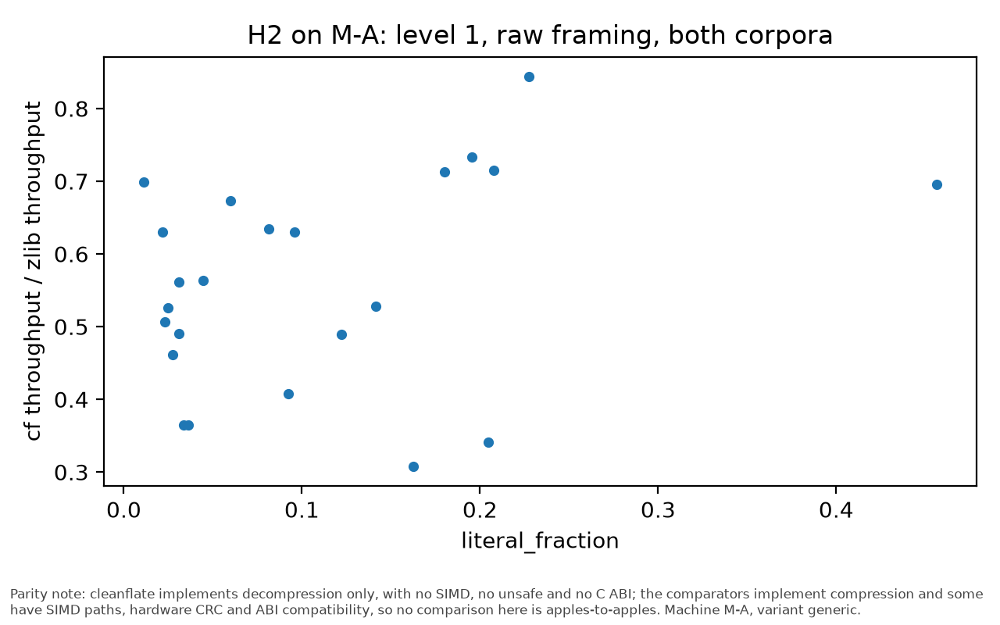

*Per-file ratio against literal_fraction_M-A.* Parity note: cleanflate implements decompression only, with no SIMD, no unsafe and no C ABI; the comparators implement compression and some have SIMD paths, hardware CRC and ABI compatibility, so no comparison here is apples-to-apples.

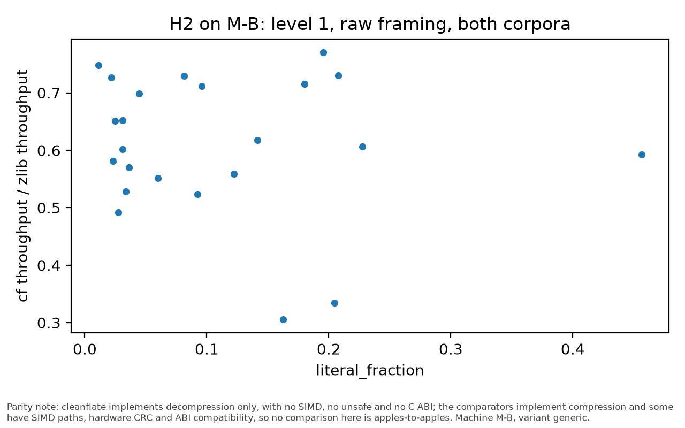

*Per-file ratio against literal_fraction_M-B.* Parity note: cleanflate implements decompression only, with no SIMD, no unsafe and no C ABI; the comparators implement compression and some have SIMD paths, hardware CRC and ABI compatibility, so no comparison here is apples-to-apples.

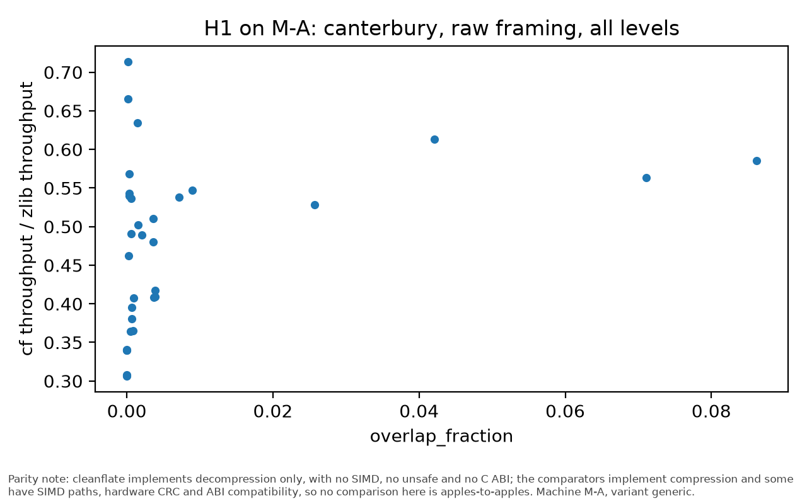

*Per-file ratio against overlap_fraction_M-A.* Parity note: cleanflate implements decompression only, with no SIMD, no unsafe and no C ABI; the comparators implement compression and some have SIMD paths, hardware CRC and ABI compatibility, so no comparison here is apples-to-apples.

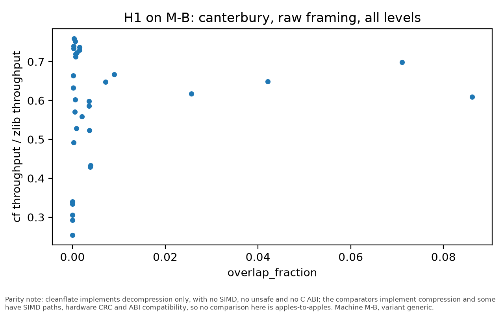

*Per-file ratio against overlap_fraction_M-B.* Parity note: cleanflate implements decompression only, with no SIMD, no unsafe and no C ABI; the comparators implement compression and some have SIMD paths, hardware CRC and ABI compatibility, so no comparison here is apples-to-apples.

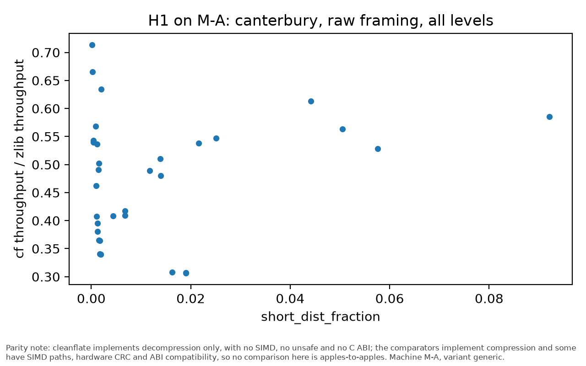

*Per-file ratio against short_dist_fraction_M-A.* Parity note: cleanflate implements decompression only, with no SIMD, no unsafe and no C ABI; the comparators implement compression and some have SIMD paths, hardware CRC and ABI compatibility, so no comparison here is apples-to-apples.

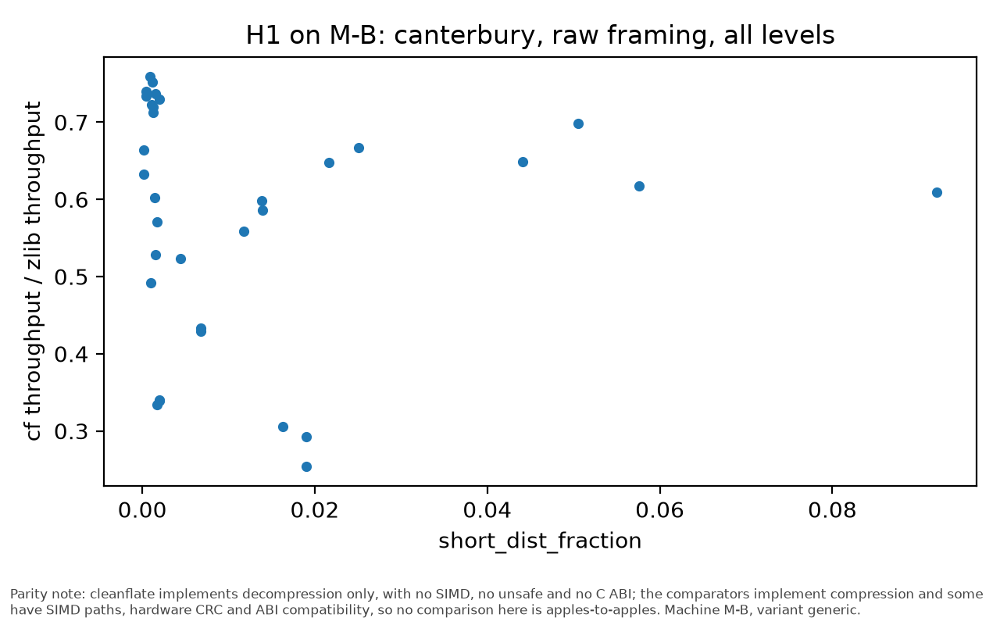

*Per-file ratio against short_dist_fraction_M-B.* Parity note: cleanflate implements decompression only, with no SIMD, no unsafe and no C ABI; the comparators implement compression and some have SIMD paths, hardware CRC and ABI compatibility, so no comparison here is apples-to-apples.

### Binary size

**Minimal decoder binary size**

| Machine | Subject | Opt-level | Stripped bytes | Note |
|---|---|---|---|---|
| M-A | cf | 3 | 368880 | n/a |
| M-A | cf | s | 352384 | n/a |
| M-A | mox | 3 | 335920 | n/a |
| M-A | mox | s | 319424 | n/a |
| M-A | zlib | 3 | 50488 | n/a |
| M-A | zlib | s | 33976 | n/a |
| M-A | zng | 3 | 100456 | n/a |
| M-A | zng | s | 100472 | n/a |
| M-A | zrs | 3 | 352400 | n/a |
| M-A | zrs | s | 335888 | n/a |
| M-A | zsys | 3 | n/a | dynamically linked system library; excluded from the static size comparison |
| M-A | zsys | s | n/a | dynamically linked system library; excluded from the static size comparison |
| M-B | cf | 3 | 393888 | n/a |
| M-B | cf | s | 373408 | n/a |
| M-B | mox | 3 | 361120 | n/a |
| M-B | mox | s | 340640 | n/a |
| M-B | zlib | 3 | 43136 | n/a |
| M-B | zlib | s | 34944 | n/a |
| M-B | zng | 3 | 158040 | n/a |
| M-B | zng | s | 100696 | n/a |
| M-B | zrs | 3 | 406184 | n/a |
| M-B | zrs | s | 381608 | n/a |
| M-B | zsys | 3 | n/a | dynamically linked system library; excluded from the static size comparison |
| M-B | zsys | s | n/a | dynamically linked system library; excluded from the static size comparison |

*Parity note: cleanflate implements decompression only, with no SIMD, no unsafe and no C ABI; the comparators implement compression and some have SIMD paths, hardware CRC and ABI compatibility, so no comparison here is apples-to-apples.*

*Source: `results/binary_size.csv` <- `data/raw/size/M-A/20261003T192318Z.json`, `data/raw/size/M-B/20261002T180735Z.json` via `cfbench.size`.*

*Binary size per subject.* Parity note: cleanflate implements decompression only, with no SIMD, no unsafe and no C ABI; the comparators implement compression and some have SIMD paths, hardware CRC and ABI compatibility, so no comparison here is apples-to-apples.

**cargo bloat, first rows**

| Machine | Subject | Opt-level | Crate | Bytes | Share |
|---|---|---|---|---|---|
| M-A | cf | 3 | [Unknown] | 4160 | 0.0172 |
| M-A | cf | 3 | __rustc | 212 | 0.0009 |
| M-A | cf | 3 | cleanflate | 15848 | 0.0654 |
| M-A | cf | 3 | min_cf | 13976 | 0.0576 |
| M-A | cf | 3 | std | 212024 | 0.8744 |
| M-A | cf | s | [Unknown] | 4156 | 0.0184 |
| M-A | cf | s | __rustc | 212 | 0.0009 |
| M-A | cf | s | cleanflate | 14872 | 0.0659 |
| M-A | cf | s | min_cf | 12772 | 0.0566 |
| M-A | cf | s | std | 197236 | 0.8746 |
| M-A | mox | 3 | [Unknown] | 4160 | 0.0182 |
| M-A | mox | 3 | __rustc | 212 | 0.0009 |
| M-A | mox | 3 | min_mox | 14904 | 0.0652 |
| M-A | mox | 3 | miniz_oxide | 2776 | 0.0121 |
| M-A | mox | 3 | std | 210456 | 0.9201 |
| M-A | mox | s | [Unknown] | 4156 | 0.0197 |
| M-A | mox | s | __rustc | 212 | 0.0010 |
| M-A | mox | s | min_mox | 10432 | 0.0494 |
| M-A | mox | s | miniz_oxide | 2720 | 0.0129 |
| M-A | mox | s | std | 197356 | 0.9349 |
| M-A | zrs | 3 | [Unknown] | 4144 | 0.0177 |
| M-A | zrs | 3 | __rustc | 228 | 0.0010 |
| M-A | zrs | 3 | min_zrs | 15496 | 0.0663 |
| M-A | zrs | 3 | std | 210156 | 0.8995 |
| M-A | zrs | 3 | zlib_rs | 7384 | 0.0316 |
| M-A | zrs | s | [Unknown] | 4140 | 0.0190 |
| M-A | zrs | s | __rustc | 228 | 0.0010 |
| M-A | zrs | s | min_zrs | 13472 | 0.0618 |
| M-A | zrs | s | std | 197024 | 0.9043 |
| M-A | zrs | s | zlib_rs | 6776 | 0.0311 |
| M-B | cf | 3 | [Unknown] | 1709 | 0.0059 |
| M-B | cf | 3 | __rustc | 197 | 0.0007 |
| M-B | cf | 3 | cleanflate | 19969 | 0.0686 |
| M-B | cf | 3 | min_cf | 17667 | 0.0607 |
| M-B | cf | 3 | std | 248424 | 0.8537 |
| M-B | cf | s | [Unknown] | 1667 | 0.0061 |
| M-B | cf | s | __rustc | 304 | 0.0011 |
| M-B | cf | s | cleanflate | 16867 | 0.0621 |
| M-B | cf | s | min_cf | 15592 | 0.0574 |
| M-B | cf | s | std | 234681 | 0.8634 |

*Parity note: cleanflate implements decompression only, with no SIMD, no unsafe and no C ABI; the comparators implement compression and some have SIMD paths, hardware CRC and ABI compatibility, so no comparison here is apples-to-apples.*

*Source: `results/cargo_bloat.csv` <- `data/raw/size/M-A/20261003T192318Z.json`, `data/raw/size/M-B/20261002T180735Z.json` via `cfbench.size`.*
