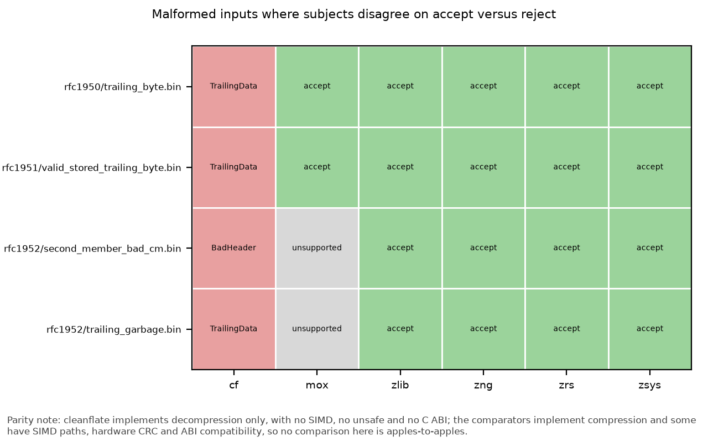
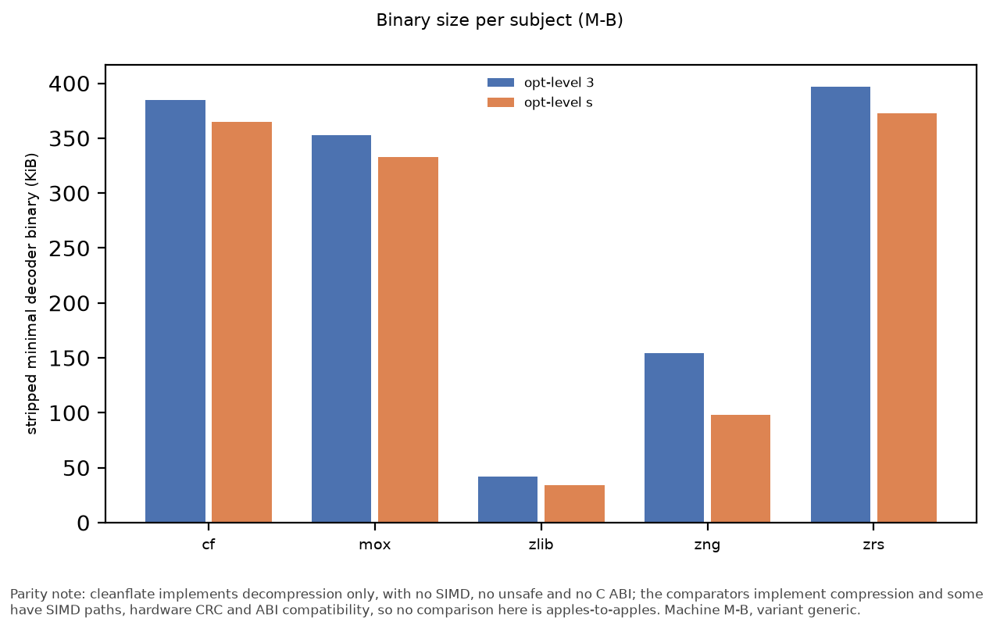
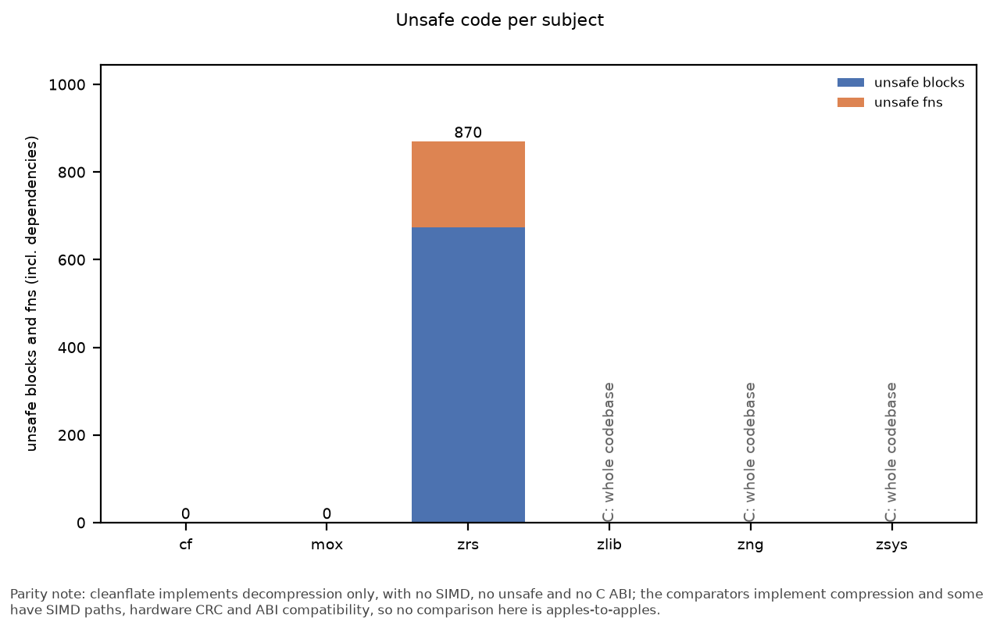
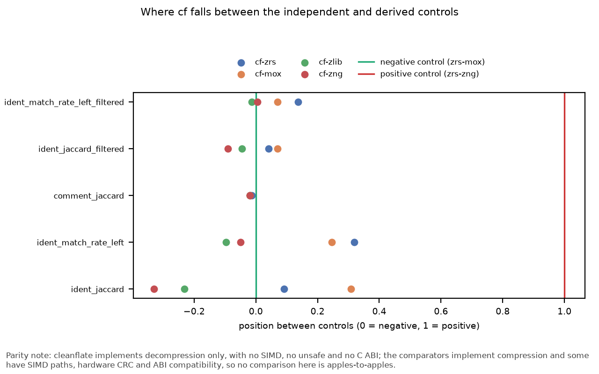
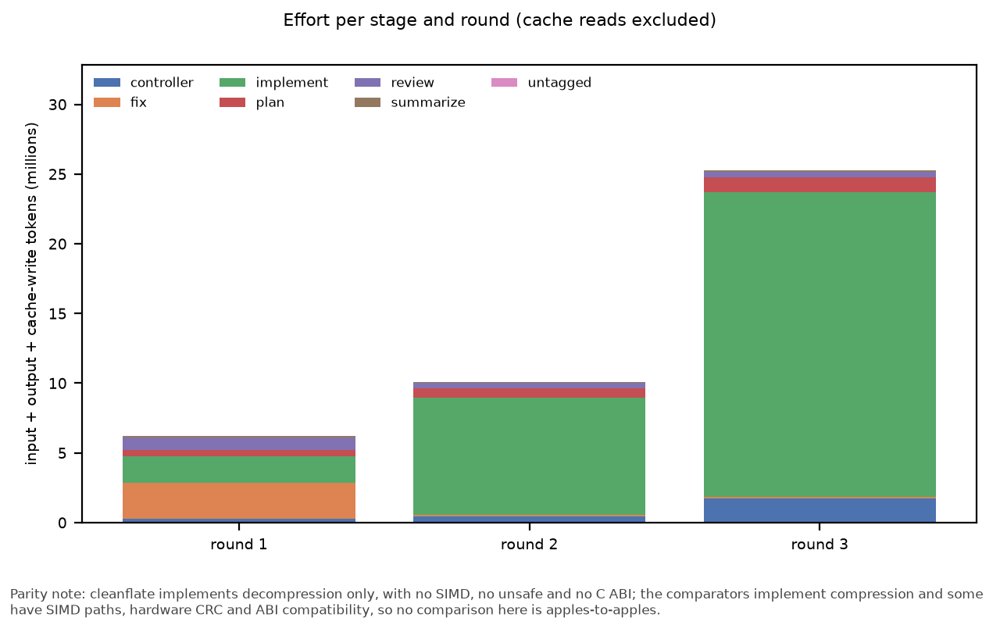

<!-- generated by cfbench.kits.results_md; do not edit -->

# Results

## Environments

| Machine | CPU | Cores (physical / logical) | OS | Kernel | Governor |
|---|---|---|---|---|---|
| M-B | AMD Ryzen 5 3400G with Radeon Vega Graphics | 4 / 8 | Pop!_OS 24.04 LTS | 7.1.5-76070105-generic | schedutil |

*Source: raw env captures `data/raw/env/M-B/20261001T042705Z.json`.*

Pending: run `make env` on M-A.

## Subjects and pins

**M-B**

| Build | Compiler | Target CPU | Hardware CRC compiled in | Runtime dispatch |
|---|---|---|---|---|
| cf | rustc 1.89.0 (29483883e 2025-08-04) | generic | no | no |
| cf@native | rustc 1.89.0 (29483883e 2025-08-04) | native | no | no |
| mox | rustc 1.89.0 (29483883e 2025-08-04) | generic | no | no |
| mox@native | rustc 1.89.0 (29483883e 2025-08-04) | native | no | no |
| zlib | cc (Ubuntu 13.3.0-6ubuntu2~24.04.1) 13.3.0 | generic | no | no |
| zlib-nohw | cc (Ubuntu 13.3.0-6ubuntu2~24.04.1) 13.3.0 | generic | no | no |
| zng | cc (Ubuntu 13.3.0-6ubuntu2~24.04.1) 13.3.0 | generic | yes | yes |
| zrs | rustc 1.89.0 (29483883e 2025-08-04) | generic | yes | yes |
| zrs@native | rustc 1.89.0 (29483883e 2025-08-04) | native | yes | yes |
| zsys | None | generic | no | no |

Hardware-CRC determinations come from disassembly and symbol inspection of each built binary (`subjects.lock.json`); on x86_64 the `zlib-nohw` control is identical to the default build.

*Source: `subjects.lock.json`.*

## Performance methodology

- Harness: one process per measured cell, cells in randomized order (seed 20261019); the harness is single-threaded and counts heap with an in-process allocator.
- Each cell warms up for 500 ms, then takes at least 30 samples of at least 10 ms each.
- Medians carry a 95% bootstrap confidence interval from 2000 resamples.
- The full session is run 2 times; the two runs agree when every aggregate is within 5%, otherwise the machine is flagged.
- A run is refused when the starting load average exceeds 1.0.
- Levels 1, 6, 9; framings raw, zlib, gzip; modes oneshot, stream_small, stream_large. Streaming uses 4096-byte and 1048576-byte chunks.
- Aggregates are total output bytes divided by summed per-file time; ratios are against stock zlib (zlib = 1.00x) and are only formed within the same mode.

## Performance results

Pending: run `make perf` on M-A and M-B.

Pending: run `make perf` on M-A and M-B.

Pending: run `make perf` on M-A and M-B.

Pending: run `make perf` on M-A and M-B.

## Framing decomposition

Pending: run `make framing` on M-A and M-B.

Pending: run `make framing` on M-A and M-B.

Overhead is `(1/T_framed - 1/T_raw) / (1/T_raw)`. The headline test asks whether cleanflate's gzip penalty roughly matches stock zlib's with hardware CRC disabled; the verdict is reported either way, and on x86_64 the control build is identical to the default build.

Pending: figure `framing_decomposition` is not rendered yet (run `make figures` once its table has data).

## Content analysis

Pending: run `make content` on M-A and M-B.

H1: cleanflate's relative weakness on Canterbury tracks short-distance and overlapping match density. H2: its level-1 weakness tracks literal fraction. Verdicts use Spearman rho with a seeded permutation p-value; they are never omitted.

Findings note: [CONTENT_FINDINGS.md](CONTENT_FINDINGS.md). Per-file token features: `results/content_features.csv`.

Pending: scatter plots need perf data; run `make perf` on M-A and M-B, then `make content`.

## Trajectory

Pending: run `make trajectory` on M-A and M-B.

## Correctness

**Conformance over the shared corpus**

| Machine | Subject | Streams | Passed | Failed | Unsupported | Pass rate |
|---|---|---|---|---|---|---|
| M-B | cf | 2962 | 2962 | 0 | 0 | 1 |
| M-B | mox | 2962 | 2519 | 0 | 443 | 1 |
| M-B | zlib | 2962 | 2962 | 0 | 0 | 1 |
| M-B | zng | 2962 | 2962 | 0 | 0 | 1 |
| M-B | zrs | 2962 | 2962 | 0 | 0 | 1 |
| M-B | zsys | 2962 | 2962 | 0 | 0 | 1 |

*Source: `results/conformance.csv` <- `data/raw/correctness/M-B/20261001T060238Z.json` via `cfbench.conformance`.*

**Conformance disagreements (an empty table means none)**

| Machine | Entry | Framing | Subject | Outcome | Error |
|---|---|---|---|---|---|

*Source: `results/conformance_disagreements.csv` <- `data/raw/correctness/M-B/20261001T060238Z.json` via `cfbench.conformance`.*

**Malformed inputs on which subjects disagree about accept versus reject**

| File | Framing | Outcomes by subject | cf expected |
|---|---|---|---|
| rfc1950/trailing_byte.bin | zlib | cf=error:TrailingData;zlib=accept;zng=accept;zrs=accept;mox=accept;zsys=accept | TrailingData |
| rfc1951/valid_stored_trailing_byte.bin | raw | cf=error:TrailingData;zlib=accept;zng=accept;zrs=accept;mox=accept;zsys=accept | TrailingData |
| rfc1952/second_member_bad_cm.bin | gzip | cf=error:BadHeader;zlib=accept;zng=accept;zrs=accept;mox=unsupported;zsys=accept | BadHeader |
| rfc1952/trailing_garbage.bin | gzip | cf=error:TrailingData;zlib=accept;zng=accept;zrs=accept;mox=unsupported;zsys=accept | TrailingData |

*Source: `results/malformed_disagreements.csv` <- `data/raw/correctness/M-B/20261001T062930Z.json` via `cfbench.malformed`.*

Full matrix: `results/malformed_matrix.csv`; highlights: [MALFORMED_HIGHLIGHTS.md](MALFORMED_HIGHLIGHTS.md).

*Malformed-input disagreements.* Parity note: cleanflate implements decompression only, with no SIMD, no unsafe and no C ABI; the comparators implement compression and some have SIMD paths, hardware CRC and ABI compatibility, so no comparison here is apples-to-apples.

Pending: run `make fuzz` on M-A and M-B.

Pending: run `make fuzz` on M-A and M-B.

Pending: figure `fuzz_stats` is not rendered yet (run `make figures` once its table has data).

Pending: run `make bombs` on M-A and M-B.

## Size, safety and complexity

**Minimal decoder binary size**

| Machine | Subject | Opt-level | Stripped bytes | Note |
|---|---|---|---|---|
| M-B | cf | 3 | 393888 | n/a |
| M-B | cf | s | 373408 | n/a |
| M-B | mox | 3 | 361120 | n/a |
| M-B | mox | s | 340640 | n/a |
| M-B | zlib | 3 | 43136 | n/a |
| M-B | zlib | s | 34944 | n/a |
| M-B | zng | 3 | 158040 | n/a |
| M-B | zng | s | 100696 | n/a |
| M-B | zrs | 3 | 406184 | n/a |
| M-B | zrs | s | 381608 | n/a |
| M-B | zsys | 3 | n/a | dynamically linked system library; excluded from the static size comparison |
| M-B | zsys | s | n/a | dynamically linked system library; excluded from the static size comparison |

*Source: `results/binary_size.csv` <- `data/raw/size/M-B/20261001T051108Z.json` via `cfbench.size`.*

*Binary size per subject.* Parity note: cleanflate implements decompression only, with no SIMD, no unsafe and no C ABI; the comparators implement compression and some have SIMD paths, hardware CRC and ABI compatibility, so no comparison here is apples-to-apples.

**cargo bloat, first rows**

| Machine | Subject | Opt-level | Crate | Bytes | Share |
|---|---|---|---|---|---|
| M-B | cf | 3 | [Unknown] | 1709 | 0.0059 |
| M-B | cf | 3 | __rustc | 197 | 0.0007 |
| M-B | cf | 3 | cleanflate | 19969 | 0.0686 |
| M-B | cf | 3 | min_cf | 17667 | 0.0607 |
| M-B | cf | 3 | std | 248424 | 0.8537 |
| M-B | cf | s | [Unknown] | 1667 | 0.0061 |
| M-B | cf | s | __rustc | 304 | 0.0011 |
| M-B | cf | s | cleanflate | 16867 | 0.0621 |
| M-B | cf | s | min_cf | 15592 | 0.0574 |
| M-B | cf | s | std | 234681 | 0.8634 |
| M-B | mox | 3 | [Unknown] | 1709 | 0.0063 |
| M-B | mox | 3 | __rustc | 197 | 0.0007 |
| M-B | mox | 3 | min_mox | 16037 | 0.0592 |
| M-B | mox | 3 | miniz_oxide | 13693 | 0.0505 |
| M-B | mox | 3 | std | 236568 | 0.8726 |
| M-B | mox | s | [Unknown] | 1667 | 0.0066 |
| M-B | mox | s | __rustc | 197 | 0.0008 |
| M-B | mox | s | min_mox | 11561 | 0.0455 |
| M-B | mox | s | miniz_oxide | 13094 | 0.0515 |
| M-B | mox | s | std | 224976 | 0.8850 |
| M-B | zrs | 3 | [Unknown] | 1709 | 0.0059 |
| M-B | zrs | 3 | __rustc | 220 | 0.0008 |
| M-B | zrs | 3 | min_zrs | 19731 | 0.0676 |
| M-B | zrs | 3 | std | 248635 | 0.8515 |
| M-B | zrs | 3 | zlib_rs | 18645 | 0.0639 |
| M-B | zrs | s | [Unknown] | 1667 | 0.0061 |
| M-B | zrs | s | __rustc | 220 | 0.0008 |
| M-B | zrs | s | min_zrs | 15608 | 0.0574 |
| M-B | zrs | s | std | 236584 | 0.8700 |
| M-B | zrs | s | zlib_rs | 15120 | 0.0556 |

*Source: `results/cargo_bloat.csv` <- `data/raw/size/M-B/20261001T051108Z.json` via `cfbench.size`.*

**Unsafe surface**

| Subject | Crate | Version | Role | forbids unsafe | Unsafe blocks | Unsafe fns | Unsafe impls | geiger used | Note |
|---|---|---|---|---|---|---|---|---|---|
| cf | cleanflate | 0.1.0 | subject | true | 0 | 0 | 0 | 0 | n/a |
| mox | adler2 | 2.0.1 | dependency | true | 0 | 0 | 0 | 0 | n/a |
| mox | miniz_oxide | 0.9.1 | subject | true | 0 | 0 | 0 | 0 | n/a |
| zlib | zlib | n/a | subject | n/a | n/a | n/a | n/a | n/a | C: entire codebase memory-unsafe by language |
| zng | zng | n/a | subject | n/a | n/a | n/a | n/a | n/a | C: entire codebase memory-unsafe by language |
| zrs | libz-rs-sys | 0.6.8 | subject | false | 320 | 102 | 0 | 495 | n/a |
| zrs | zlib-rs | 0.6.8 | subject | false | 354 | 94 | 5 | 2860 | n/a |
| zsys | zsys | n/a | subject | n/a | n/a | n/a | n/a | n/a | C: entire codebase memory-unsafe by language |

*Source: `results/unsafe.csv` <- `data/raw/size/any/20261001T051308Z.json` via `cfbench.unsafe_scan`.*

*Unsafe code per subject.* Parity note: cleanflate implements decompression only, with no SIMD, no unsafe and no C ABI; the comparators implement compression and some have SIMD paths, hardware CRC and ABI compatibility, so no comparison here is apples-to-apples.

**Dependencies**

| Subject | Package | Direct | Transitive | Advisories |
|---|---|---|---|---|
| cf | cleanflate@0.1.0 | 0 | 0 | n/a |
| mox | miniz_oxide@0.9.1 | 1 | 1 | n/a |
| zrs | libz-rs-sys@0.6.8 | 1 | 1 | n/a |
| zrs | zlib-rs@0.6.8 | 0 | 0 | n/a |

*Source: `results/deps.csv` <- `data/raw/size/any/20261001T051441Z.json` via `cfbench.deps`.*

**Decompression-path lines of code (tokei; method in docs/methods/decomp-paths.md)**

| Subject | Language | Files | Code | Comments | Blanks |
|---|---|---|---|---|---|
| cf | Markdown (embedded) | 0 | 0 | 1013 | 27 |
| cf | Rust | 17 | 3683 | 119 | 318 |
| cf | Total | 17 | 3683 | 1132 | 345 |
| mox | Markdown (embedded) | 0 | 0 | 353 | 75 |
| mox | Rust | 5 | 2293 | 363 | 339 |
| mox | Total | 5 | 2293 | 716 | 414 |
| zlib | C | 7 | 2666 | 761 | 292 |
| zlib | C Header | 6 | 9791 | 147 | 134 |
| zlib | Total | 13 | 12457 | 908 | 426 |
| zng | C | 50 | 6843 | 1747 | 1425 |
| zng | C Header | 43 | 12908 | 1192 | 551 |
| zng | Total | 93 | 19751 | 2939 | 1976 |
| zrs | Markdown (embedded) | 0 | 0 | 225 | 64 |
| zrs | Rust | 26 | 7296 | 695 | 1632 |
| zrs | Total | 26 | 7296 | 920 | 1696 |

*Source: `results/loc.csv` <- `data/raw/size/any/20261001T065129Z.json` via `cfbench.loc`.*

**Per-function complexity (p90 by nearest rank)**

| Subject | Tool | Version | Metric | Functions | Median | p90 | Max |
|---|---|---|---|---|---|---|---|
| cf | rust-code-analysis-cli | 0.0.25 | cognitive | 173 | 0 | 7 | 171 |
| cf | rust-code-analysis-cli | 0.0.25 | cyclomatic | 173 | 2 | 8 | 106 |
| mox | rust-code-analysis-cli | 0.0.25 | cognitive | 93 | 0 | 5 | 40 |
| mox | rust-code-analysis-cli | 0.0.25 | cyclomatic | 93 | 1 | 9 | 86 |
| zlib | lizard | 1.24.0 | cyclomatic | 71 | 3 | 13 | 209 |
| zlib | lizard (cognitive unavailable) | 1.24.0 | cognitive | 71 | n/a | n/a | n/a |
| zng | lizard | 1.24.0 | cyclomatic | 284 | 1 | 9 | 210 |
| zng | lizard (cognitive unavailable) | 1.24.0 | cognitive | 284 | n/a | n/a | n/a |
| zrs | rust-code-analysis-cli | 0.0.25 | cognitive | 326 | 0 | 5 | 332 |
| zrs | rust-code-analysis-cli | 0.0.25 | cyclomatic | 326 | 1 | 6 | 161 |

*Source: `results/complexity.csv` <- `data/raw/size/any/20261001T065344Z.json`, `data/raw/size/any/20261001T065504Z.json` via `cfbench.complexity`.*

## Clean-room verification

Methods (full description in `docs/methods/similarity.md`): tree-sitter token n-gram Jaccard (n from 5 to 10), identifier overlap (length at least 6, RFC-mandated names excluded), comment n-gram overlap, and JPlag 6.3.0. Tools: tree-sitter 0.26.0, tree-sitter-rust 0.24.2, tree-sitter-c 0.24.2. The RFC exclusion list is `config/rfc_identifiers.txt` (effective list: `results/similarity_identifier_exclusions.txt`).

**Scores against the controls (negative zrs-mox, positive zrs-zng)**

| Metric | Pair | Role | Score | Negative control | Positive control | Position | Classification |
|---|---|---|---|---|---|---|---|
| comment_jaccard | cf-mox | test | 0.0003 | 0.0010 | 0.0395 | -0.0185 | below negative |
| comment_jaccard | cf-zlib | test | 0.0003 | 0.0010 | 0.0395 | -0.0198 | below negative |
| comment_jaccard | cf-zng | test | 0.0003 | 0.0010 | 0.0395 | -0.0195 | below negative |
| comment_jaccard | cf-zrs | test | 0.0005 | 0.0010 | 0.0395 | -0.0132 | below negative |
| comment_jaccard | zrs-mox | negative | 0.0010 | 0.0010 | 0.0395 | 0 | negative control |
| comment_jaccard | zrs-zng | positive | 0.0395 | 0.0010 | 0.0395 | 1 | positive control |
| ident_jaccard | cf-mox | test | 0.0747 | 0.0439 | 0.1438 | 0.3090 | between |
| ident_jaccard | cf-zlib | test | 0.0207 | 0.0439 | 0.1438 | -0.2316 | below negative |
| ident_jaccard | cf-zng | test | 0.0108 | 0.0439 | 0.1438 | -0.3306 | below negative |
| ident_jaccard | cf-zrs | test | 0.0529 | 0.0439 | 0.1438 | 0.0907 | at or near negative |
| ident_jaccard | zrs-mox | negative | 0.0439 | 0.0439 | 0.1438 | 0 | negative control |
| ident_jaccard | zrs-zng | positive | 0.1438 | 0.0439 | 0.1438 | 1 | positive control |
| ident_match_rate_left | cf-mox | test | 0.1285 | 0.0601 | 0.3386 | 0.2457 | at or near negative |
| ident_match_rate_left | cf-zlib | test | 0.0334 | 0.0601 | 0.3386 | -0.0959 | below negative |
| ident_match_rate_left | cf-zng | test | 0.0463 | 0.0601 | 0.3386 | -0.0498 | below negative |
| ident_match_rate_left | cf-zrs | test | 0.1491 | 0.0601 | 0.3386 | 0.3195 | between |
| ident_match_rate_left | zrs-mox | negative | 0.0601 | 0.0601 | 0.3386 | 0 | negative control |
| ident_match_rate_left | zrs-zng | positive | 0.3386 | 0.0601 | 0.3386 | 1 | positive control |
| jplag_avg | cf-mox | test | 0.1795 | 0.1311 | n/a | n/a | positive control unavailable |
| jplag_avg | cf-zrs | test | 0.1812 | 0.1311 | n/a | n/a | positive control unavailable |
| jplag_avg | zlib-zng | context | 0.2997 | 0.1311 | n/a | n/a | positive control unavailable |
| jplag_avg | zrs-mox | negative | 0.1311 | 0.1311 | n/a | 0 | negative control |
| ngram_containment@5 | cf-mox | test | 0.3673 | 0.5251 | 0.1095 | n/a | controls not separated |
| ngram_containment@5 | cf-zlib | test | 0.0688 | 0.5251 | 0.1095 | n/a | controls not separated |
| ngram_containment@5 | cf-zng | test | 0.0902 | 0.5251 | 0.1095 | n/a | controls not separated |
| ngram_containment@5 | cf-zrs | test | 0.5155 | 0.5251 | 0.1095 | n/a | controls not separated |
| ngram_containment@5 | zrs-mox | negative | 0.5251 | 0.5251 | 0.1095 | 0 | negative control |
| ngram_containment@5 | zrs-zng | positive | 0.1095 | 0.5251 | 0.1095 | 1 | positive control |
| ngram_jaccard@10 | cf-mox | test | 0.0414 | 0.0395 | 0.0082 | n/a | controls not separated |
| ngram_jaccard@10 | cf-zlib | test | 0.0010 | 0.0395 | 0.0082 | n/a | controls not separated |
| ngram_jaccard@10 | cf-zng | test | 0.0017 | 0.0395 | 0.0082 | n/a | controls not separated |
| ngram_jaccard@10 | cf-zrs | test | 0.0500 | 0.0395 | 0.0082 | n/a | controls not separated |
| ngram_jaccard@10 | zrs-mox | negative | 0.0395 | 0.0395 | 0.0082 | 0 | negative control |
| ngram_jaccard@10 | zrs-zng | positive | 0.0082 | 0.0395 | 0.0082 | 1 | positive control |
| ngram_jaccard@5 | cf-mox | test | 0.2148 | 0.2153 | 0.0555 | n/a | controls not separated |
| ngram_jaccard@5 | cf-zlib | test | 0.0352 | 0.2153 | 0.0555 | n/a | controls not separated |
| ngram_jaccard@5 | cf-zng | test | 0.0348 | 0.2153 | 0.0555 | n/a | controls not separated |
| ngram_jaccard@5 | cf-zrs | test | 0.2234 | 0.2153 | 0.0555 | n/a | controls not separated |
| ngram_jaccard@5 | zrs-mox | negative | 0.2153 | 0.2153 | 0.0555 | 0 | negative control |
| ngram_jaccard@5 | zrs-zng | positive | 0.0555 | 0.2153 | 0.0555 | 1 | positive control |
| ngram_jaccard@6 | cf-mox | test | 0.1539 | 0.1516 | 0.0333 | n/a | controls not separated |
| ngram_jaccard@6 | cf-zlib | test | 0.0171 | 0.1516 | 0.0333 | n/a | controls not separated |
| ngram_jaccard@6 | cf-zng | test | 0.0182 | 0.1516 | 0.0333 | n/a | controls not separated |
| ngram_jaccard@6 | cf-zrs | test | 0.1643 | 0.1516 | 0.0333 | n/a | controls not separated |
| ngram_jaccard@6 | zrs-mox | negative | 0.1516 | 0.1516 | 0.0333 | 0 | negative control |
| ngram_jaccard@6 | zrs-zng | positive | 0.0333 | 0.1516 | 0.0333 | 1 | positive control |
| ngram_jaccard@7 | cf-mox | test | 0.1105 | 0.1076 | 0.0209 | n/a | controls not separated |
| ngram_jaccard@7 | cf-zlib | test | 0.0075 | 0.1076 | 0.0209 | n/a | controls not separated |
| ngram_jaccard@7 | cf-zng | test | 0.0094 | 0.1076 | 0.0209 | n/a | controls not separated |
| ngram_jaccard@7 | cf-zrs | test | 0.1220 | 0.1076 | 0.0209 | n/a | controls not separated |
| ngram_jaccard@7 | zrs-mox | negative | 0.1076 | 0.1076 | 0.0209 | 0 | negative control |
| ngram_jaccard@7 | zrs-zng | positive | 0.0209 | 0.1076 | 0.0209 | 1 | positive control |
| ngram_jaccard@8 | cf-mox | test | 0.0785 | 0.0773 | 0.0137 | n/a | controls not separated |
| ngram_jaccard@8 | cf-zlib | test | 0.0034 | 0.0773 | 0.0137 | n/a | controls not separated |
| ngram_jaccard@8 | cf-zng | test | 0.0050 | 0.0773 | 0.0137 | n/a | controls not separated |
| ngram_jaccard@8 | cf-zrs | test | 0.0911 | 0.0773 | 0.0137 | n/a | controls not separated |
| ngram_jaccard@8 | zrs-mox | negative | 0.0773 | 0.0773 | 0.0137 | 0 | negative control |
| ngram_jaccard@8 | zrs-zng | positive | 0.0137 | 0.0773 | 0.0137 | 1 | positive control |
| ngram_jaccard@9 | cf-mox | test | 0.0575 | 0.0554 | 0.0103 | n/a | controls not separated |
| ngram_jaccard@9 | cf-zlib | test | 0.0017 | 0.0554 | 0.0103 | n/a | controls not separated |
| ngram_jaccard@9 | cf-zng | test | 0.0029 | 0.0554 | 0.0103 | n/a | controls not separated |
| ngram_jaccard@9 | cf-zrs | test | 0.0682 | 0.0554 | 0.0103 | n/a | controls not separated |
| ngram_jaccard@9 | zrs-mox | negative | 0.0554 | 0.0554 | 0.0103 | 0 | negative control |
| ngram_jaccard@9 | zrs-zng | positive | 0.0103 | 0.0554 | 0.0103 | 1 | positive control |

*Source: `results/similarity_summary.csv` <- `data/raw/similarity/any/20261001T051802Z.json`, `data/raw/similarity/any/20261001T052006Z.json`, `data/raw/similarity/any/20261001T052008Z.json`, `data/raw/similarity/any/20261001T052552Z.json` via `cfbench.similarity.summary`.*

**Result statement:** T1 claim NOT allowed: a cf pair is not at or near the negative control for `ident_jaccard` (cf-mox between), `ident_match_rate_left` (cf-zrs between).

*Where cleanflate falls between the controls.* Parity note: cleanflate implements decompression only, with no SIMD, no unsafe and no C ABI; the comparators implement compression and some have SIMD paths, hardware CRC and ABI compatibility, so no comparison here is apples-to-apples.

**Top fragment pairs and their review verdicts**

| Pair | Fragments | RFC-forced | idiomatic-inevitable | suspicious | Unreviewed |
|---|---|---|---|---|---|
| cf-mox | 20 | 0 | 0 | 0 | 20 |
| cf-zlib | 20 | 0 | 0 | 0 | 20 |
| cf-zng | 20 | 0 | 0 | 0 | 20 |
| cf-zrs | 20 | 0 | 0 | 0 | 20 |
| zrs-mox | 20 | 0 | 0 | 0 | 20 |
| zrs-zng | 20 | 0 | 0 | 0 | 20 |

Verdicts live in `config/similarity_verdicts.toml` and are filled in by a human reviewer; per-pair excerpts are under `results/similarity_fragments/`.

Structural write-up: [STRUCTURE_COMPARISON.md](STRUCTURE_COMPARISON.md).

## Effort, cost and provenance

**Totals per round**

| Round | Wall-clock s | Idle s | Models | Input tokens | Output tokens | Cache-write tokens | Cache-read tokens | Cost USD |
|---|---|---|---|---|---|---|---|---|
| 1 | 30485 | 0 | claude-opus-5-5;claude-sonnet-5 | 4338 | 850772 | 5338331 | 769582775 | n/a |
| 2 | 26218 | 28931 | claude-opus-5-5;claude-sonnet-5-5 | 1096 | 168462 | 9928038 | 153669576 | n/a |
| 3 | 45863 | 0 | claude-opus-5-5;claude-sonnet-5-5 | 1214 | 143298 | 25095429 | 200948466 | n/a |
| total | 102566 | 28931 | claude-opus-5-5;claude-sonnet-5;claude-sonnet-5-5 | 6648 | 1162532 | 40361798 | 1124200817 | n/a |

*Source: `results/effort_totals.csv` <- `data/raw/effort/any/20261001T055110Z-1.json`, `data/raw/effort/any/20261001T055110Z.json` via `cfbench.effort.derive`.*

**Per stage and round**

| Round | Stage | Wall-clock s | Models | Input tokens | Output tokens | Cache-write tokens | Cache-read tokens | Cost USD |
|---|---|---|---|---|---|---|---|---|
| 1 | controller | n/a | claude-opus-5-5 | 158 | 26308 | 219416 | 5312174 | n/a |
| 1 | fix | 12459 | claude-sonnet-5 | 1734 | 209432 | 2406085 | 341861784 | n/a |
| 1 | implement | 12776 | claude-sonnet-5 | 2002 | 489175 | 1389604 | 400356890 | n/a |
| 1 | plan | 1800 | claude-opus-5-5 | 36 | 96886 | 370984 | 1971772 | n/a |
| 1 | review | 2876 | claude-opus-5-5 | 372 | 19845 | 883029 | 19416463 | n/a |
| 1 | summarize | 186 | claude-opus-5-5 | 36 | 9126 | 69213 | 663692 | n/a |
| 1 | untagged | 388 | n/a | n/a | n/a | n/a | n/a | n/a |
| 2 | controller | n/a | claude-opus-5-5;claude-sonnet-5-5 | 132 | 33965 | 407858 | 9477717 | n/a |
| 2 | fix | 2449 | claude-sonnet-5-5 | 68 | 1574 | 91343 | 1057595 | n/a |
| 2 | implement | 19391 | claude-sonnet-5-5 | 596 | 11623 | 8414676 | 124047330 | n/a |
| 2 | plan | 2703 | claude-opus-5-5 | 66 | 97541 | 551216 | 6023705 | n/a |
| 2 | review | 1288 | claude-opus-5-5 | 212 | 16171 | 408950 | 12749955 | n/a |
| 2 | summarize | 387 | claude-opus-5-5 | 22 | 7588 | 53995 | 313274 | n/a |
| 3 | controller | n/a | claude-opus-5-5;claude-sonnet-5-5 | 156 | 52408 | 1690750 | 17414900 | n/a |
| 3 | fix | 2312 | claude-sonnet-5-5 | 36 | 604 | 77926 | 471724 | n/a |
| 3 | implement | 30843 | claude-sonnet-5-5 | 750 | 12274 | 21842529 | 164213966 | n/a |
| 3 | plan | 1727 | claude-opus-5-5 | 94 | 61994 | 1043871 | 10377909 | n/a |
| 3 | review | 527 | claude-opus-5-5 | 156 | 7866 | 386239 | 8137984 | n/a |
| 3 | summarize | 6410 | claude-opus-5-5 | 22 | 8152 | 54114 | 331983 | n/a |
| 3 | untagged | 4044 | n/a | n/a | n/a | n/a | n/a | n/a |

*Source: `results/effort_stage_round.csv` <- `data/raw/effort/any/20261001T055110Z-1.json`, `data/raw/effort/any/20261001T055110Z.json` via `cfbench.effort.derive`.*

*Effort per stage and round.* Parity note: cleanflate implements decompression only, with no SIMD, no unsafe and no C ABI; the comparators implement compression and some have SIMD paths, hardware CRC and ABI compatibility, so no comparison here is apples-to-apples.

**Milestones**

| Round | Milestone | Wall-clock s | Review rounds |
|---|---|---|---|
| 1 | P0 | 1530 | 4 |
| 1 | P1 | 2944 | 4 |
| 1 | P2 | 1871 | 4 |
| 1 | P3 | 1747 | 4 |
| 1 | P4 | 5526 | 4 |
| 1 | P6 | 529 | 4 |
| 1 | R1 | 2353 | 4 |
| 1 | R2 | 822 | 4 |
| 1 | R3 | 198 | 4 |
| 1 | other | 12965 | 4 |
| 2 | P0 | 6490 | 3 |
| 2 | P1 | 2762 | 3 |
| 2 | P2 | 2507 | 3 |
| 2 | P3 | 2931 | 3 |
| 2 | P4 | 2481 | 3 |
| 2 | P5 | 1214 | 3 |
| 2 | R1 | 419 | 3 |
| 2 | R2 | 193 | 3 |
| 2 | other | 7221 | 3 |
| 3 | P0 | 5535 | 2 |
| 3 | P1 | 3272 | 2 |
| 3 | P2 | 7799 | 2 |
| 3 | P3 | 5102 | 2 |
| 3 | P4 | 6570 | 2 |
| 3 | P5 | 1429 | 2 |
| 3 | R1 | 597 | 2 |
| 3 | other | 15559 | 2 |

*Source: `results/effort_milestones.csv` <- `data/raw/effort/any/20261001T055110Z-1.json`, `data/raw/effort/any/20261001T055110Z.json` via `cfbench.effort.derive`.*

**Review rounds**

| Round | Review round | Verdict | Fix tasks |
|---|---|---|---|
| 1 | 1 | CHANGES REQUESTED | 8 |
| 1 | 2 | CHANGES REQUESTED | 5 |
| 1 | 3 | CHANGES REQUESTED | 1 |
| 1 | 4 | APPROVED | 0 |
| 2 | 1 | CHANGES REQUESTED | 2 |
| 2 | 2 | CHANGES REQUESTED | 1 |
| 2 | 3 | APPROVED | 0 |
| 3 | 1 | CHANGES REQUESTED | 1 |
| 3 | 2 | APPROVED | 0 |

*Source: `results/effort_review_rounds.csv` <- `data/raw/effort/any/20261001T055110Z-1.json`, `data/raw/effort/any/20261001T055110Z.json` via `cfbench.effort.derive`.*

**Defect discovery source**

| Round | Discovery source | Defects |
|---|---|---|
| 1 | conformance | 1 |
| 1 | fuzzing | 1 |
| 1 | none reported | 47 |
| 1 | other | 3 |
| 1 | review | 2 |
| 1 | unit_tests | 3 |
| 2 | conformance | 2 |
| 2 | none reported | 33 |
| 2 | unit_tests | 2 |
| 3 | none reported | 36 |
| 3 | other | 2 |

*Source: `results/effort_defects.csv` <- `data/raw/effort/any/20261001T055110Z-1.json`, `data/raw/effort/any/20261001T055110Z.json` via `cfbench.effort.derive`.*

**Human interventions**

| Round | When | Stage/task | Nature |
|---|---|---|---|
| 1 | 2026-09-29T15:33Z | implement/P0-08 | Downloaded the Canterbury corpus archive (`cantrbry.tar.gz`, sha256 `f140e8a5b73d3f53198555a63bfb827889394a42f20825df33c810c3d5e3f8fb`) from the allowlisted URL in a browser and supplied it to `fetch-corpora.sh --from-file`, which verified it against that known-good SHA-256 before use. |
| 1 | 2026-09-29T18:50Z | review→implement, round 1 | Re-opened the 17 tasks auto-skipped behind P0-08 (P0-09..P0-11, P1-03, P1-11, P1-12, P2-05, P2-06, P3-04, P3-06, P4-07..P4-10, P6-01..P6-03) by flipping `[-]` to `[ ]` in `docs/PROGRESS.md` (commit `b992fec`, tagged `[stage:review] [task:reopen]`). The operator authorized it; the go-flight controller session made the edit. |
| 2 | 2026-09-29 | phase-2 SPEC | Directed a performance pass after phase 1 missed its 70% throughput target; the controller session drafted `docs/SPEC.md` (now `docs/phase-2/SPEC.md`) from that direction, using only phase-1 docs, cleanflate's own code and general techniques. |
| 2 | 2026-09-30 | phase-2 post-merge | Created and pushed signed tags `v0.1.0-cleanroom` (`e94efcf`) and `v0.2.0-cleanroom` (`d3e911b`); phase 1's tag had never been created. |
| 2 | 2026-09-30 | phase-2 post-merge | Hour-long fuzz runs, `make bomb` peak-memory comparison and DESIGN D-27..D-32 read-through deferred (not done yet). |
| 2 | 2026-09-30 | phase-2 post-merge | Merged PR #2 (phase 2) into `main` after green CI, and re-ran the full `make bench` on the merged code (`docs/perf/phase2-final-operator.json`, recorded in `docs/PERF.md`). |
| 2 | 2026-09-30 | phase-2 post-merge fix | Bounded one-shot size hints by DEFLATE's maximum expansion (`MAX_DEFLATE_EXPANSION` = 1032, DESIGN.md D-33), so an 18-byte gzip input claiming a 4 GiB ISIZE preallocates at most 18,576 bytes instead of 64 MiB. Written and verified in the controller session, outside a Foundry flight, so it had no pipeline review. |
| 2 | 2026-09-30 | phase-2 pre-flight | Installed `perf` 7.1.5 (Pop!_OS `linux-tools-common`, `linux-tools-generic`, `linux-tools-$(uname -r)`) and `cargo flamegraph` 0.6.14 (`cargo install flamegraph --locked`). `kernel.perf_event_paranoid` left at 2. |
| 2 | 2026-09-30T00:00Z | post-approval CI | Two CI fixes after the round-4 APPROVED review, never reviewed by the pipeline: `ea3809a` commits `testdata/corpora/archives/cantrbry.tar.gz` (un-ignoring only that file) so CI skips the download; `f2b547b` makes the corpus verify step check only the requested corpus. |
| 3 | 2026-09-30 | phase-3 SPEC | Supplied a "round 3" performance brief (drafted with Claude Desktop from the phase-2 bench numbers); the controller session reconciled it with the repo into `docs/SPEC.md`. No implementation source was consulted. |
| 3 | 2026-09-30 | phase-3 post-merge | Merged PR #3 (phase 3) into `main`; controller session created and pushed the signed tag `v0.3.0-cleanroom`. Quiet-machine bench re-run, peak-memory comparison, hour-long fuzz runs and hand review of D-34..D-36 deferred (not done yet). |

*Source: `results/effort_interventions.csv` <- `data/raw/effort/any/20261001T055110Z-1.json`, `data/raw/effort/any/20261001T055110Z.json` via `cfbench.effort.derive`.*

**Denied tool calls**

| Round | Category | Denied calls |
|---|---|---|
| 1 | clean-room forbidden word | 4 |
| 1 | forbidden tool | 2 |
| 1 | network lockdown | 6 |
| 1 | recursive grep | 1 |
| 1 | unparseable command | 2 |
| 2 | clean-room forbidden word | 1 |
| 2 | recursive grep | 4 |
| 3 | clean-room forbidden word | 6 |
| 3 | profiling rule | 3 |
| 3 | recursive grep | 3 |

*Source: `results/effort_denied.csv` <- `data/raw/effort/any/20261001T055110Z-1.json`, `data/raw/effort/any/20261001T055110Z.json` via `cfbench.effort.derive`.*

Data gaps and methods: [EFFORT_GAPS.md](EFFORT_GAPS.md).

**zlib-rs status-quo context (from the public GitHub and crates.io APIs)**

| Fact | Value | Fetched |
|---|---|---|
| commit_count | 1083 | 20261001T055248Z |
| contributor_count_including_anonymous | 37 | 20261001T055248Z |
| first_commit_date | 2023-12-05T05:04:21Z | 20261001T055248Z |
| first_commit_sha | 8b273a581175728de535a363c25a4352e6d005c6 | 20261001T055248Z |
| first_github_release | v0.2.0 (2024-06-12T12:16:19Z) | 20261001T055248Z |
| first_published_version_libz-rs-sys | 0.0.1 (2024-02-23T08:44:59.656473Z) | 20261001T055248Z |
| first_published_version_zlib-rs | 0.0.1 (2024-02-23T08:44:37.843487Z) | 20261001T055248Z |
| latest_github_release | v0.6.8 (2026-09-15T13:10:36Z) | 20261001T055248Z |
| latest_published_version_libz-rs-sys | 0.6.8 (2026-09-15T13:10:03.060802Z) | 20261001T055248Z |
| latest_published_version_zlib-rs | 0.6.8 (2026-09-15T13:10:00.283903Z) | 20261001T055248Z |
| repo_created_at | 2023-12-05T05:04:21Z | 20261001T055248Z |
| stable_1_0_release_libz-rs-sys | none: no 1.0 or later version published as of the fetch date | 20261001T055248Z |
| stable_1_0_release_zlib-rs | none: no 1.0 or later version published as of the fetch date | 20261001T055248Z |

*Scope:* Context, not a head-to-head comparison. zlib-rs is a full zlib replacement: complete API and C ABI, compression as well as decompression, SIMD code paths, and performance parity with zlib-ng as a goal. cleanflate (this repo's subject) only decompresses, in safe Rust, without SIMD or a C ABI, and was built in three Foundry rounds; the two efforts have different scopes.

*Source: `results/zlibrs_context.csv` via `cfbench.effort.context`.*

## Findings for the cleanflate repo

See [findings.md](findings.md) for bugs found in cleanflate. They are recorded there and never patched in this repo. The file currently lists no entries.

## Threats to validity

### Training-data contamination

Model training data cannot be controlled, so resemblance is measured against negative and positive controls instead of assumed away. T1 claim NOT allowed: a cf pair is not at or near the negative control for `ident_jaccard` (cf-mox between), `ident_match_rate_left` (cf-zrs between). Similarity metrics are proxies; a low score does not prove independence, and a high one does not prove copying.

### Machine variance and thermal effects

Timings come from two desktop-class machines that are not isolated labs; runs are refused above a starting load of 1.0 and each session is repeated 2 times. Pending: run `make perf` on M-A and M-B. Governor and thermal state are recorded in the environment captures.

### Feature-scope mismatch

cleanflate only decompresses, in safe Rust, with no SIMD and no C ABI; the comparators compress, some use SIMD and hardware CRC, and several expose a C ABI. Parity note: cleanflate implements decompression only, with no SIMD, no unsafe and no C ABI; the comparators implement compression and some have SIMD paths, hardware CRC and ABI compatibility, so no comparison here is apples-to-apples. The zlib-rs context table states the scope difference for the effort comparison.

### Fuzz budget limits

Fuzzing finds divergences but cannot show their absence. No full fuzz run is recorded yet (configured budget 4 CPU hours per target); Pending: run `make fuzz` on a machine that can spare it. Normalizations that hide API-semantics differences are listed in `fuzz/README.md`.

### n=1 build effort

The effort data describes one pipeline building one library in three rounds on one operator's setup; model prices are unset, so cost is unavailable, and human time is only partly recorded (see EFFORT_GAPS.md). It is an existence proof, not a distribution.

### Hardware-CRC asymmetry

Hardware CRC is not equal across subjects: on M-B the default zlib build has hardware CRC not compiled in and the zlib-nohw control does not. On x86_64 the control build is identical to the default build, so the control only separates the two on aarch64. Currently: no framing verdict yet.
